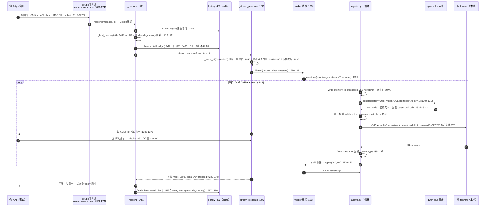
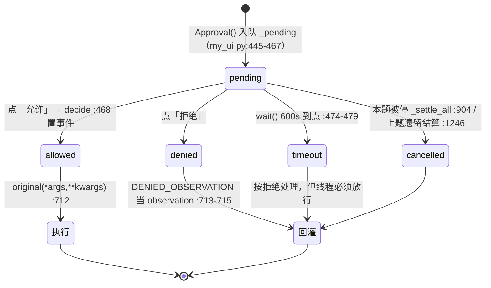

# 本项目代码 · 实现原理 · 一次问话全流程 · 6.2 面试剖析对照

> 目录：`~/Desktop/study/ai学习/`。写于 2026-11-04。
> 事实源**只有磁盘代码**：所有结论格式 `文件:行号`，行号是当天用 `grep -n` 逐条校准过的当前行号，不采信任何二手叙述。三个主角是 `scofenAgent/my_ui.py`（**1,758 行**）、`scofenAgent/my_coding_agent.py`（256 行）、`scofenAgent/my_agent.py`（111 行），内核是 `smolagents/src/smolagents/`（`agents.py` 1,813 / `models.py` 2,102 / `tools.py` 1,422 / `local_python_executor.py` 1,768）。
> 对照的第 3 章原文是 `~/Desktop/study/人生/职业规划/ai学习/6.2-LLM技术栈-面试剖析.md`（325 行）。
> **一条勘误先说在前面**：`README.md:5` 自称「行号一律按当前版本对齐（v1.7，1,253 行）」，磁盘现状是 1,758 行，README 里所有 `my_ui.py:` 锚点（`:1135` OpsUI、`:382` History、`:546` 审批门、`:1198-1201` launch、`:1245`）**全部过期**，正确落点分别是 `my_ui.py:600`、`:482`、`:695`、`:1749-1755`。本文不用 README 的行号。

---

## 1 实现原理：一个本地 Agent 客户端由哪几层构成

### 1.1 五层拓扑与各自职责

一句话读法：**模型只负责"想"，代码负责"怎么想""做什么""能不能做""做完留下什么"。** 本项目里这五层的真实归属：

| 层 | 代码 | 版本/来源 | 在本机的真实状态 |
|---|---|---|---|
| ⑤ 交付外壳 | `my_ui.py` + `~/Desktop/我的Agent.app` + `关闭Agent.command` | 自写 | **在跑**，127.0.0.1:7860 |
| ④ 平台层 | `dify/` | tar 解出，无 `.git` | 未部署（`docker/.env` 不存在） |
| ③ Java 接入层 | `langchain4j/` | `1.23.0-beta33-SNAPSHOT` | 源码可读，未接进本链路 |
| ② 编排内核 | `smolagents/src/smolagents/` | `1.27.0.dev0`，HEAD `96f33fa`，editable 装进 `.venv` | **在跑**，就是 agent 循环本体 |
| ① 工具/协议层 | `servers/`（modelcontextprotocol/servers，HEAD `ef9808f`）+ 自写五只手 | — | servers **未安装**；五只手在跑，MCP **没接线** |
| 模型侧 | 阿里云百炼 `dashscope` OpenAI 兼容口 · `qwen-plus` | `.env` 里只有 `OPENAI_API_KEY` | 每次决策都走它，**它不碰你的机器** |

#### 1.1.1 全链路最重要的一句话

`my_agent.py:12-13` + `my_agent.py:69`：

```python
BASE_URL = "https://dashscope.aliyuncs.com/compatible-mode/v1"
MODEL_ID = "qwen-plus"
...
model = OpenAIServerModel(model_id=MODEL_ID, api_base=BASE_URL)
```

云端返回的**永远只是文本**（工具名 + 参数 JSON），真正把 `read_file` 跑起来、把内容读出来的，是你机器上的 `my_coding_agent.py`。这条边界一旦说清，后面所有"安全/审批/越界"的设计都是它的推论。

### 1.2 交付外壳层 `my_ui.py`（1,758 行）

#### 1.2.1 装配：import 即完成，没有工厂函数

进程入口只有一个 `launch`，`my_ui.py:1749-1758`：

```python
if __name__ == "__main__":
    OpsUI(agent, file_upload_folder="./data").launch(
        share=False,
        server_name="127.0.0.1",
        server_port=7860,
        css=DARK_CSS,
    )
    # Ctrl-C 之后 gradio 会关掉端口但留下非守护线程，进程卡住不退出；
    # 启动器的「退出后自收终端窗口」那段就永远轮不到执行。硬退一次。
    os._exit(0)
```

- **`share=False` 是安全开关，不是风格选择**：框架默认 `share: bool = True`（`src/smolagents/gradio_ui.py:422`），照默认调用会把这个带着你百炼 Key 的本机 agent 变成 `gradio.live` 公网链接。
- 界面不是 gradio 默认 UI：`OpsUI(GradioUI)`（`my_ui.py:600`）自建 Blocks，只从父类借了两个私有函数（`_clean_model_output` / `_process_final_answer_step`）复用清理逻辑。
- 对象图在 import 期就固定了：`my_ui.py:15` `from my_agent import agent` → `my_agent.py:8` 从 `my_coding_agent` 拿五只手 → `my_agent.py:69` 建 model → `my_agent.py:71-91` 建 agent。**进程里只有一个 agent 对象**，这是后面所有"会话隔离靠换引用而不是多实例"设计的根因。
- sqlite 在 `OpsUI.__init__` 打开：`my_ui.py:30` 定 `DB_PATH`（`.agent-history.sqlite3`，实测存在 73,728 B），`my_ui.py:642` `self.hist = History(DB_PATH)`，建表在 `History.__init__`（`:492-515`）。

#### 1.2.2 三层运行时门：不改 `src/`，只换实例

`my_ui.py:664-667`：

```python
self._install_gate()
# P1-a：查重这层必须在审批那层**之后**装，它才套在最外面（理由见 _install_dup_gate）。
self._install_dup_gate()
self._install_plan_gate()
```

三道门全是**猴补丁**，装法有两种：

1. **换工具的 `forward`**（`_install_gate` `my_ui.py:670-693`）——只动 `GATED_TOOLS = ("write_file", "run_python")`（`:34`），即"只拦会动东西的两只手"（`:32-33` 注释）。关键三行：`copy.copy(base)` 拷一份工具对象再换 `forward`，并打 `_opsui_gated` 幂等标记——多个 OpsUI 实例（测试里反复建）不能把门套成两层，否则问两遍、点一次「允许」只解外面那层，里面那条线程永远挂着。
2. **包 `_run_stream` 生成器**（`_install_plan_gate` `:830-883`、`_install_dup_stop` `:788-827`）——在 `PlanningStep` / `ActionStep` 被 yield 出来之后插动作。

被包的四个内核点，行号都在 `agents.py`：主循环 `while`（`:545`）、`interrupt_switch` 判据（`:546-547`）、每轮 run 开头把 interrupt 清回 `False`（`:470`）、计划步 `_finalize_step` + append（`:566-567`）。**审批门必须在 append 之前**，所以它包在生成器 yield 处——被拒的计划根本不进 memory，整题等于没开工。

三道门互相的次序是有意义的：**查重在审批外面**（先判"这步是不是重复"，再决定要不要打扰人），**计划门在最外的生成器侧**。

#### 1.2.3 双库记忆：显示层 `messages` 与模型层 `memory` 各自一份

`my_ui.py:496-513` 一次建表，三张：

| 表 | 主键/列 | 用途 | 写入 |
|---|---|---|---|
| `sessions` | `id AUTOINCREMENT, title, created_at, updated_at` | 会话目录 | `ensure()` `:589-597` |
| `messages` | `session_id FK CASCADE, ord, role, content, meta` + `idx_messages_session` | **给人看的那屏**（可含 UI 加工） | `save()` `:551-572`，覆盖写 |
| `memory` | `session_id PK CASCADE, payload TEXT, updated_at` | **给模型的那份**（内核 `AgentMemory.steps` 序列化） | `save_memory()` `:574-582`，`INSERT OR REPLACE` 整条覆盖 |

一个会话在 `memory` 表里就是**一行**，payload 是整份 steps：`encode_memory`（`:163-201`）产出 `json.dumps({"fmt":"v2","steps":rows})`，格式版本 `MEM_FMT="v2"`（`:94`），读侧兼容 `("v1","v2")`（`:99`，`:95-98` 注释写明：只改版本号不回读，旧会话当场失忆）。

存哪些字段是**口径问题**，写在 `MEM_FIELDS`（`:100-115`），口径注释 `:88-93`：「下一轮模型 `to_messages()` 真正读到的东西」。所以 `model_input_messages`（内核里每步的完整入参快照）**刻意不存**——那会让库随步数平方膨胀。审批秒 `wait` 不在 `MEM_FIELDS`，单独走 `:196-199` 写、`:256-259` 读回挂到 `step._opsui_wait`。

#### 1.2.4 线程模型：worker + 队列 + 0.25 秒 tick

这是整个外壳最硬的一处设计，理由写在 `_worker` 的 docstring（`my_ui.py:1218-1224`）：**审批要阻塞 `forward`，如果同一线程同步推生成器，永远 yield 不出审批卡，界面死锁**。所以：

- 每轮提问起一条 daemon 线程 `threading.Thread(target=self._worker, ...)`（`:1270-1271`），事件用 `queue.Queue` 交接（`:1270`），异常也入队（`:1231`）。
- UI 侧外层循环每帧 `q.get(timeout=0.25)`（`:1284`）——**取不到事件就当作一次 "poll" tick**，专门用来刷审批卡的状态。审批等待期间界面每 0.25 秒还活着，`ap.wait()` 那行注释（`:707`）就是这句话。
- 消息流**只归生成器独占**：审批按钮 `_decide`（`:892-902`）只改 `decision` + 置事件，绝不返回 chatbot 输出（`:1731-1733` 注释）；否则两个写者抢同一个组件，会出现卡片下标失配（`:1369-1370` 记录了踩过的坑：改卡片要**原地改对象**，不能按下标 pop）。
- 唯一一把锁 `OpsUI._gate_lock`（`:612`）保护的登记项全是**类属性**（`_pending :611`、`_ap_cards :627`、`_seen_calls/_dup_* :632-638`、`_run_seq/_cancelled_before :616-617`、`_pending_wait :621`）。`:608-610` 的注释给的理由是同一句话：**门守的是进程里唯一那个 agent，装门的实例和画卡的实例可能不是同一个。**

#### 1.2.5 状态与错误分档

`_respond`（`:1481`）按异常类型给用户看不同文案，分档在 `:1524-1560`：

| 捕获 | 判定条件 | 状态 | 依据行 |
|---|---|---|---|
| `GeneratorExit` | 生成器被关（刷新/切会话） | `interrupted`，原样抛 | `:1524-1531` |
| `PlanDeniedError` | `isinstance(exc, PlanDeniedError)` | `plan_denied` | `:1536`；异常类定义 `:428-441` |
| `AgentError` + 熔断已抬 | `_dup_tripped and _run_seq > _cancelled_before` | `dup_fused`（两个都占认停止） | `:1543-1544` |
| 其余 `AgentError` | — | `stopped` | `:1545-1560` |
| 超步数 | **不抛异常**，从 memory 里认 `AgentMaxStepsError` | `maxed` | `_stats :1186-1189`，内核 `agents.py:630` |

最后一行值得记：内核耗尽步数时**不 raise**，只在最后一个 ActionStep 上挂错误、靠 `RunResult.state="max_steps_error"` 标记（`agents.py:523-526/625-637`），所以外层只能去 memory 里认——这是"读框架代码才知道怎么读"的典型。

### 1.3 编排内核层 smolagents

#### 1.3.1 主循环与三个终止出口

`MultiStepAgent`（`agents.py:268`）→ `run()`（`:436-538`）把任务写进 memory 后统一走 `_run_stream`（`:540-611`），非流式只是把生成器吃干净再取最后一个（`:498-503`）。循环体：

```python
# agents.py:545
while not returned_final_answer and self.step_number <= max_steps:
```

三条出口：
1. **正常交卷**：`_step_stream` 产出里出现 `ActionOutput 且 is_final_answer`（`:577-604`）；tool-calling 侧判据就是工具名等于 `final_answer`（`:1406`）。
2. **熔断**：`step_number == max_steps + 1` → `_handle_max_steps_reached`（`:606-607` → `:625-637`）→ `provide_final_answer`（`:810-853`）**用全量记忆另问一次模型强行总结**，失败也不抛、返回错误文本。答案不可信，但题不会挂死。
3. **中断**：`if self.interrupt_switch: raise AgentError("Agent interrupted.")`（`:546-547`）。注意每轮 `run` 开头会把它清回 `False`（`:470`）——这条就是 `my_ui.py` D7 修复要绕开的那个坑（见 2.3.4）。

错误处理是**回灌不是崩溃**：`AgentGenerationError` 直接上抛（`:594-596`），其余 `AgentError` 写进 `action_step.error`（`:597-599`），下一轮由 `memory.py:139-143` 原样送回模型：

```python
error_message = (
    "Error:\n"
    + str(self.error)
    + "\nNow let's retry: take care not to repeat previous errors! If you have retried several times, try a completely different approach.\n"
)
```

#### 1.3.2 提示装配：memory 到 messages 的唯一函数

`write_memory_to_messages`（`agents.py:758-770`，**本版本没有 `write_memory_step` 这个名，题库若引用要改口**）= `memory.system_prompt.to_messages()` + 逐 step `to_messages()`。系统提示来自 yaml 资源：`ToolCallingAgent` 用 `prompts/toolcalling_agent.yaml`（`agents.py:1241-1243`），渲染走 `populate_template`（`:102-107`，Jinja2 StrictUndefined）。

工具进 prompt 有两条不同路径（本版本无 `to_step_prompt`）：

- tool-calling 侧：`to_tool_calling_prompt()`（`tools.py:289-290`）注入 yaml `:93-95`，同时 `get_tool_json_schema`（`models.py:288-329`）把**同一份 `inputs`** 转成 OpenAI 的 `tools` 参数——两处同源，所以不会出现"prompt 里说有三个参数、schema 里只有两个"的漂移。
- code 侧：`to_code_prompt()`（`tools.py:258-287`）渲染成 `def name(args) -> type:` + docstring。

few-shot 在模板里（`toolcalling_agent.yaml:28-90` Action JSON 示例；`code_agent.yaml:12-130` 六个 Thought/Code/Observation 往返）。`dynamic description` 在这个版本里的真身是两处：工具描述每次渲染时现取（`to_tool_calling_prompt` `tools.py:290` 读 `self.description`），agent 的 `system_prompt` 是 property、每次访问重新渲染（`agents.py:355-356`），并在每次 run 刷新进 memory（`agents.py:477`，构造时同理 `:343`）。

**本项目没有自定义 system prompt**：三个自写文件都没传 `prompt_templates` / `custom_sys_prompt`。`my_agent.py:84-89` 写了 `description`，但 `:80-83` 的注释记录了实测结论——`'读代码' in agent.system_prompt → False`，**顶层 agent 的 description 不进模型上下文**。它在内核里只有两个消费点：序列化进 `to_dict()`（`agents.py:1005`），和被当作**子 agent** 时的必填校验（`agents.py:373`，`_setup_managed_agents` 会把 `agent.description` 渲染进父 agent 的 prompt——`code_agent.yaml:147`）。本项目没用 `managed_agents`，所以这句 description 事实上只是写给人看的规格。模型真正读得到的是**各工具 docstring** 和 **`guarded()` 的报错文案**。这条决定了 3.4 节的写法。

#### 1.3.3 模型抽象：统一签名、流式、重试

统一签名在基类 `Model.generate(messages, stop_sequences=None, response_format=None, tools_to_call_from=None, **kwargs)`（`models.py:553-578`）。本项目只用到 `OpenAIModel`（`models.py:1646`，别名 `OpenAIServerModel = OpenAIModel` 在 `:1796`）。

- **流式**：`generate_stream` 吐 `ChatMessageStreamDelta`，OpenAI 侧增量解析在 `models.py:1741-1756`——分别拆 `choice.delta.content` 与**带 index 的 `delta.tool_calls`**；聚合函数 `agglomerate_stream_deltas`（`models.py:220-279`）按 index 把 `tool_call.function.arguments` 字符串拼回来（`:256`）。外壳侧 `my_ui.py:1289-1293` 拿它拼帧并转义 `<`/`>`。
- **重试**：不是装饰器，是组合对象 `Retrying`（`utils.py:528-606`），指数退避带抖动 `delay *= exponential_base * (1 + jitter*random())`（`:593`），默认常量 `RETRY_MAX_ATTEMPTS = 3 / RETRY_WAIT = 60 / RETRY_EXPONENTIAL_BASE = 2 / RETRY_JITTER = True`（`models.py:38-41`）。**失败分类只有"限流"一类**：`is_rate_limit_error`（`models.py:1194-1202`，字符串匹配 429/rate limit），谓词不匹配立刻 reraise（`utils.py:576-579`）。**没有 fallback / 换模机制。**
- **stop 序列分三路**：支持的后端塞 `completion_kwargs["stop"]`（`models.py:534-536`）；o3/o4/gpt-5/grok 那类不支持的（`supports_stop_parameter` `:418-438`）改客户端后处理 `remove_content_after_stop_sequences`（`:79-91`）；本地 Transformers 用 `StoppingCriteriaList`（`:980-999`）。
- **token 计量**：每个后端从 `response.usage` 构造 `TokenUsage`（`models.py:1789-1792`）。**没有金额换算。**

#### 1.3.4 记忆数据结构与回灌协议

`memory.py` 全是 dataclass：`ActionStep`（`:50-150`）、`PlanningStep`（`:153-183`）、`TaskStep`（`:186-196`）、`SystemPromptStep`（`:199-206`）、`AgentMemory`（`:214-277`）。`AgentMemory.reset()`（`:232-234`）**清 steps 但保留 system_prompt**。

`ActionStep.to_messages`（`:92-150`）就是回灌协议：assistant 上轮输出 → `TOOL_CALL` 角色 "Calling tools:" → 图像 → `TOOL_RESPONSE` "Observation:" → 有 error 时拼上 1.3.1 那段重试提示。`PlanningStep.to_messages`（`:179-183`）特意追一条 USER `"Now proceed and carry out this plan."`，防模型接着把计划往下编。

`CallbackRegistry`（`memory.py:280-316`）按 step 类注册回调，由 `agents.py:620-623` 逐步触发——**本项目没用这条**，外壳改用包 `forward` + 包 `_run_stream` 实现观测与拦截（理由见 1.8）。

#### 1.3.5 两条动作空间分支，本项目只走了一条

| 分支 | 内核入口 | 动作形态 | 本项目 |
|---|---|---|---|
| `ToolCallingAgent` | `agents.py:1276-1359` | 模型输出 `tool_calls` JSON，宿主按名执行 | **在用**（`my_agent.py:71`） |
| `CodeAgent` | `agents.py:1638-1764` | 模型写 Python，AST 解释器执行 | **未启用** |

`ToolCallingAgent` 一步内多个 tool_calls 是**并行**的（`agents.py:1424-1434`）：

```python
            # If multiple tool calls, process them in parallel
            with ThreadPoolExecutor(self.max_tool_threads) as executor:
                futures = []
                for tool_call in parallel_calls.values():
                    ctx = copy_context()
                    futures.append(executor.submit(ctx.run, process_single_tool_call, tool_call))
```

——本项目一个会话一次只问一件事、单步基本一个调用，所以 `max_tool_threads` 这条并行能力**事实上没被吃到**。

CodeAgent 那条分支（含 `local_python_executor` 沙箱、`executor_type` 切 Docker/E2B/Modal/Blaxel、`use_structured_outputs_internally` 严格 schema）**全部在库里、全部没接**。写文档时不要把"smolagents 支持代码动作空间"说成"我的 agent 用代码当动作"——不是。

### 1.4 工具层：一个函数怎么变成模型能调的东西

以五只手为例，链路五站：

1. **写函数 + docstring**：`my_coding_agent.py:83`（`read_file`）、`:107`（`list_dir`）、`:126`（`grep_files`）、`:162`（`write_file`）、`:193`（`run_python`），每个都挂 `@tool`。
2. **`@tool` 装饰器**（`tools.py:1061-1168`）调 `get_json_schema(func)`（`_function_type_hints_utils.py:97`）把**类型注解 → JSON Schema**（`:326` 解析注解、`:415` 映射类型、docstring 的 Args 段变参数描述、`(choices: ...)` 变 enum），动态造一个 `SimpleTool` 子类，并把原函数 AST 源码切段回填 `__source__`（`tools.py:1148-1165`，供序列化）。
3. **契约校验**：`Tool.__init_subclass__` 挂 `validate_after_init`（`tools.py:137-142`）→ `validate_arguments`（`:144-226`）检查 `forward` 形参集与 `inputs` 键一致。
4. **随请求下发**：`models.py:288-329` 转成 OpenAI `tools`；同时进 system prompt（1.3.2）。
5. **执行前宿主再校验一次**：`validate_tool_arguments(tool, arguments)`（`tools.py:1361-1412` ← `agents.py:1476`）。模型给的参数名不对、类型不对，在这里挡下，不进业务函数。

两只行情工具走的是同一套类的另一种写法：`MaxDrawdownTool`（`my_agent.py:33-50`）、`AnnualizedVolTool`（`my_agent.py:53-66`）——**指标口径写在代码里**（最大回撤含回吐区间 `:22-33`；年化波动率是日收益率标准差×√252，样本方差 `:42-49`），不是靠提示词跟模型解释一遍。

`final_answer` 由框架自动注册进 `tools`，所以 UI 层查重给它开了特例（`my_ui.py:747-748`）。

### 1.5 边界与三圈闸门（五只手）

设计原则是文件头 docstring 自陈的那句「**边界写在代码里，不靠 prompt 求模型自觉**」（`my_coding_agent.py:7-11`）。三圈：

| 圈 | 实现 | 行号 | 挡住什么 |
|---|---|---|---|
| ① 路径收敛 | `guarded()`：`resolve()` 后 `is_relative_to(ROOT)`；与 `DENY_NAMES` 取交集；`must_exist` 分支 | `:43-80`（ROOT `:24`、名单 `:37`、越界 `:58-66`） | 出 `ai学习` 根；读 `.env`（凭证）、`.git`、`.venv`、`node_modules`、`__pycache__`、`.agent-staging` |
| ② 写只暂存 | `write_file` 拼 `STAGING / p.relative_to(ROOT)`，回 unified diff，**原路径物理无写入入口** | `:162-190`（拼接 `:182`、出口是人手工 `cp` `:189`） | 覆盖原文件；`.agent-staging` 同时在一进的拒绝名单里（`:33-36` 注释：**故意的**，防 agent 读回自己草稿自我确认） |
| ③ 执行降级 | `ast.parse` 预检（`:200-203`）→ 违禁词正则（`:204-206`）→ `TemporaryDirectory(dir=STAGING)`（`:207`）→ env 只留 5 个键（`:210-211`）→ `timeout=20`（`:213-216`）→ stdout 4000/stderr 2000（`:217`） | `:193-218` | `rm`/`rmtree`/`subprocess`/`socket`/`urllib`/`requests`；**模型拿不到 `OPENAI_API_KEY`** |

第 ② 圈的黑名单原文（`:37`）：

```python
DENY_NAMES = {".env", ".git", ".venv", "node_modules", "__pycache__", ".agent-staging"}
```

`guarded` 的报错文案是**写给模型读的**——`:44-53` 注释引了 `.agent-ui.log` 21:06 的实测死循环：文案不 telling，模型就反复撞同一堵墙。这是"错误信息是接口的一部分"在 agent 上的具体形态。

动作空间总账：**5 只手（文件读写跑）+ 2 只行情工具 + 框架注入的 `final_answer` = 8 项**（`my_agent.py:71-81`），`max_steps=8`（`:75`），`planning_interval=8`（`:30`，注释 `:15-29` 给了理由：框架只在 interval 非 None 时产 PlanningStep，且第 1 步必出（`agents.py:550-551`），8 与 max_steps 同高 ⇒ **每题恰好一份计划、题内不重规划**；设 None 即整刀关掉计划审批）。

### 1.6 沙箱的两种做法，以及本项目选的那一种为什么更弱

这是文档里必须诚实的一节，也是面试里最容易被追的一节。

| | 内核 `LocalPythonExecutor` | 本项目 `run_python` |
|---|---|---|
| 机制 | **手写 AST 解释器逐节点求值**（`local_python_executor.py:1416` `evaluate_ast`），根本不调 `eval`/`exec` | `ast.parse` 只做**语法预检**（`my_coding_agent.py:200-203`），随后 `subprocess.run([sys.executable, script])` 真跑 CPython（`:213-216`） |
| 拦法 | **白名单**：builtins 裁剪（`BASE_PYTHON_TOOLS :74-127`，`print`→只收集不打印 `:64`，`getattr`→`nodunder_getattr :68-71`）、危险模块黑名单 `:130-141`、危险函数 `:143-153`、每个求值结果再 `check_safer_result :156-182`、`import` 授权树 `:360-385`/`:1316-1318`、授权模块还得 `get_safe_module` 脱壳 `:1271-1306` | **正则黑名单**：`r"\brm\b|shutil\.rmtree|os\.remove|os\.unlink|subprocess|socket\.|urllib|requests\."`（`:204-206`） |
| 熔断 | `MAX_OPERATIONS=10000000`、`MAX_WHILE_ITERATIONS=1000000`、`MAX_EXECUTION_TIME_SECONDS=30`（`:58-60`），超时靠 ThreadPoolExecutor（`:285-320`，注释明说线程杀不掉只能放弃等待） | `timeout=20`（`:213-216`），stdout/stderr 截断（`:217`） |
| 环境 | 进程内受限状态，跨步持久 `self.state`（`:1688-1765`） | 临时目录 + 清空过的 env（`:210-211`） |

结论口径照抄框架自己的诚实话：**本地执行器不是安全沙箱，不可信代码要换后端**（`local_python_executor.py:1692-1693` 注释）。本项目的正则黑名单属于"挡住无意"，**挡不住有心**（`os` 拼字符串、`__import__` 变体都在真 CPython 里活着）。它成立的唯一前提是「我自己的目录 + 我自己盯着 + 高危那两只手已经进了审批门」。这句话必须自己先说，别等面试官替你问。

真正兜底的是 1.5 的①②圈（路径与写入面），不是 ③ 圈的禁词。

### 1.7 协议层 MCP：内核有能力，本项目没接线

- 内核侧**有**：`MCPClient`（`mcp_client.py:85-162`）把转换委托给外部包 `mcpadapt`——`MCPAdapt(server_parameters, SmolAgentsAdapter(structured_output=...))`（`:104-105`、`:118-120`），`connect()` 即 `adapter.__enter__()` 返回 `list[Tool]`（`:124-126`）。传输只接受 `StdioServerParameters`（子进程 stdio）或 `{"url","transport"}`，transport 限 `"streamable-http"`（默认，`:109-112`）与 `"sse"`（`:113-116`）。
- 门禁在 `ToolCollection.from_mcp`：`trust_remote_code=False` 直接 raise（`tools.py:1052-1056`）——"MCP server 会在你机器上执行代码，请明确承认你信任它"。**`MCPClient` 本身没有逐调用审批钩子。**
- 本项目侧**没有**：`my_agent.py` / `my_coding_agent.py` / `my_ui.py` 三个文件里 `grep -i mcp` **零命中**。`servers/`（①层参考实现）**未安装**（无 `node_modules`，且要求 Node ≥ 24，本机 v22）。
- 所以准确说法是：**五只手是"MCP 那种工具层的进程内版本"**，`② ↔ ①` 的跨进程协议这一跳在本项目里还没连。`MCPClient` 也没有审批钩子，本项目的审批是外壳自己包 `forward` 实现的（`my_ui.py:679-693`）——如果将来接 MCP，这道门必须照同一方式套在 MCP 工具的 `forward` 上，否则协议层的工具会绕过审批。

### 1.8 参数面：本项目对模型「没设」的东西（诚实清单）

两个构造点（`my_agent.py:69`、`my_coding_agent.py:222`）**都只传 `model_id` + `api_base`**，没有 `generation_kwargs`、没有 `client_kwargs`。因此：

| 参数 | 状态 | 实际落在哪 |
|---|---|---|
| `temperature` / `top_p` / `max_tokens` | **未设** | 服务端默认（qwen-plus） |
| `timeout` / `max_retries` | **未设** | OpenAI SDK 默认（框架侧 `models.py:1705` `openai.OpenAI(**self.client_kwargs)`） |
| `requests_per_minute` 限流 | **未传** | 内核 `RateLimiter` 存在（`utils.py:497-525`）但没启用 |
| 重试 | 内核默认 | `Retrying` 3 次 / 60s 起 / 只认限流（`models.py:38-41`、`:1194-1202`） |
| fallback / 多模型路由 | **未设** | `LiteLLMRouterModel`（`models.py:1363`、`:1446-1453`）在库里，没接 |
| 自定义 system prompt / `final_answer_checks` / `step_callbacks` | **未用** | 外壳用包 `forward` 替代回调 |

对照 6.2 第 2.2 节列的"RPC 治理五件套"，本项目真实覆盖的是**接口先行 + 异常归一**两件，**显式超时 / 网络错与内容错分流 / 预算熔断**三件没做——那三件的实现在 `emotion-server`（Java）里，不在本项目（见 3.3、3.8）。

### 1.9 上下文预算：没有压缩函数，靠什么挡住窗口

内核里**没有任何截断/摘要/压缩记忆的实现**（`memory.py` 全文无 summarize；`summary_mode` 只是 planning 复用的轻视角，丢 system prompt 与 plan 回显，不是压缩）。窗口只靠**单点硬截断**：

| 位置 | 上限 | 行号 |
|---|---|---|
| 内核 observation 进记忆前 | 20,000 字符，**头尾各半** | `truncate_content` `utils.py:257-266`（上限常量 `:254`）← `agents.py:1752` |
| 沙箱 print 总输出 | 50,000 | `local_python_executor.py:57`、`:1644-1646` |
| 网页正文 | 40,000 | `default_tools.py:504-513` |
| 本项目 `read_file` | 300 行 / 200 KB | `my_coding_agent.py:39-40` |
| 本项目 `grep_files` | 100 命中 | `:126-159` |
| 本项目 `write_file` diff | 6,000 字 | `:189` |
| 本项目沙箱 stdout | 4,000 | `:217` |
| 本项目 UI 卡片正文 | thought 800 / observation 4,000 | `my_ui.py:1145`、`:1149` |

再加两道结构性封顶：`max_steps=8`（`my_agent.py:75`）限住步数、`planning_interval=8` 限住每题一份计划。**没有 token 级预算熔断**——6.2 第 2.2 节要求的那种"每个入口一个预算"在本项目没实现。

顺带一条与"头尾效应"呼应的实测事实：内核 `truncate_content` 保留的是**头一半 + 尾一半**，正是 6.2 讲 lost-in-the-middle 时该举的代码例子。

---

## 2 一次 AI 问话的全流程

### 2.1 时序图



### 2.2 分段实录（14 段）

| # | 段 | 关键行 | 干了什么 |
|---|---|---|---|
| 1 | 事件入口 | `my_ui.py:1711-1726` | `gr.MultimodalTextbox`（可带附件）`.submit(fn=self._respond, inputs=[box, sid], outputs=8 个组件)`。**没有自建 HTTP API**，传输是 gradio 对生成器的逐帧下发 |
| 2 | 会话建行 | `:1486` → `History.ensure :589-597` | `sid` 由 `gr.State(value=None)`（`:1672`）持有，首轮 INSERT 拿 `lastrowid` |
| 3 | 记忆绑定 | `:1489` → `_bind_memory :1399-1424` | **只换引用不 reset**；进程里 `_mem: dict[int, AgentMemory]`（`:658`）没有这条会话就 `decode_memory(self.hist.load_memory(sid))` + `mem.steps.extend(steps)`（`:1419-1421`）= 重启后接着记得 |
| 4 | 起点是追加不是覆盖 | `:1493` + `:1490-1492` 注释 | `base = hist.load(sid)`，D5 修复：连问不吞前一题 |
| 5 | 开局清账 | `:1246-1268` | 结算上题遗留审批、锁内清 `_pending/_ap_cards/_pending_wait/_seen_calls/_dup_*`、`_abandoned.clear()`、`OpsUI._run_seq += 1` |
| 6 | 起 worker | `:1270-1271`（理由 `:1218-1224`） | 换线程的唯一原因是审批会阻塞 `forward` |
| 7 | 进内核循环 | `:1225` → `agents.py:496/545` | `run(stream=True)`；本项目在它之上套了 `stopped`（`:816-826`）与 `gated`（`:850-856`）两层实例包装 |
| 8 | 提示装配 | `agents.py:758-770` | system（yaml + 8 个工具签名）+ 逐 step `to_messages()` |
| 9 | 模型决策 | `agents.py:1309-1313` → `models.py:1646` | 带 `tools_to_call_from` 与 `stop_sequences`；HTTPS 出网到 dashscope，**内容出域仅限你给它的目录片段** |
| 10 | 宿主校验 | `agents.py:1476` → `tools.py:1361-1412` | 参数名/类型/必填，模型瞎给的在这里挡 |
| 11 | 审批暂停 | `my_ui.py:695-715` | `decision = ap.wait()`（`:707`）只阻塞 worker；`allowed` 才 `return original(...)`，否则把 `DENIED_OBSERVATION`（`:57-61`）当 observation 交回模型（`:713-715`） |
| 12 | UI 消费 | `:1280-1344` | 每帧 `q.get(timeout=0.25)`；delta 走 `agglomerate_stream_deltas(...).render_as_markdown()` + 转义 `<`/`>`（`:1289-1293`）；`ActionStep/PlanningStep/FinalAnswerStep` 收泡、**领审批等待账**（`:1327` `payload._opsui_wait = waited`）、产 `_step_card`（`:1329-1331`） |
| 13 | 审批卡渲染 | `:1346-1379` | 每帧扫 `_pending_snapshot()`，首见出卡并登记；decision 落定且画上终态后在锁内摘单；**原地改对象不按下标** |
| 14 | 落库 | `:1564-1579` finally | `hist.save(sid, last)`（`:1572` 注释：停止时生成器被关掉，这一句保证半截内容也落库）；记忆落库双条件 `mem is not None and self._mem_sid == sid`（`:1577-1579`）——**防并发提问把别人的记忆盖到这条会话上** |

### 2.3 四条分支路径

#### 2.3.1 审批暂停（HITL 的机制本体）



三条要点：
- **超 600 秒按拒绝处理，但线程必须放行**——`wait()`（`:474-479`）到点即置 `decision="timeout"`、`waited=600.0` 照常返回。`:38` 注释给的理由：「题可以重问，worker 线程挂着不放会永远占住 agent」。
- `kind="plan"` 复用同一套门（`:453-460`）。`_plan_gate`（`:859-883`）批准后计划才进 memory，拒绝/超时抛 `PlanDeniedError`（`:428-441`）→ **整题等于没开工**。
- 审批秒**单列、不进步骤耗时**：落定瞬间记 `self.waited`（`:471`），超过 `APPROVAL_WAIT_MIN=0.05`（`:43`）才过账（`:710-712`），在步骤卡标题显示 `· 审批 {wait:.1f}s`（`:1136-1141`）、状态条显示「本题审批」药丸（`:1204-1205`），并随 `wait` 键进 payload（`:196-199`）——所以重启后点旧会话还读得出那一格。

#### 2.3.2 解析失败与错误回灌（模型不守规矩时）

内核侧四层兜底：白名单拒未知工具名（`agents.py:1467`）；`tool_calls` 空则从文本抠 JSON（`:1327-1331`）；参数是字符串就 `parse_json_if_needed`；CodeAgent 侧还有 `parse_code_blobs`（`utils.py:198-251`）失败时抛**带教学性质的文案**（`:224-251`，见含 `final`/`answer` 字样就示范 `final_answer("...")` 写法）与人为补闭合标签诱导收尾（`agents.py:1690-1695`）。所有这些都归 `AgentParsingError`（`agents.py:1707-1713`），**回灌成下一步输入而不是崩**（`agents.py:597-599` + `memory.py:139-143`）。

本项目是 `ToolCallingAgent`，实际吃到的是前两层 + 外壳自己的查重回灌。

#### 2.3.3 重复熔断（P1-a）

`_dup_call`（`:765-786`）以 `(工具名, 参数JSON)` 为指纹计数（参数归一 `_bind_args :717-729` 与审批卡共用），**第二次同名同参不再执行**，回 `DUP_OBSERVATION`（`:78-81`）；累计挡住超过 `DUP_BLOCK_LIMIT=2`（`:73`）置 `_dup_tripped` 并 `agent.interrupt()` + 回 `DUP_FUSE_OBSERVATION`（`:82-86`）。

`_install_dup_stop`（`:788-827`）补的是一个很具体的洞：`interrupt` 判在循环体最上面（`agents.py:546`），**max_steps 的最后一步会漏判、改走 `_handle_max_steps_reached` 多打一次模型**——`:791-800` 注释附了实测价签（in 1,560 / out 303 / 7.16s）。修法是在 ActionStep yield **之后**抛（`:805-810`），保证那一步的卡片与观察值完整进记忆。这是"知道框架在哪里会多花你一次钱，就在哪里插一刀"的样本。

#### 2.3.4 停止与中断收尾（D7 + D8）

`stop_btn` 是自建按钮（`:1690`，`:1687-1689` 注释：MultimodalTextbox 自带的 stop 在自建 Blocks 下失效，实测照样跑到 9/8），绑 `_stop`（`:1592-1612`）：

```python
with self._gate_lock:
    OpsUI._cancelled_before = OpsUI._run_seq
self._settle_all("cancelled")
self.agent.interrupt()
self._state = "stopping"
return self._status_html("stopping")
```

语义三条：**不掐正在执行的一步**，停在下一个步边界（`agents.py:546-547`）；按停止等于没批的都拒（`:1600` 注释）；D7 修的是"停止按在待批卡出现之前不留痕迹"——因为内核每轮 run 把 `interrupt_switch` 清回 `False`（`agents.py:470`），后到的待批原本没人管。现在 `_stop` 先抬 `_cancelled_before` 号，闸在**同一临界区**里看到 `_run_seq <= _cancelled_before` 就直接自判 `cancelled`、不再挂人（类级注释 `:613-617`、`_gated_call :698-706`、`_plan_gate :867-870` 同规）。

D8 的收尾是 `_mark_interrupted`（`:909-964`）：把冻在「🟡 等待你审批」的卡原地改终态（`:922-928`）、把孤儿审批秒挂回最后一个 ActionStep（`:930-939`）、追加「⏹ 本题已中断」说明气泡（`:940-964`）。另有 `_stream_response` 的 finally（`:1387-1396`）在生成器被关时兜底三件套：`_abandoned.set()` → `agent.interrupt()` → `_settle_all("cancelled")`。

### 2.4 这一趟的账单

`_stats`（`:1161-1192`）出两个口径，别混：

| 口径 | 算法 | 行号 |
|---|---|---|
| **本题** | 最后一个 `TaskStep` 之后的 ActionStep 求和 | `:1166-1167` |
| **进程累计** | `agent.monitor.get_total_token_counts()` | `:1169`（内核 `Monitor` `monitoring.py:81-117`，`:106-117` 打一行 Duration/input/output tokens） |

计时口径上，审批等待被从步骤耗时里**单列**（2.3.1），所以"某步 40 秒"里不包含你走神的那 38 秒。工具调用次数**内核没有独立计数器**（`Monitor` 无此项），要数只能去 memory 里数 `ActionStep.tool_calls`（`agents.py:1436`）——题库若问"工具调用合法率怎么统计"，本项目的答法是"从落库的 payload 里数"，不是"框架给了指标"。

日志：三个自写文件自己**不写日志文件**，`.agent-ui.log`（仓库根，实测 17 KB）是框架 logger 的落点，由启动脚本 tee 过去。

### 2.5 真实样本：那道 5 步的「读代码找行号」题

README §7（`README.md:1037-1070`）记录了同口径实测过的一题（"final_answer 在哪一行注册进 self.tools，把前后 3 行读出来"）：`list_dir` → `grep_files`（跳 `SKIP_DIRS`、上限 100 命中）→ `read_file` 指定 `start_line`/`lines` 拿带行号片段 → `final_answer`，**5 步、累计 input 19,399 token**。同一份 README（`:631`）还记了另一条更值钱的账：工具从 2 个变 7 个后，单题累计 input 从 **2,375 → 19,399**。

**注意这是 README 里 2026-10-28 的实测记录，本轮（11-04）没有复测**，但结论方向不因复测而变：**工具变多 ≈ prompt 里的签名变多 ≈ 每步上下文更贵，不是免费的功能叠加**。这条账是 6.2 第 9.1 第 17 题（"如何控制成本"）在本项目里唯一有数字支撑的证据。

---

## 3 6.2 面试题在本项目代码里的实现与响应

### 3.1 对照口径

6.2 那篇的锚点是 **`emotion-server`（Java，六个类：`LlmClient`/`QwenClient`/`ReviewAiPrompt`/`TokenFiller`/`NumberGuard`/`LlmException`，已核对于 `~/Desktop/study/股市/code/emotion-server/src/main/java/com/emotion/ai/` 全部存在）**，不是本项目。所以本章按**三分法**诚实归类，不混用两个仓库的功劳：

| 标记 | 含义 |
|---|---|
| ✅ **本项目可指行号** | 题的答案就在这三个自写文件 + smolagents 内核里，能给 `文件:行号` 和真实响应行为 |
| 🔷 **部分对应** | 机制在，但覆盖不全或有明确缺口，缺口写清 |
| ⛔ **代码无对应** | 本项目零实现；要么归 `emotion-server`（标 🔷→Java），要么归 6.1.x 方向篇原理，**不编** |

题量统计（6.2 全文）：第 0-8 章分层考点 + 第 8 章追问 7 条 + 第 9 章图上可见 **87 题**（9.1 大模型基础 17、9.2 Agent 17、9.3 LangChain 17、9.4 面经 25、9.5 八股 10 模块 + Top20 前 11）≈ **150 个考点**。其中本项目代码能扛住的是 **Agent 层、工具与安全治理、ReAct 循环、记忆持久化、流式与错误回灌**这五块（约 40 个考点）；**推理服务层的治理是 🔷**；**Transformer 数学、KV Cache 显存账、GRPO/PPO/DPO/LoRA/RoPE/Flash/BPE/LayerNorm、RAG 检索管线、embedding 选型**这些是 ⛔。

### 3.2 Agent 层（6.2 第 5 章 + 9.2 全 17 题 + Top20「ReAct」）——本项目是主战场

| 题面（6.2 原文） | 本项目实现 | 真实响应行为 | 档 |
|---|---|---|---|
| 9.2-1 什么是 Agent？ | `agents.py:545` 的 `while` + `my_coding_agent.py` 五只手的副作用 | 循环 + 副作用；工具真在你机器上跑（`guarded` `:43-80`） | ✅ |
| 9.2-2 如何获取上下文对话信息？ | 三类来源全在：会话内历史＝`memory` 表 payload（`my_ui.py:574-582`、`:163-201`）、环境状态＝工具返回值（`memory.py:92-150` 的 `TOOL_RESPONSE`）、外部记忆＝sqlite（无向量库） | 重启后 `_bind_memory`（`my_ui.py:1419-1421`）把 steps 回灌，同一题的 in token 不从裸起步 | ✅ |
| 9.2-3/4 自我反省是什么／方法有哪些？ | 内核把"回改"外包成第二轮上下文：`memory.py:139-143`；本项目的"反省极限形态"是**规则判分**：`guarded` 拒（`:58-66`）、查重拒（`my_ui.py:765-786`）、审批门拒（`:695-715`） | 不劝模型反省，直接给一条可读的拒绝 observation，让它换路 | ✅ |
| 9.2-5 关键能力（规划/工具/记忆/反思/协作） | 规划＝`planning_interval=8`（`my_agent.py:30`）+ `_plan_gate`（`my_ui.py:859-883`）；工具＝8 项；记忆＝双表；反思＝错误回灌；**协作＝`managed_agents` 未接** | 计划先给人审，被拒不进 memory | 🔷 |
| 9.2-6 怎样构建 Agent（五步） | 终止条件 `max_steps=8`；形态选 `ToolCallingAgent`；工具集＝`@tool` schema；状态＝`History` 三表；护栏＝三道门 | 五步全是代码，不是一句 prompt | ✅ |
| 9.2-7 类型（ReAct vs Plan-and-Execute） | 本项目**同时**有：ReAct 循环（`agents.py:545`）+ 一次性计划（`agents.py:639-747` 产 PlanningStep）；CodeAgent 分支未用 | 每题一份计划、题内不重规划（`my_agent.py:15-29` 注释即此判据） | ✅ |
| 9.2-8 什么让 Agent 有自治能力？ | 自由度是**三个配置项**：`max_steps=8`（`my_agent.py:75`）、`GATED_TOOLS`（`my_ui.py:34`）、`DUP_BLOCK_LIMIT=2`（`:73`）；循环控制权在 `agents.py:545`，下一步选择权在模型 | 「自由度是借来的，每一分都用可观测性还」在本项目有具体刻度 | ✅ |
| 9.2-11 Agent 和传统 LLM 应用的区别 | 四件自己造的东西：终止 `:545`／预算 `_stats :1161-1192`／权限 `my_coding_agent.py:43-80`／审计 `my_ui.py:496-513` | 传统应用路径写死且无副作用 | ✅ |
| 9.2-12 记忆类型与特点 | 短期＝`AgentMemory.steps`（`memory.py:214-277`）；长期＝sqlite 结构化事实（`memory` 表）；情节记忆＝整份 steps payload；**语义记忆无（不走向量库）；程序性记忆＝AGENTS.md/Skill 不在本项目** | 写入口径 `MEM_FIELDS :100-115`：只存"下一轮模型真读到的东西"，`model_input_messages` 不存防平方膨胀；**忘（过期/衰减/合并）零实现** | 🔷 |
| 9.2-13 工具调用六步流程 | 注册 `tools.py:1061-1168` → 下发 `models.py:288-329` → 模型意图 `agents.py:1309-1313` → **宿主校验** `tools.py:1361-1412` ← `agents.py:1476` ＋ 审批 `my_ui.py:695` → 执行 → 回灌 `memory.py:92-150` | 铁律「校验与执行都在宿主，模型只有申请权」有两道实门 | ✅ |
| 9.2-14 工具系统设计考量 | 粒度＝一只手一事；描述＝docstring（本项目**唯一**进上下文的自定义文本，见 1.3.2）；schema＝类型注解自动转；幂等＝写只落 staging；权限＝读自动/写必批；错误归一＝`guarded` 文案写给模型读；可观测＝`_step_card :1085-1159` | 七个维度都有落点，其中「描述质量」最实：`description` 字段实测不进模型上下文（`my_agent.py:80-83`） | ✅ |
| 9.2-15 工具调用失败怎么处理 | 分类处置四类全在：可重试＝内核 `Retrying`（`utils.py:528-606`，**但只认限流**）；可回灌＝`memory.py:139-143`；须上报＝`DENIED_OBSERVATION`（`my_ui.py:57-61`）；熔断＝`_dup_tripped`→`interrupt`（`:765-827`） | **可换路（同类工具降级）无**；"别让它拿报错硬编故事"靠 observation 显式进上下文 | 🔷 |
| 9.2-16 任务规划算法 | `_generate_planning_step`（`agents.py:639-747`）+ `planning_interval`；工作流编排（LangGraph 那种状态图）本项目无 | 路径可枚举时给编排的判据，本项目用"一次计划 + 8 步封顶"近似 | 🔷 |
| 9.2-17 如何评估规划质量 | 指标只有三个可读：步数（`step_number`）、token/耗时（`_stats :1161-1192`）、超步数 `maxed`（`:1186-1189` 从 memory 认 `AgentMaxStepsError`）；**非法调用率/死循环率/一致性回归＝无自动评测** | 本项目对"死循环"的处理是运行时熔断（P1-a），不是离线指标 | 🔷 |
| Top20-3.1 ReAct 原理及实现 | `agents.py:545` 循环 + `ToolCallingAgent._step_stream`（`:1276-1359`）+ `stop_sequences=["Observation:","Calling tools:"]`（`:1311`） | 想（assistant）→ 做（`TOOL_CALL`）→ 看（`TOOL_RESPONSE`）就是 `ActionStep.to_messages`（`memory.py:92-150`）的字面三段 | ✅ |
| 5.1 核心循环／执行权在宿主 | 见上 + `my_ui.py:712` `original(*args, **kwargs)` 只在 `allowed` 后执行 | 模型永远在"申请"，`_gated_call` 才决定"执行" | ✅ |
| 9.2-9/10 LangChain model 与核心组件 | 本项目的对位抽象是 smolagents：Model I/O＝`models.py:553-578` 统一签名；Chains＝无；Agents＝`agents.py:268`；Memory＝`memory.py`；Retrieval＝grep/read 手（非语义）；Callbacks＝`CallbackRegistry`（`memory.py:280-316`，**本项目没用**）；LCEL＝无 | 换后端只换 Model 类不动业务（`my_agent.py:69` 一个构造点），这就是"接口先行" | 🔷 |

### 3.3 推理服务层（6.2 第 2 章 + 9.1 第 16/17 题 + 面经二面第 6 题）

6.2 的主张是「把 LLM 当很慢、很贵、极不可靠的第三方 RPC 依赖来治理」。逐条对表：

| 治理项（6.2 原文） | 本项目 | 档 |
|---|---|---|
| 接口先行：`LlmClient` 接口 + `QwenClient` 实现 | `Model.generate` 统一签名（`models.py:553-578`）+ 单点构造（`my_agent.py:69`）；换供应商=换 `BASE_URL`/`MODEL_ID`（`:12-13`）。**但没有本项目自己的接口层**，抽象是框架的 | 🔷 |
| 超时必须显式设 | **没设**（1.8）。吃 OpenAI SDK 默认 + 内核 3 次退避 | ⛔ |
| 重试区分"网络错"与"内容错" | 内核只有 `is_rate_limit_error`（`models.py:1194-1202`），即只分"限流 / 其他"；"内容错走降级不重试"这条**在 UI 层实现**：拒绝 observation 回灌（`my_ui.py:713-715`）而不是重投 | 🔷 |
| 异常归一 `LlmException` | 内核异常家族 `AgentError`→Parsing/Execution/Generation（`utils.py:92-137`）+ 外壳五档状态机（2.3 表 `my_ui.py:1524-1560`）。**归一做得比 emotion-server 还细，但没有"HTTP 429/5xx→业务异常"那层** | ✅ |
| 流式（SSE、TTFT） | 全链路流式：`run(stream=True)`（`:1225`）→ `generate_stream`（`models.py:1741-1756`）→ delta 聚合（`:220-279`）→ 逐帧 yield。**TTFT 没埋点** | ✅ |
| 流式与安全天然冲突，要选边 | 本项目的选边很干净：**不在文本层收段校验，而在动作层逐步拦**——`GATED_TOOLS` 两只手 + 计划门（`my_ui.py:34/830-883`）。文本可以胡说，动作不能自己落 | ✅ |
| 限流与预算熔断 | `RateLimiter` 在库（`utils.py:497-525`）但**未传参启用**；预算只有 `max_steps=8` + 单点截断（1.9），**没有 token 级熔断** | ⛔ |
| 多模型对比（同输入同管线跑多家） | 无。单 `qwen-plus`；`LiteLLMRouterModel`（`models.py:1363`）在库未接 | ⛔ |
| 面经二面-6 设计多轮对话服务 | 会话状态外置 ✅（sqlite 三表 + `_bind_memory`）；上下文装配器 ✅（`write_memory_to_messages`）；SSE/流式 ✅；输出过护栏再落库 ⛔（**落库前没有内容校验**，只有审批前置）；`request_id` 幂等 ⛔；会话级 token 预算 ⛔；多轮注入每轮重过边界 🔷（`_settle_all` 每题结算遗留审批 `:1246`，但"注入内容"本身没有过滤层） | 🔷 |

**面试话术建议**（不要把 emotion-server 的功劳安到本项目）：本项目能诚实讲的是**循环/权限/审计/流式/异常分档**这五件，治理项里**超时、预算熔断、多模型路由**三件明确"本项目没做，做在 Java 那一侧（`emotion-server` 的 `QwenClient`/`LlmException`）"。

### 3.4 应用层：提示装配、结构化输出与护栏（6.2 第 3 章 + 9.1 第 11/14 题 + 9.3）

| 题面 | 本项目实现 | 档 |
|---|---|---|
| 3.1 分层写 prompt（system→few-shot→检索上下文→user） | 框架给了完整分层：`toolcalling_agent.yaml` system + few-shot（`:28-90`）+ 工具签名（`tools.py:289-290` ← yaml `:93-95`）；本项目在其下只改**工具 docstring 与报错文案**（1.3.2 的实测：`description` 不进上下文） | ✅ |
| 3.2-1 提示求它输出 JSON | 本项目走的是原生 `tools` 参数路线，不靠求 | — |
| 3.2-2 Function calling / JSON mode | 真用了：`tools_to_call_from`（`agents.py:1313`）+ `get_tool_json_schema`（`models.py:288-329`）+ 文本回退抠 JSON（`agents.py:1327-1331`）。**6.2 那句提醒在本项目同样成立**：schema 全对的 JSON 里数字一样可以是编的——所以两只行情工具把计算放进代码（3.2-下一行） | ✅ |
| 3.2-3 约束解码 | 内核只有 `use_structured_outputs_internally` + strict json_schema（`agents.py:1657-1658`、schema `models.py:43-67`），且**InferenceClient 仅 cerebras/fireworks 支持、MLX/Transformers/Bedrock 直接 raise**（`models.py:825/1061/2029`）；本项目未启用 | 🔷 |
| 3.2-4 令牌化回填 TokenFiller（数值根本不让模型经手） | **emotion-server 才有**（Java）。本项目最接近的是 `MaxDrawdownTool`/`AnnualizedVolTool`（`my_agent.py:33-50/53-66`）：**回撤与年化波动由代码按公式算**，模型只递价格数组、只转述结果。差别要说清：模型仍"看得见"工具返回的那个数字，所以这是**计算不让经手**，不是**呈现不让经手** | 🔷→Java |
| 3.3 NumberGuard 两档正则 | **emotion-server 才有**。本项目对应的文本门卫是 `sanitize_for_rich`（`utils.py:64-89`，防工具输出里的 `[/...]` 崩 rich markup）与外壳的 `<`/`>` 转义（`my_ui.py:1289-1293`）——**这是显示层门卫，不是数值门卫**，别混着讲 | 🔷→Java |
| 9.1-11 幻觉如何用提示控制 | 本项目的提示侧手段就三条：few-shot 定格式、docstring 定工具语义、**拒绝文案定边界**（`my_coding_agent.py:44-53`，实测不 telling 就死循环）。6.2 的结论"提示只压低概率"在本项目由三道门接手 | ✅ |
| 9.1-14 如何提高准确性并让回答可验证 | 可验证性＝**payload 里每步都带来源**：`MEM_FIELDS`（`:100-115`）存的正是"下一轮模型真读到的那段文本"，所以库里每个结论能倒指到某次 `read_file` 的哪段输出（配合 `read_file` 的**带行号**输出 `my_coding_agent.py:83-104`）。这条比 emotion-server 更硬：审计线上每个 token 都能指回来源 | ✅ |
| 9.3-7/12 提示模板与迭代 | 模板是 yaml 资源（可版本化），本项目选择不覆盖它——诚实说：没有本项目自己的 prompt 版本管理与回归门禁 | ⛔ |
| 9.3-8 内存模块（Buffer/Window/TokenBuffer/Summary） | 本项目是 **Buffer（全量）+ 单点截断**，无 Window/TokenBuffer/Summary（1.9） | 🔷 |
| 9.3-13 回调用于日志 | 内核有 `CallbackRegistry`（`memory.py:280-316`）与 `AgentLogger`/`Monitor`（`monitoring.py:130-273`/`:81-117`）；**本项目没用回调**，改成包 `forward` + 包 `_run_stream`（理由：既要观测还要**拦截**，回调点不够） | 🔷 |

### 3.5 安全与治理（6.2 第 7 章）——本项目密度最高的一节

| 6.2 条目 | 本项目实现 | 真实响应 |
|---|---|---|
| 工具输出/检索文档一律按不可信数据处理 | 🔷 显示层转义 `<`/`>`（`my_ui.py:1289-1293`）+ rich markup 消毒（`utils.py:64-89`）；**进模型上下文前没有过滤/包裹声明**（缺口） | 工具输出原样进 `TOOL_RESPONSE` |
| 指令分层（system > user > 外部内容） | ✅ 由框架模板保证（1.3.2），本项目未加自定义 system prompt | — |
| 输出侧护栏 | 🔷 本项目护栏在**动作侧**（审批门/查重门/路径门），不在文本侧 | 见 3.4 |
| 高危动作出圈必须 HITL | ✅ `GATED_TOOLS=("write_file","run_python")`（`my_ui.py:34`）+ 计划审批（`:830-883`）+ 超时按拒绝（`:474-479`） | 见 2.3.1 |
| 最小权限：能碰什么目录/什么网 | ✅ 目录＝`ROOT` 收敛（`my_coding_agent.py:43-80`）；凭证＝`DENY_NAMES`（`:37`）挡 `.env`；网络＝沙箱 env 只留 5 个键（`:210-211`）**模型拿不到 `OPENAI_API_KEY`**、禁词含 `socket./urllib/requests.`（`:204-206`）；删除＝**动作空间里根本没有删除这只手**（`guarded` 越界文案 `:62-63` 专门向模型声明"没有删除这一只手"） | 见 1.5 |
| 每步留痕可回放 | ✅ `memory` 表 payload（`{"fmt":"v2","steps":[...]}`）整份可解码回 `AgentMemory`；内核另有 `memory.replay/get_full_steps`（`memory.py:236-277`，**本项目未用**） | 点旧会话即回放 |
| 成本控制/缓存/小模型路由 | ⛔ 无缓存、无路由；唯一实测账是 2.5 那条 token 翻倍记录 | — |
| prompt injection 的同构认知（＝SQL 注入的 LLM 版） | 🔷 本项目用**结构**而不是**过滤**缓解：即使模型被注入说服，`write_file` 也只能落 staging（`:182`）、没有删除工具、`run_python` 撞审批。注入可以骗到"决定"，骗不到"权限" | 这是本项目最该主动讲的一招 |

### 3.6 评测与可观测（6.2 第 5.5 章）

- 任务成功率／轨迹质量：本项目**没有离线评测集**。可指的是**验收脚本**：`验收脚本/` 目录（v1.1–v1.8 + `gate/`）与 `README.md:1074-1298` 的 BDD 场景清单（Gherkin 可当测试用例读），`迭代记录.md` 每版有「上线验收（当场跑过的真实输出）」。判据正是 6.2 说的"同条件可复现产出"。
- 成本与时延：✅ 双口径 token（`_stats :1161-1192`）+ 审批秒单列（`:710-712`）。
- 一致性（同输入多次跑）：⛔ 无；且本项目未设 `temperature`，所以连"锁温度再比"的前提都没满足——这条要么别主动开，要么说明在 emotion-server 侧做的。

### 3.7 RAG（6.2 第 4 章 + 9.3 第 9/10/11/16/17 题 + 面经一面第 7 题）——⛔ 本项目零实现，但零得有理由

代码事实：`grep -i "embedding|vectorstore|chroma|faiss|rerank"` 打在 `my_*.py` 与 `servers/src` 上**零命中**；`langchain4j/` 里有完整 RAG 抽象但**没接进本链路**（③层未参与，见 1.1）。本项目唯一的"检索"是关键词路：`grep_files`（正则、上限 100 命中、跳 `SKIP_DIRS`）+ `read_file`（带行号、300 行/200 KB 分页）+ `list_dir`。

这恰好是 6.2 第 4 章"不适合 RAG"三情形的第一条实证，面试可以这么接：

> 「语料是**我自己的源码**，答案要求精确到 `文件:行号`（语义路反而会漂），所以走关键词路 + 分页读，实测 5 步命中（README §7 那道题）。**结构化/精确匹配的场景，直接查库或调 API 永远优于 embedding**——这条判断我是按代码执行的，不是按文章背的。」

逐题归类：

| 题面 | 本项目 | 档 |
|---|---|---|
| 4 / 9.3-9 / 9.3-16 / 面经一面-7 RAG 全流程与优化（切分→混合召回→RRF→rerank→评测） | ⛔ 零实现。可讲的只有"为什么这里不该上"（上面那段）+ `langchain4j/` 是③层参考 | ⛔ |
| 9.3-10 embedding 用途与两个坑（换模型重建索引、非对称前缀） | ⛔ 本项目无 embedding | ⛔ |
| 9.3-11 文档加载器与 metadata | 🔷 最接近的是 `read_file` 的行号 + 路径元数据（`my_coding_agent.py:83-104`），但那是给模型看的文本，不是 metadata 字段 | 🔷 |
| 9.3-17 / 6.2 上下文长文处理（Map-Reduce/Refine/Stuff） | 🔷 本项目是 **Stuff + 单点截断**；唯一"头尾"证据是内核 `truncate_content` 保留头半尾半（`utils.py:257-266`） | 🔷 |
| 「上下文窗口够大还要 RAG 吗」（第 8 章追问 2） | ✅ 本项目给了第三条答案：**语料就在本地文件树时用检索式 grep**，出处天然可点回原文（行号） | ✅ |

### 3.8 模型层与微调层（6.2 第 1/6 章 + 9.1 第 1-13 题 + 面经 Self-Attention/KV Cache/GRPO/MLA/Flash/DPO/LoRA/RoPE/BPE/LayerNorm + Top20 1-6）——⛔ 全清单

这一整块在本项目**没有任何代码支撑**，因为它属于训练与推理引擎侧，本项目是**应用/编排侧**。逐条列明，防止面试时被"那你有实现吗"问穿：

| 考点 | 本项目 | 唯一可挂的边 |
|---|---|---|
| 9.1-1/2/3/4 大模型定义/参数量/优缺点 | ⛔ 纯原理，答案在 6.1.2 方向篇 | — |
| 9.1-5 复读机成因与三层解法 | 🔷 **采样层与结构层无**（本项目没设 penalty），但**产品层有对应物**：查重门 `_dup_call`（`my_ui.py:765-786`）在**行为层**挡重复——同参二次不执行。这条能讲，但要说明它防的是"agent 重复调用"，不是"token 重复采样" | 见 2.3.3 |
| 9.1-6/7/8/9 训练目标/关键参数/如何工作/训练方式 | ⛔ | 能挂的只有第 8 题末句的工程推论：「token 出、不回改」＝本项目为什么每步都要给 observation 而不是让它自己接着编（`memory.py:92-150`） |
| 9.1-10 / 面经-1/3 / Top20-2/4 Self-Attention、多头、手写实现 | ⛔ 零 numpy 实现，本项目没有注意力代码 | — |
| 9.1-12/13、6 章、面经-3、Top20-5/6 LoRA/QLoRA/显存账/秩选择/PPO Critic/GRPO/DPO 推导、MLA、Flash、RoPE、BPE、LayerNorm、RLHF 三阶段 | ⛔ 全部训练/推理内核，本项目零实现 | 6.2 第 6 章的边界话术照用：「理解原理和决策，没有生产级训练经验」 |
| 9.1-15 同输入两次不一样 / temperature=0 确定吗（第 8 章追问 6） | ⛔ 本项目**没设 temperature**，所以这条不能用本项目答；复现性的证据归 emotion-server 的读数表回填 | 🔷→Java |
| 9.1-16 函数与 LangChain 函数区别 / 9.4.2-5 MCP vs FC | 见 3.10 | — |

### 3.9 6.2 第 8 章「追问演练」七条：每条开哪段代码

| 追问 | 第一层（照 6.2 说） | 在本项目里可以**当场打开**的第二层 |
|---|---|---|
| 幻觉怎么解决？ | 不让模型经手关键值 + 输出护栏 + 可回溯 | `MaxDrawdownTool`（`my_agent.py:33-50`，公式在代码里）+ `MEM_FIELDS`（`my_ui.py:100-115`，每步留来源）+ `guarded` 拒（`my_coding_agent.py:43-80`）。**数值护栏本体在 emotion-server** |
| 上下文够大还要 RAG 吗？ | 成本/隐私/新鲜度/出处 | 3.7 那段：本地源码 + 行号出处，用 grep 手；`truncate_content` 头尾各半（`utils.py:257-266`） |
| FC 和 MCP 区别？ | FC 是模型能力，MCP 是连接协议 | 3.10 |
| ReAct 和 workflow 编排怎么选？ | 路径可枚举用编排 | `planning_interval=8` + 三道门（`my_ui.py:664-667`）就是"半编排"：循环给模型，写操作卡给人 |
| 怎么评测 LLM 输出？ | 能判分的判分 | `验收脚本/` + README §8 Gherkin；`_stats` 双口径（`:1161-1192`）；**没有自动 judge** |
| temperature=0 就确定吗？ | 基本确定但不逐字节 | ⛔ 本项目没设温度——直接切 emotion-server 的"数字与结构层复现"口径，别在本项目里找 |
| 流式输出怎么保证安全？ | 收段校验或分句+撤回，要选边 | ✅ 本项目的第三种选边：**不在文本层校验，在动作层拦**（`my_ui.py:695-715`），所以流式和护栏不打架 |

### 3.10 MCP 与 Function Calling 那两题：本项目的诚实答法

- **FC（✅ 在用）**：模型按 schema 输出调用意图（`agents.py:1309-1313`），宿主校验（`tools.py:1361-1412`）后执行。**执行权在宿主**这句在本项目有第二道门：`_gated_call`（`my_ui.py:695`）里 `ap.wait()` 之前，`original` 一次都不会被调用。
- **MCP（🔷 机制在库、本项目未接）**：三层 Host/Client/Server 与三类原语（tools/resources/prompts）的**代码证据**只有 `mcp_client.py:104-126`（`MCPAdapt` + `SmolAgentsAdapter`，把 server 的工具转成 `list[Tool]`）+ 传输两型（`:109-116`）+ `trust_remote_code` 门禁（`tools.py:1052-1056`）。**本项目三个自写文件里 `grep -i mcp` 零命中，`servers/` 未安装。**
- 所以口径：「**Function calling 我跑通了，八项动作空间、审批门就套在 forward 上；MCP 我读到 `mcp_client.py` 这一层（171 行全文可讲），但没把它接进我的 agent——因为接进来以后审批门要重新套一遍在 MCP 工具的 forward 上，我先把执行边界做实了再连协议**。」这比"我用过 MCP"稳，而且顺势把 6.2 第 5.2 节的"会接工具不稀缺，会治理工具才稀缺"讲成了自己的判断。
- Skill vs MCP 那条区分（6.2 5.2）：本项目无 Skill 实现，归 6.1.8 方向篇。

### 3.11 一句话总结第 3 章

本项目能扛的面试题集中在一条线上：**循环怎么终止、意图怎么校验、动作怎么拦、状态怎么落库、错误怎么回灌、流式怎么不死锁**。这条线上的题（约 40 个考点）我给得出 `文件:行号`；这条线之外的（Transformer 数学、训练算法、RAG 管线、数值护栏本体）分别归 6.1.x 原理篇与 `emotion-server`，我在文档里逐条标了归属——**不拿别人的实现回答你的追问**。

---

## 4 缺口与用法

### 4.1 【代码无对应】汇总（面试前先补口径）

1. **显式超时 / `max_retries` / `temperature` / `top_p` / `max_tokens`**：两个模型构造点只传两参（`my_agent.py:69`、`my_coding_agent.py:222`）。
2. **token 级预算熔断、结果缓存、多模型路由**：内核有 `RateLimiter`（`utils.py:497-525`）与 `LiteLLMRouterModel`（`models.py:1363`），**都没启用**。
3. **fallback / 换模**：内核**没有**这个机制（不是未启用，是没有）。
4. **记忆压缩/摘要/遗忘**：`memory.py` 无 summarize；`AgentMemory.reset`（`:232-234`）只清 steps。
5. **MCP 接线**：见 3.10。
6. **CodeAgent 那条动作空间**：整条分支（含 AST 沙箱、`executor_type` 远程执行器、严格 schema）在库未用——**别说"我的 agent 用代码当动作"**。
7. **自动评测集 / judge / 一致性回归 / TTFT 埋点 / 工具调用合法率指标**：全无。
8. **RAG 全链路 / embedding / 数值护栏 TokenFiller-NumberGuard**：本项目零实现，归 `emotion-server`（Java）与 6.1.3/6.1.5/6.1.6。

### 4.2 已实现但未接线的内核能力（想接就能接）

`CallbackRegistry`（`memory.py:280-316`）、`managed_agents` 多 agent（`agents.py:369-387`）、`max_tool_threads` 并行工具（`agents.py:1424-1434`）、`final_answer_checks`、`memory.replay/get_full_steps`（`:236-277`）、`return_full_result`/`RunResult`、`requests_per_minute`、`from_mcp`/`ToolCollection`、Docker/E2B 执行器（`agents.py:1598-1618`）。这一份同时是"下一步该做什么"的清单——**接哪一条都能把对应面试题从 🔷 变成 ✅**。

### 4.3 README 勘误（本轮实测）

| README 的说法 | 磁盘现状 |
|---|---|
| `README.md:5` 「`my_ui.py` 行号按 v1.7、1,253 行对齐」 | 1,758 行；已含 V9（审批进记忆）/ P0-4（计划审批）/ P1-a（重复熔断）/ D7 / D8 |
| `README.md:63` OpsUI `:1135` / History `:382` / 审批门 `:546` | `my_ui.py:600` / `:482` / `:695` |
| `README.md:77`、`:637` launch `:1198-1201` / `:1245` | `my_ui.py:1749-1755` |
| `README.md:599`、`:633` 「208 行」「1,253 行」 | `my_coding_agent.py` 256 行、`my_ui.py` 1,758 行 |
| 内核侧行号（`agents.py:545/606/625/1598`、`tools.py:258`、`models.py:583` 等） | **抽查一致**，可继续按 README 跳 |

内核术语也要跟着本版本改口（写文档、答题时别用旧名）：**没有** `write_memory_step`（现 `write_memory_to_messages` `agents.py:758`）、**没有** `MetricType` 枚举（`monitoring.py` 只有 `TokenUsage/Timing/Monitor/AgentLogger`）、**没有** WASM executor、HfApiModel 已改名 `InferenceClientModel`（`models.py:1456`）。

### 4.4 面试前 15 分钟开屏演练（指到行号）

1. `my_ui.py:664-667` —— 三道门的装配顺序，说清"查重为什么在审批外面"。
2. `my_ui.py:695-715` —— 审批怎么把一次工具调用停在 `original` 之前（**执行权在宿主**的代码证据）。
3. `my_ui.py:1218-1224` + `:1270-1271` —— 为什么必须换线程；不换会死锁在哪一步。
4. `my_coding_agent.py:43-80` + `:182-190` + `:210-211` —— 三圈边界；重点讲 `.agent-staging` **同时**在拒绝名单和写入落点这个闭环是故意的。
5. `memory.py:139-143` —— 那句 "Now let's retry..."，就是"错误回灌而不是崩溃"的字面证据。
6. `agents.py:545` + `:625-637` —— 循环与熔断；顺带说清"框架不抛 MaxSteps 异常"（`my_ui.py:1186-1189` 只能从 memory 认）。
7. `my_ui.py:765-827` —— P1-a 重复熔断，附那句"最后一步漏判会多花 in 1,560 / out 303 / 7.16s"，这是最像工程直觉的一个细节。
8. `local_python_executor.py:1692-1693` —— 主动把"本地执行器不是真沙箱"这句话讲出来，比被人问出来强一个档次。
