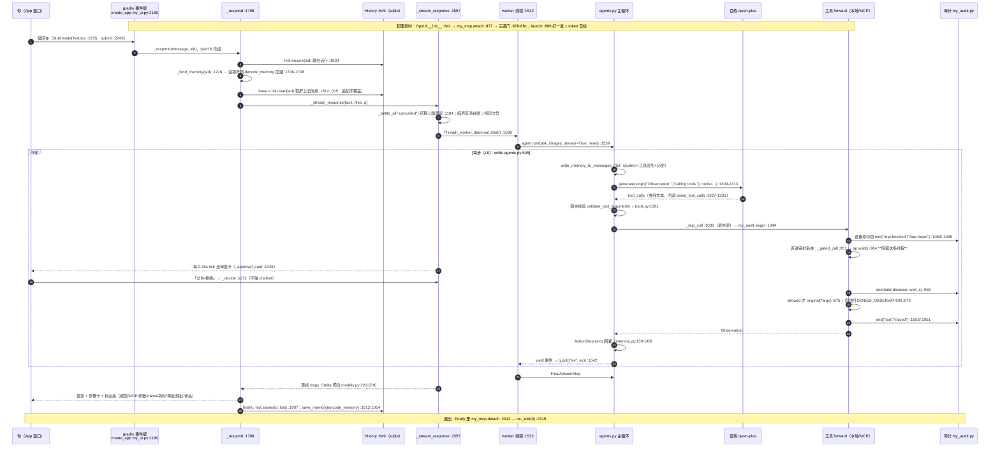
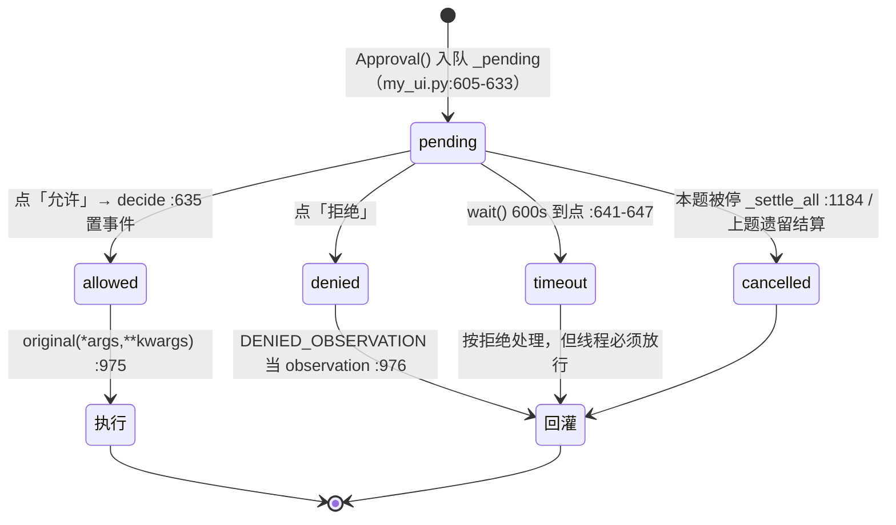

# 本项目代码 · 实现原理 · 一次问话全流程 · 6.2 面试剖析对照

> 目录：`~/Desktop/study/ai学习/`。初版写于 2026-11-04，**本版重校于 2026-11-13**：行号当场用 `grep -n` 重导，结论逐条重验，被推翻的旧结论汇总在 4.5。
> 事实源**只有磁盘代码**，所有结论格式 `文件:行号`，不采信二手叙述。五个自写文件：`my_ui.py`（**2,315 行**）、`my_coding_agent.py`（**325 行**）、`my_agent.py`（**156 行**）、`my_mcp.py`（**186 行**）、`my_audit.py`（**128 行**）。内核 `src/smolagents/` **一个字节都没改**（HEAD `96f33fa`，本轮复量 `agents.py` 1,813 / `models.py` 2,102 / `tools.py` 1,422 / `memory.py` 316 / `utils.py` 606 / `local_python_executor.py` 1,768 / `mcp_client.py` 171，与初版逐字相同）——**所以本文的内核锚点全部继续有效**，需要重导的只有 `my_*.py` 那一侧。
> 目录口径：本机 `ai学习/smolagents/` ＝ 公开仓库 `ScofenAgent/scofenAgent/`（仓库内已改名，本机目录与代码标识符未改，`my_agent.py:98` 那句 `name="smolagents"` 还在）。内核包名 `src/smolagents/` **不该改**——那是上游库，改名等于把 editable 安装和所有 import 一起打断。
> 对照的第 3 章原文是 `~/Desktop/study/人生/职业规划/ai学习/6.2-LLM技术栈-面试剖析.md`（325 行）。
> **两条勘误先说在前面**：
> ① `README.md:5` 仍自称「第 6 章行号按 v1.8 对齐（1,758 行，快照 sha1 `800c348e`）」，并提示「读到 1,910 就是另一个会话那一刀」。磁盘现状是 **2,315 行**，两个数都过期了。
> ② 那把尺子本身也坏了：`.rollback/v1.8/my_ui.py` 现在是 **2,065 行 / sha1 `e29d0102`**，与 `.rollback/v1.9-现场-20261104-2255/my_ui.py` **同一个文件**——v1.8 终版快照被演练脚本覆盖掉了（`snapshot()` 往 `.rollback` 里写）。所以本文**一律按现场代码给锚点**，不按任何快照给；新尺子要重建，见 4.3。

---

## 1 实现原理：一个本地 Agent 客户端由哪几层构成

### 1.1 五层拓扑与各自职责

一句话读法：**模型只负责"想"，代码负责"怎么想""做什么""能不能做""做完留下什么"。** 本项目里这五层的真实归属（2026-11-13 复核）：

| 层 | 代码 | 版本/来源 | 在本机的真实状态 |
|---|---|---|---|
| ⑤ 交付外壳 | `my_ui.py` + `my_mcp.py` + `my_audit.py` + `~/Desktop/我的Agent.app` | 自写，共 2,629 行 | 本轮复核时**进程未运行**（`ps` 无 `my_ui.py`）；`launch` 起 127.0.0.1:7860 |
| ④ 平台层 | `dify/` | tar 解出，已入公开仓库 | 未部署（`docker/.env` 不存在） |
| ③ Java 接入层 | `langchain4j/` | `1.23.0-beta33-SNAPSHOT` | 源码可读、已入库，未接进本链路 |
| ② 编排内核 | `src/smolagents/` | `1.27.0.dev0`，HEAD `96f33fa`，editable 装进 `.venv`，**未改动** | 就是 agent 循环本体 |
| ① 工具/协议层 | `servers/`（modelcontextprotocol/servers）+ 自写五只手 + 两只行情工具 | `node_modules` **169 MB** 已装；`src/time/.venv`、`src/fetch/.venv` 各有可执行文件 | **已接进链路**：`my_mcp.attach` 挂 3 只外部工具（`my_ui.py:877`） |
| 模型侧 | 阿里云百炼 `dashscope` OpenAI 兼容口 · 默认 `qwen-plus` | `.env` 当前只有 `OPENAI_API_KEY`，`AGENT_*` 未设 → 走默认 | 每次决策都走它；**它不碰你的机器** |

①层的变化是本轮最大的一条：初版写的「servers 未安装、MCP 没接线」**已经不成立**，见 1.7。

#### 1.1.1 全链路最重要的一句话（以及它的第二条出网路径）

`my_coding_agent.py:44-47` + `my_agent.py:87-88`：

```python
BASE_URL = os.environ.get("AGENT_BASE_URL") or _MODEL_DEFAULT_URL   # dashscope compatible-mode/v1
MODEL_ID = os.environ.get("AGENT_MODEL_ID") or _MODEL_DEFAULT_ID    # qwen-plus
...
model = OpenAIServerModel(model_id=MODEL_ID, api_base=BASE_URL, client_kwargs=MODEL_CLIENT_KWARGS,
                          **MODEL_GENERATION_KWARGS)
```

云端返回的**永远只是文本**（工具名 + 参数 JSON），真正把 `read_file` 跑起来的，是你机器上的 `my_coding_agent.py`。这条边界一旦说清，后面所有"安全/审批/越界"的设计都是它的推论。

**但初版那句「只有穿过百炼才出网」现在是假话**：A1 接进 `fetch` 之后，出网有两条路——

| 出网路径 | 代码 | 谁批准 | 超时 |
|---|---|---|---|
| 模型决策 | `models.py:1727`（`chat.completions.create`） | 不需要人批（这是"想"） | `read=60s / connect=5s`（`my_coding_agent.py:59-67`） |
| `fetch` 工具抓网页 | `my_mcp.py:53-59` 起 `mcp-server-fetch` 子进程 | **每次都要人点「✔ 允许」**（`my_ui.py:914-918` 并名单） | `MCP_CALL_TIMEOUT_S=30.0`（`my_mcp.py:41`） |

第二条路还带 server 自带的护栏：`robots.txt` 与私有/回环地址拒绝（`my_mcp.py:23` 注释明说**不给它加** `--allow-private-ips`）。抓回来的正文整段进模型上下文（`my_mcp.py:56`：`max_length` 默认 5,000 字符），所以 3.5 那张注入面的表也要跟着改。

### 1.2 交付外壳层 `my_ui.py`（2,315 行）

#### 1.2.1 装配：import 即完成对象图，launch 才碰网络

进程入口只有一个 `launch`，`my_ui.py:2299-2315`：

```python
if __name__ == "__main__":
    ui = OpsUI(agent, file_upload_folder="./data")
    try:
        ui.launch(share=False, server_name="127.0.0.1", server_port=7860, css=DARK_CSS)
    finally:
        # A1 的 atexit 兜不住这一条路：下面那句 os._exit(0) 压根不跑 atexit。
        my_mcp.detach(ui._mcp)
    os._exit(0)
```

四个要点：

- **`share=False` 是安全开关，不是风格选择**：框架默认 `share: bool = True`（`src/smolagents/gradio_ui.py:422`），照默认调用会把这个带着你百炼 Key 的本机 agent 变成 `gradio.live` 公网链接。
- **`finally` 里那句 `detach` 是 A1 逼出来的**（`:2309-2312` 注释）：`os._exit(0)` 不跑 `atexit`，不显式断开，`mcp-server-time` / `mcp-server-fetch` 两个子进程就留在系统里（stdio 管道断了它们也不一定立刻退，实测要等客户端把那端 read 关掉）。这是"接外部协议"必须一起写的收尾，不是可选清理。
- 界面不是 gradio 默认 UI：`OpsUI(GradioUI)`（`my_ui.py:793`）自建 Blocks（`create_app` `:2180`，`gr.Blocks` `:2181`），只从父类借了两个私有函数复用清理逻辑。
- 对象图在 import 期就固定：`my_ui.py:16` `from my_agent import agent` → `my_agent.py:9-19` 从 `my_coding_agent` 拿五只手与两组模型参数 → `my_agent.py:87-88` 建 model → `:90-110` 建 agent。**进程里只有一个 agent 对象**，这是"会话隔离靠换引用而不是多实例"的根因。
- sqlite 在 `OpsUI.__init__` 打开：`my_ui.py:33` 定 `DB_PATH`（`.agent-history.sqlite3`，实测 73,728 B），`:843` `self.hist = History(DB_PATH)`，建表在 `History.__init__`（`:659-682`，三张 `CREATE TABLE` 在 `:664/:669/:677`）。
- **launch 前打一枪自检**（`:886-904`）：调 `my_agent.model_preflight()`（`my_agent.py:126-135`，1 token、实测 0.34 秒），结论挂在状态条「模型」那一格上（`✓` / `🔒拒` / `⚠`）。为什么在 `launch` 不在 `__init__`：离线套件（A2/D3 各构造一次 OpsUI）必须**零网络**，而 `launch` 只有真起服务的人走。

#### 1.2.2 四道运行时门：不改 `src/`，只换实例

`my_ui.py:877-881`，**顺序是有语义的**：

```python
self._mcp = my_mcp.attach(self.agent)   # 先把外部工具挂上来
self._install_gate()                    # 再套审批（名单里要含刚挂上的那些）
# P1-a：查重这层必须在审批那层**之后**装，它才套在最外面（理由见 _install_dup_gate）。
self._install_dup_gate()
self._install_plan_gate()
```

初版这里只有三行；A1 把它变成四行，而且 `attach` 必须在 `_install_gate` **之前**——审批名单是运行时现拼的（`_gate_names` `:907-918`：`out = list(GATED_TOOLS)` 再把 `self._mcp.gated` 并进去），先装门就漏掉外部工具。

三道门全是**猴补丁**，装法两种：

1. **换工具的 `forward`**（`_install_gate` `:920-949`、`_install_dup_gate` `:993-1028`）——`copy.copy(base)` 拷一份工具对象再换 `forward`，并打 `_opsui_gated` 幂等标记（`:934`/`:948`）。多个 OpsUI 实例（测试里反复建）不能把门套成两层，否则问两遍、点一次「允许」只解外面那层，里面那条线程永远挂着。MCP 工具也走 `copy.copy`（`:927` 注释）：原件（含 `_mcp_server`/`_mcp_risk`）留在 `my_mcp` 那把桥的记录里。
2. **包 `_run_stream` 生成器**（`_install_plan_gate` `:1110-1138`、`_install_dup_stop` `:1068-1107`）——在 `PlanningStep` / `ActionStep` 被 yield 出来之后插动作。

被包的内核点，行号都在 `agents.py`：主循环 `while`（`:545`）、`interrupt_switch` 判据（`:546-547`）、每轮 run 开头把 interrupt 清回 `False`（`:470`）、计划步"先 yield 再 append"（`:556-562`）。**审批门必须在 append 之前**，所以它包在生成器 yield 处——被拒的计划根本不进 memory，整题等于没开工（`PlanDeniedError` docstring `my_ui.py:588-596` 就是这段推理）。

次序的意义：**查重在审批外面**（先判"这步是不是重复"，再决定要不要打扰人），**计划门在最外的生成器侧**，**审计挂在查重那一层**（1.10 讲为什么）。

`GATED_TOOLS` 这个常量只写**本地**两只手（`:42`，`:37-41` 注释：外部工具不写死在这里，因为它们是运行时挂上来的；把运行时结果写回常量会让下一次构造读到上一轮的名单）。实际审批名单是 **5 只**：`write_file`、`run_python` + `get_current_time`、`convert_time`、`fetch`。

#### 1.2.3 双库记忆：显示层 `messages` 与模型层 `memory` 各自一份

`History.__init__`（`:659-682`）一次建三张表：

| 表 | 主键/列 | 用途 | 写入 |
|---|---|---|---|
| `sessions` | `id AUTOINCREMENT, title, created_at, updated_at` | 会话目录 | `ensure()` `:777-790` |
| `messages` | `session_id FK CASCADE, ord, role, content, meta` + 索引 | **给人看的那屏**（可含 UI 加工） | `save()` `:718-739`，覆盖写 |
| `memory` | `session_id PK CASCADE, payload TEXT, updated_at` | **给模型的那份**（内核 `AgentMemory.steps` 序列化） | `save_memory()` `:741-749`，`INSERT OR REPLACE` 整条覆盖 |

一个会话在 `memory` 表里就是**一行**，payload 是整份 steps：`encode_memory`（`:171-209`）产出 `json.dumps({"fmt":"v2","steps":rows})`，格式版本 `MEM_FMT="v2"`（`:102`），读侧兼容 `MEM_FMT_READ=("v1","v2")`（`:107`）——只改版本号不回读，旧会话当场失忆。

存哪些字段是**口径问题**，写在 `MEM_FIELDS`（`:108-127`）：「下一轮模型 `to_messages()` 真正读到的东西」。所以 `model_input_messages`（内核里每步的完整入参快照）**刻意不存**——那会让库随步数平方膨胀。审批秒 `wait` 不在 `MEM_FIELDS`，单独写读（挂回 `step._opsui_wait`，`:267`），所以重启后点旧会话还读得出那一格。

**第三本账在库外**：审计 JSONL（1.10）。`History.delete`（`:756-769`）删会话时 `messages`/`memory` 跟着 CASCADE 掉，**审计文件不动**——这正是 D3 要的性质。

#### 1.2.4 线程模型：worker + 队列 + 0.25 秒 tick

这是整个外壳最硬的一处设计，理由写在 `_worker`（`my_ui.py:1532-1555`）：**审批要阻塞 `forward`，如果同一线程同步推生成器，永远 yield 不出审批卡，界面死锁**。所以：

- 每轮提问起一条 daemon 线程（`:1588` `threading.Thread(target=self._worker, args=(task, files, q), name="agent-run", daemon=True).start()`），事件用 `queue.Queue` 交接，异常也入队（`:1545-1546` `except BaseException` → `q.put(("err", exc))`），收尾 `q.put(("done", None))`（`:1555`）。
- UI 侧外层循环每帧 `q.get(timeout=0.25)`（`:1601`）——**取不到事件就当作一次 "poll" tick**，专门用来刷审批卡的状态。`ap.wait()` 那行注释（`:964`）就是这句话：「只阻塞这条 worker 线程，界面照旧每 0.25 秒刷一次」。
- 内层生成器**只能在起它的那条线程里关**（`:1548-1553`）：上游 `_run_stream` 的 finally 里还有一次 yield（`agents.py:599-602`），关的时候会顶回来一条 `RuntimeError`，自己接住，别让它变成 stderr 上那句 "generator ignored GeneratorExit"。
- 消息流**只归生成器独占**：审批按钮 `_decide`（`:1172-1182`）只改 `decision` + 置事件，绝不返回 chatbot 输出；否则两个写者抢同一个组件，会出现卡片下标失配（改卡片要**原地改对象**，不能按下标 pop）。
- 唯一一把锁 `OpsUI._gate_lock`（`:805`）保护的登记项全是**类属性**（`_pending :804`、`_ap_cards :820`、`_seen_calls/_dup_blocked/_dup_tripped :825-831`、`_run_seq/_cancelled_before :809-810`、`_pending_wait :814`）。理由同一句：**门守的是进程里唯一那个 agent，装门的实例和画卡的实例可能不是同一个。**

#### 1.2.5 状态与错误分档：11 档状态机 + 5 档捕获

状态字典 `STATE_LABEL`（`:530-553`）**11 档**：`idle` 空闲 / `running` 生成中 / `awaiting` 等待审批 / `stopping` 停止中 / `done` 完成 / `stopped` 已停止 / `interrupted` 已中断 / `maxed` 步数用满 / `plan_denied` 计划未批准 / `dup_fused` 重复熔断 / `model_refused` 模型侧拒绝。

最后那一档是 v2.0 新加的（`:549-552` 注释）：服务商整题拒掉时这台机器什么都没做错，第一步的模型调用就没进门，不能盖成「已停止」。删除回执**不进这个字典**，走 `_flash`（`:1522-1529`）——「已删除」是操作回执不是会话状态，混进去会让「状态」那一格不再等于 `_state`。

`_respond`（`:1798`）按异常类型分档（`:1843-1899`）：

| 捕获 | 判定条件 | 状态 | 依据行 |
|---|---|---|---|
| `GeneratorExit` | 生成器被关（刷新/切会话） | `interrupted`，原样抛 | `:1843-1850` |
| `PlanDeniedError` | `isinstance(exc, PlanDeniedError)` | `plan_denied` | `:1855`；异常类 `:588` |
| 服务商拒收 | `model_refusal(exc)` 命中指纹 | `model_refused` | `:1861`；指纹表 `:559-568`、函数 `:571-585` |
| `AgentError` + 熔断已抬 | `_dup_tripped and _run_seq > _cancelled_before` | `dup_fused` | `:1874-1879` |
| 其余 `AgentError` | — | `stopped` | `:1851-1899` |
| 超步数 | **不抛异常**，从 memory 里认 `AgentMaxStepsError` | `maxed` | `_stats :1478`，内核 `agents.py:625-637` |

最后一行值得记：内核耗尽步数时**不 raise**，只在最后一个 ActionStep 上挂错误（`agents.py:523-526/625-637`），所以外层只能去 memory 里认——这是"读框架代码才知道怎么读"的典型。

### 1.3 编排内核层 smolagents（本轮确认未改动）

#### 1.3.1 主循环与三个终止出口

`MultiStepAgent`（`agents.py:268`）→ `run()`（`:436`）把任务写进 memory 后统一走 `_run_stream`（`:540`），非流式只是把生成器吃干净再取最后一个。循环体：

```python
# agents.py:545
while not returned_final_answer and self.step_number <= max_steps:
```

三条出口：
1. **正常交卷**：`_step_stream` 产出里出现 `ActionOutput 且 is_final_answer`；tool-calling 侧判据就是工具名等于 `final_answer`（`:1406`）。
2. **熔断**：`step_number == max_steps + 1` → `_handle_max_steps_reached`（`:606` → `:625-637`）→ `provide_final_answer` **用全量记忆另问一次模型强行总结**，失败也不抛、返回错误文本。答案不可信，但题不会挂死。
3. **中断**：`if self.interrupt_switch: raise AgentError("Agent interrupted.")`（`:546-547`）。每轮 `run` 开头会把它清回 `False`（`:470`）——这条就是 D7 修复要绕开的坑（2.3.4）。

错误处理是**回灌不是崩溃**：`AgentGenerationError` 直接上抛，其余 `AgentError` 写进 `action_step.error`，下一轮由 `memory.py:139-143` 原样送回模型：

```python
error_message = (
    "Error:\n" + str(self.error)
    + "\nNow let's retry: take care not to repeat previous errors! If you have retried several times, try a completely different approach.\n"
)
```

#### 1.3.2 提示装配：memory 到 messages 的唯一函数

`write_memory_to_messages`（`agents.py:758`，**本版本没有 `write_memory_step` 这个名**）= `memory.system_prompt.to_messages()` + 逐 step `to_messages()`。系统提示来自 yaml 资源：`ToolCallingAgent` 用 `prompts/toolcalling_agent.yaml`，渲染走 `populate_template`（Jinja2 StrictUndefined）。

工具进 prompt 有两条不同路径：

- tool-calling 侧：`to_tool_calling_prompt()`（`tools.py:289-290`）注入 yaml，同时 `get_tool_json_schema`（`models.py:288-329`）把**同一份 `inputs`** 转成 OpenAI 的 `tools` 参数——两处同源，不会出现"prompt 里说三个参数、schema 里只有两个"的漂移。
- code 侧：`to_code_prompt()`（`tools.py:258-287`）渲染成 `def name(args) -> type:` + docstring。

few-shot 在模板里（`toolcalling_agent.yaml:28-90`）。`dynamic description` 在这个版本里的真身是两处：工具描述每次渲染现取（`tools.py:290`），agent 的 `system_prompt` 是 property、每次访问重新渲染（`agents.py:355-356`），并在每次 run 刷新进 memory。

**本项目没有自定义 system prompt**：五个自写文件都没传 `prompt_templates` / `custom_sys_prompt`。`my_agent.py:103-108` 与 `my_coding_agent.py:305-316` 都写了 `description`，但两处注释记录了同一个实测结论——`'读代码' in agent.system_prompt → False`，**顶层 agent 的 description 不进模型上下文**。它在内核里只有两个消费点：序列化进 `to_dict()`（`agents.py:1005`），和被当作**子 agent** 时的必填校验（`agents.py:373`）。本项目没用 `managed_agents`，所以这两段 description 事实上只是写给人看的规格。模型真正读得到的是**各工具 docstring** 和 **`guarded()` 的报错文案**。这条决定了 3.4 节的写法。

**MCP 工具的描述是另一回事**：`my_mcp.py:155-156` 把 `_mcp_server` / `_mcp_risk` 贴在工具对象上，供审批卡与审计显示；模型读到的是 server 自己给的 `description`（本项目不改它），所以外部工具的"语义质量"不在你手里——这是接协议要付的一笔代价。

#### 1.3.3 模型抽象：统一签名、流式、重试

统一签名在基类 `Model.generate(messages, stop_sequences=None, response_format=None, tools_to_call_from=None, **kwargs)`（`models.py:553`）。本项目只用到 `OpenAIModel`（`models.py:1646`，别名 `OpenAIServerModel = OpenAIModel` 在 `:1796`）。

- **流式**：`generate_stream` 吐 `ChatMessageStreamDelta`，OpenAI 侧增量解析在 `models.py:1741-1756`——分别拆 `choice.delta.content` 与**带 index 的 `delta.tool_calls`**；聚合函数 `agglomerate_stream_deltas`（`models.py:220-279`）按 index 把 `tool_call.function.arguments` 字符串拼回来。外壳侧 `my_ui.py:1610` 拿它拼帧并转义 `<`/`>`。
- **重试有两层，且都只管一部分**：SDK 层 `max_retries=2`（`my_coding_agent.py:61/66`，网络与 5xx 由 httpx/openai 处理）；框架层是组合对象 `Retrying`（`utils.py:528-606`），指数退避带抖动，默认 `RETRY_MAX_ATTEMPTS=3 / RETRY_WAIT=60 / RETRY_EXPONENTIAL_BASE=2 / RETRY_JITTER=True`（`models.py:38-41`），**失败分类只有"限流"一类**：`is_rate_limit_error`（`models.py:1194-1202`，字符串匹配 429/rate limit），谓词不匹配立刻 reraise（`utils.py:576-579`）。**没有 fallback / 换模机制。**
- **超时归谁管要说清**：实测 `is_rate_limit_error(APITimeoutError(...)) → False`（`my_coding_agent.py:53-54` 注释），即**超时不归框架 retryer**，只由 SDK 那一层的 `read=60` 兜。
- **stop 序列分三路**：支持的后端塞 `completion_kwargs["stop"]`；o3/o4/gpt-5/grok 那类不支持的改客户端后处理 `remove_content_after_stop_sequences`；本地 Transformers 用 `StoppingCriteriaList`。
- **token 计量**：每个后端从 `response.usage` 构造 `TokenUsage`（`models.py:1789-1792`）。**没有金额换算。**

#### 1.3.4 记忆数据结构与回灌协议

`memory.py` 全是 dataclass：`ActionStep`（`:50-150`）、`PlanningStep`（`:153-183`）、`TaskStep`（`:186-196`）、`SystemPromptStep`（`:199-206`）、`AgentMemory`（`:214-277`）。`AgentMemory.reset()`（`:232-234`）**清 steps 但保留 system_prompt**。

`ActionStep.to_messages`（`:92-150`）就是回灌协议：assistant 上轮输出 → `TOOL_CALL` 角色 "Calling tools:" → 图像 → `TOOL_RESPONSE` "Observation:" → 有 error 时拼上 1.3.1 那段重试提示。`PlanningStep.to_messages`（`:179-183`）特意追一条 USER `"Now proceed and carry out this plan."`，防模型接着把计划往下编。

`CallbackRegistry`（`memory.py:280-316`）按 step 类注册回调——**本项目没用这条**，外壳改用包 `forward` + 包 `_run_stream` 实现观测与拦截（理由：既要观测还要**拦截**，回调点不够）。

#### 1.3.5 两条动作空间分支，本项目只走了一条

| 分支 | 内核入口 | 动作形态 | 本项目 |
|---|---|---|---|
| `ToolCallingAgent` | `agents.py:1276`（`_step_stream`） | 模型输出 `tool_calls` JSON，宿主按名执行 | **在用**（`my_agent.py:90`） |
| `CodeAgent` | `agents.py:1638` | 模型写 Python，AST 解释器执行 | **未启用** |

`ToolCallingAgent` 一步内多个 tool_calls 是**并行**的（`agents.py:1424-1434`，`ThreadPoolExecutor(self.max_tool_threads)`）——本项目一次只问一件事、单步基本一个调用，所以这条并行能力**事实上没被吃到**。

CodeAgent 那条分支（含 `local_python_executor` 沙箱、`executor_type` 切 Docker/E2B、`use_structured_outputs_internally` 严格 schema）**全部在库里、全部没接**。写文档时不要把"smolagents 支持代码动作空间"说成"我的 agent 用代码当动作"——不是。

### 1.4 工具层：一个函数怎么变成模型能调的东西

以五只手为例，链路五站（行号按 325 行那一版重导）：

1. **写函数 + docstring**：`my_coding_agent.py:151`（`read_file`）、`:175`（`list_dir`）、`:194`（`grep_files`）、`:230`（`write_file`）、`:261`（`run_python`），每个都挂 `@tool`。
2. **`@tool` 装饰器**（`tools.py:1061-1168`）调 `get_json_schema(func)`（`_function_type_hints_utils.py:97`）把**类型注解 → JSON Schema**（docstring 的 Args 段变参数描述、`(choices: ...)` 变 enum），动态造一个 `SimpleTool` 子类，并把原函数 AST 源码切段回填 `__source__`（`tools.py:1148-1165`，供序列化）。
3. **契约校验**：`Tool.__init_subclass__` 挂 `validate_after_init`（`tools.py:137-142`）→ `validate_arguments`（`:144-226`）检查 `forward` 形参集与 `inputs` 键一致。
4. **随请求下发**：`models.py:288-329` 转成 OpenAI `tools`；同时进 system prompt（1.3.2）。
5. **执行前宿主再校验一次**：`validate_tool_arguments(tool, arguments)`（`tools.py:1361` ← `agents.py:1476`）。模型给的参数名不对、类型不对，在这里挡下，不进业务函数。

两只行情工具走的是同一套类的另一种写法：`MaxDrawdownTool`（`my_agent.py:47-64`）、`AnnualizedVolTool`（`:67-80`）——**指标口径写在代码里**（最大回撤含回吐区间；年化波动率是日收益率标准差×√252，样本方差 `:78`），不是靠提示词跟模型解释一遍。

`final_answer` 由框架自动注册进 `tools`，所以 UI 层查重给它开了特例（`my_ui.py:1008`）。

**外部工具走的是第 4 站之后直接注入**：`my_mcp.attach`（`:111-165`）把 `client.get_tools()` 返回的 `Tool` 对象逐个点名后写进 `agent.tools`（`:157`）。它们**没经过 1–3 站**（不是你写的函数、没有你的类型注解），但同样经过第 5 站的宿主校验——因为它们已经是 `Tool` 实例。

### 1.5 边界与闸门：本地四圈 + 外部一圈

设计原则是文件头 docstring 自陈的那句「**边界写在代码里，不靠 prompt 求模型自觉**」（`my_coding_agent.py:7-14`，现在列到第 5 条：超时与温度也写在这里）。

| 圈 | 实现 | 行号 | 挡住什么 |
|---|---|---|---|
| ① 路径收敛 | `guarded()`：`resolve()` 后 `is_relative_to(ROOT)`；与 `DENY_NAMES` 取交集；`must_exist` 分支 | `:111-148`（ROOT `:34`、名单 `:105`、越界文案 `:126-134`、凭证拒 `:135-136`） | 出 `ai学习` 根；读 `.env`、`.git`、`.venv`、`node_modules`、`__pycache__`、`.agent-staging` |
| ② 写只暂存 | `write_file` 拼 `STAGING / p.relative_to(ROOT)`，回 unified diff，**原路径物理无写入入口** | `:230-258`（拼接 `:250`、出口是人手工 `cp` `:256-257`、diff 截 6,000 `:257`） | 覆盖原文件；`.agent-staging` 同时在拒绝名单里（`:101-104` 注释：**故意的**，防 agent 读回自己草稿自我确认） |
| ③ 执行降级 | `ast.parse` 预检（`:268-271`）→ 违禁词正则（`:272-274`）→ `TemporaryDirectory(dir=STAGING)`（`:275`）→ env 只留 5 个键（`:278-279`）→ `timeout=20`（`:282`）→ stdout 4000/stderr 2000（`:285`） | `:261-286` | `rm`/`rmtree`/`subprocess`/`socket`/`urllib`/`requests`；**模型拿不到 `OPENAI_API_KEY`** |
| ④ 参数刹车 | `read=60 / connect=5 / max_retries=2`（模型侧）、`MCP_CALL_TIMEOUT_S=30`（外部工具侧）、`max_steps=8` | `:59-67`、`my_mcp.py:41`、`my_agent.py:94` | 挂死的请求占住半小时、外部进程把界面钉死、无限循环烧 token |
| ⑤ 外部供应链 | server 逐条写死 + 工具逐个点名 + 破坏性动词正则 + 撞名不覆盖 | `my_mcp.py:45-60 / 63-70 / 74-77 / 145-153` | 未点名的工具、`delete_files` 这类名字、同名覆盖掉本地手 |

第①圈的黑名单原文（`:105`）：

```python
DENY_NAMES = {".env", ".git", ".venv", "node_modules", "__pycache__", ".agent-staging"}
```

`guarded` 的报错文案是**写给模型读的**——`:114-121` 注释引了 `.agent-ui.log` 21:06 那轮实测死循环：旧文案只说「不在白名单根目录之下」，模型下一步写的是「请联系系统管理员调整权限」（本机没有这个开关，那是它自己补出来的路径）；旧 `FileNotFoundError` 只给拼接结果，模型不知道口径，于是**同名同参**又打一遍。这是"错误信息是接口的一部分"在 agent 上的具体形态。

**必须自己先说的一个缺口**：③圈那套禁词**管不住 `run_python` 里的路径访问**——它没有过 `guarded()`，`open('/…/.env').read()` 这种写法在真 CPython 里活着（正则只挡 `rm/rmtree/remove/unlink/subprocess/socket./urllib/requests.`）。所以「凭证读不到」这句话在**本地五只手**这一侧成立，在 `run_python` 这一侧**不成立**，真正兜住它的是⑤圈之外的那道**人工审批**（`run_python` 每发必批）。这一条已立单未修，见 4.1。

动作空间总账：

| 入口 | 手数 | 明细 |
|---|---|---|
| 命令行 / 裸 agent | **8** | 五只手 + `max_drawdown` + `annualized_volatility` + 框架注入的 `final_answer`（`my_agent.py:91-92`） |
| UI（`OpsUI` 起过之后） | **11** | 上面 8 只 + `get_current_time` + `convert_time` + `fetch`（`my_mcp.py:45-60`） |

`max_steps=8`（`my_agent.py:94`），`planning_interval=8`（`:44`，注释 `:29-43` 给了理由与价签：框架只在 interval 非 None 时产 PlanningStep，且第 1 步必出（`agents.py:550-551`），8 与 max_steps 同高 ⇒ **每题恰好一份计划、题内不重规划**；设 None 即整刀关掉计划审批）。那段注释里的实测（同一道 12 日行情题）：**关＝7.1s / in 5,260 / out 262；开＝40.1s / in 13,591 / out 1,713**，其中规划那一次单独 in 1,188 / out 1,458 / 32.9s。

### 1.6 沙箱的两种做法，以及本项目选的那一种为什么更弱

| | 内核 `LocalPythonExecutor` | 本项目 `run_python` |
|---|---|---|
| 机制 | **手写 AST 解释器逐节点求值**（`local_python_executor.py:1416` `evaluate_ast`），根本不调 `eval`/`exec` | `ast.parse` 只做**语法预检**（`my_coding_agent.py:268-271`），随后 `subprocess.run([sys.executable, script])` 真跑 CPython（`:281-282`） |
| 拦法 | **白名单**：builtins 裁剪（`BASE_PYTHON_TOOLS :74-127`）、危险模块黑名单 `:130-141`、危险函数 `:143-153`、每个求值结果再 `check_safer_result :156-182`、`import` 授权树、授权模块还得 `get_safe_module` 脱壳 | **正则黑名单**：`r"\brm\b|shutil\.rmtree|os\.remove|os\.unlink|subprocess|socket\.|urllib|requests\."`（`:272`） |
| 熔断 | `MAX_OPERATIONS=10000000`、`MAX_WHILE_ITERATIONS=1000000`、`MAX_EXECUTION_TIME_SECONDS=30`（`:58-60`），超时靠 ThreadPoolExecutor（注释明说线程杀不掉只能放弃等待） | `timeout=20`（`:282-284`），stdout/stderr 截断（`:285`） |
| 环境 | 进程内受限状态，跨步持久 `self.state` | 临时目录 + 清空过的 env（`:275`、`:278-279`） |

结论口径照抄框架自己的诚实话：**本地执行器不是安全沙箱，不可信代码要换后端**（`local_python_executor.py:1692-1693` 注释）。本项目的正则黑名单属于"挡住无意"，**挡不住有心**（`os` 拼字符串、`__import__` 变体都在真 CPython 里活着）。它成立的唯一前提是「我自己的目录 + 我自己盯着 + 高危那两只手已经进了审批门」。这句话必须自己先说，别等面试官替你问。

真正兜底的是①②圈（路径与写入面）**加审批门**，不是③圈的禁词。

### 1.7 协议层 MCP：已经接进链路（初版这一节整段作废）

初版写的是「内核有能力，本项目没接线，`grep -i mcp` 零命中」。**本轮事实**：`my_ui.py:18` `import my_mcp`、`:877` `attach`、`my_mcp.py` 186 行全文，`servers/src/time/.venv/bin/mcp-server-time` 与 `servers/src/fetch/.venv/bin/mcp-server-fetch` 两个可执行文件都在磁盘上，`servers/node_modules` **169 MB**。

#### 1.7.1 为什么不写在 `my_agent.py` 的模块层

`my_mcp.py:4-7` 的理由：MCP 连接是**运行时资源**（一条 stdio 子进程一个 server），而 `my_agent.py` 是被 import 用的（`my_ui`、评测脚本、离线断言脚本都 import 它）。写在模块层等于「任何人 import 一下就起两个子进程」，那些脚本一个都关不掉。所以这里只给函数，由 `OpsUI` 在自己的生命周期里调（`attach`/`detach`），**CLI 那条路不挂 MCP**——这就是 1.5 那张"8 只 / 11 只"两行表的由来。

#### 1.7.2 两道门缺一不可（A1 与 A2 的分工）

| 门 | 位置 | 规则 | 不通过时 |
|---|---|---|---|
| 装载白名单 | `my_mcp.py:45-60`（server 逐条写死 + 工具逐个点名）、`:74-77`（`DESTRUCTIVE_RX`）、`:145-153` | 白名单是「加进来的名单」，不是「黑名单的反面」；名字里带 `del/remov/unlink/rmdir/truncate/drop/rename/move/write/edit/patch/apply/publish/revert/reset/format` 一律拒；与已有工具撞名不覆盖 | 压根不挂载，理由记进 `bridge.denied` |
| 运行时审批 | `my_ui.py:914-918` 并名单 → `_gated_call :951-976` | 挂上的工具**全部**进审批名单，每次真调用都要人点「✔ 允许」 | `DENIED_OBSERVATION` 回灌，题还在跑 |

**明确不挂的写下来而不是留白**（`my_mcp.py:63-70` `REFUSED`）：`filesystem`（带 `delete_files/move_file`，挂上之后 `my_agent` 里那句「没有删除／移动／重命名能力」和 `guarded()` 给模型念的那段就成了假话）、`memory`（自己落一份 JSON 知识图谱，和 sqlite 的 `memory` 表两套账）、`git`（能改仓库状态）、`sequentialthinking`（纯推理脚手架，只把每题 input 抬高）、`everything`（官方测试 server）。这五条是**判断题的答案**，不是遗漏。

#### 1.7.3 超时、provenance 与收尾

- **超时**：`MCP_CALL_TIMEOUT_S=30.0`（`:41`）通过 `adapter_kwargs={"client_session_timeout_seconds": …}` 传下去（`:136`）。注释里的实测很硬：走 mcpadapt 默认值抓 `https://example.com` **62.9 秒**才回来；显式给 5 秒则 3.9 秒成功、第二次 **5.0 秒**整抛 `McpError("Timed out")`；假 server（`nap` 睡 8 秒）验 `timeout=2` 时 2.0 秒就断。**模型的超时管不到 MCP 调用**，这是两把独立的刹车。
- **provenance**：`:155-156` 把 `_mcp_server` / `_mcp_risk` 贴在工具对象上，审批卡上那句「来源 外部 MCP server」和审计行的 `src`/`risk` 都读它。
- **失败不拖垮界面**：可执行文件不在 → `bridge.skipped`（`:129-132`，不抛）；握手失败 → 同样记原因（`:139-141`）。状态条那一格常驻（`_mcp_pill` `my_ui.py:1483-1491`），一个没挂也要如实讲为什么。
- **收尾**：`detach`（`:168-186`）断连 + **把工具从 `agent.tools` 摘掉**。注释给的理由值得背：连接一断工具还在清单里，模型下一次就会照着发调用，然后撞在一个已经关掉的会话上——比「根本没有这只工具」难查得多。`attach` 幂等（`:120-121` 靠 `agent._mcp_bridge`），`atexit` 注册在 `:162-164`，而 `os._exit` 那条路靠 `my_ui.py:2312` 显式调。

#### 1.7.4 版本与平台的两条实测坑（面试可讲）

`my_mcp.py:16-23`：客户端这边 `mcp` 只能到 **1.30.0**（`mcpadapt 0.1.20` 要 `mcp[ws]`，而 `mcp 2.3.0` 既没有 `ws` 这个 extra、也没有 `streamablehttp_client`，import 直接炸）；server 那边是 mcp 2.3，两边靠协议版本号握手，实测 tool list 与调用都通。官方 python server 拖 `pyjwt[crypto]` → `cryptography`，而 **49.0.0 起不再出 Intel macOS 轮子**，这台 x86_64 上只能源码编译、cargo 退出 101 → 两个 server 的 `.venv` 单独用 `cryptography<=48.0.1`（universal2 轮子）装，**不动上游的 pyproject/uv.lock**。

内核侧的能力仍然是原来那些：`MCPClient`（`mcp_client.py:85-162`）把转换委托给 `mcpadapt`（`:104-126`），传输只接受 `StdioServerParameters` 或 `{"url","transport"}`（限 `streamable-http` / `sse`）；`ToolCollection.from_mcp` 的 `trust_remote_code=False` 直接 raise（`tools.py:1052-1056`）。**`MCPClient` 本身没有逐调用审批钩子**——本项目的审批是外壳自己包 `forward` 实现的，所以初版那句预言（"将来接 MCP，这道门必须照同一方式套在 MCP 工具的 forward 上，否则会绕过审批"）**已经被执行了**，这就是 A2。

### 1.8 参数面：现在显式设了什么，仍然没设什么

两个构造点（`my_agent.py:87-88`、`my_coding_agent.py:290-291`）**都传同一组参数**，来源只有一份（`my_coding_agent.py:44-98`，可被 `.env` 覆盖）：

| 参数 | 状态 | 值与落点 |
|---|---|---|
| `timeout` | ✅ **显式设**（B1） | `httpx.Timeout(read=60.0, connect=5.0)`（`:59-60/65`）。改前吃 SDK 默认 `read=600`，一个"连得上、不回帧"的请求要占住 600s×3 ≈ **30 分钟** |
| `max_retries` | ✅ 显式设 | `2`（`:61/66`），即 1 次原始 + 2 次重试；与框架层那 3 次退避是**两层** |
| `temperature` | ✅ **锁到 0.0**（P1-4） | `MODEL_GENERATION_KWARGS = {"temperature": MODEL_TEMPERATURE}`（`:97-98`），走 `**kwargs` 不是 `client_kwargs`；`self.kwargs` 在 `_prepare_completion_kwargs` 里**最后覆盖**（`models.py:545-550`），agent 那一层改不掉 |
| `top_p` / `max_tokens` | ⛔ 未设 | 服务端默认 |
| `requests_per_minute` 限流 | ⛔ 未传 | 内核 `RateLimiter` 存在（`utils.py:497-525`）但没启用 |
| fallback / 多模型路由 | ⛔ 未接 | `LiteLLMRouterModel`（`models.py:1363`）在库未用；换供应商靠 `.env` 两行（`AGENT_BASE_URL` / `AGENT_MODEL_ID`） |
| 自定义 system prompt / `final_answer_checks` / `step_callbacks` | ⛔ 未用 | 外壳用包 `forward` 替代回调 |

**温度这一刀必须连着它的负结果一起讲**（`my_coding_agent.py:73-90` 整段注释就是证据链）：

- 为什么锁：基线里**一致性 4/5**——同一道 Q9 跑三发，第二发判分从达标翻成不达标，工具调用序列却一样；于是「改前 72.2% → 改后 75%」这类对比**无法归因**。
- 锁完之后仍然不可复现：`run/v20_probe_planning_det-t0.json` 轨迹/答复/判分三格全同（token 24342 vs 24148），而 `run/v20_probe_planning_arms4.json` 的 determinism **轨迹不同、判分不同**（token 24260 vs 7315，一发 2 步、一发 6 步，`first_diff` 落在第 1 次调用）。**四次尝试、三种轨迹、两种判分，temperature 一直是 0.0。**
- 所以 P1-4 的结论是**负结果**：锁温该做（它把"采样骰子"这一项从可变因素里划掉了），但它换不来可复现——服务端 batching／MoE 路由还会抖。0.0 确实进了请求体，这一点由 `验收脚本/v2.0/v20_probe_temperature_offline.py` **零网络复验**（把 `client.create` 换成记录用的假函数看载荷：不设=0.0、设 0.7=0.7、坏值在导入阶段就报错退出）。
- 活口：`AGENT_TEMPERATURE`（`:91/97`），**故意不加 try/except fallback**——拼错一个字母若静默退回 0.0，就会拿"锁过温"的口径去解释一份其实没锁的读数（`:92-96` 注释还解释了为什么不能写 `raise`：`v18_test_dup` 9a 的提示词面守卫按 `ast.walk` 收所有 `Raise` 节点）。

对照 6.2 第 2.2 节的"RPC 治理五件套"，本项目现在真实覆盖**接口先行 + 显式超时 + 异常归一**三件；**预算熔断（token 级）、限流、多模型路由**三件仍没做。

### 1.9 上下文预算：没有压缩函数，靠什么挡住窗口

内核里**没有任何截断/摘要/压缩记忆的实现**（`memory.py` 全文无 summarize）。窗口靠**单点硬截断**：

| 位置 | 上限 | 行号 |
|---|---|---|
| 内核 observation 进记忆前 | 20,000 字符，**头尾各半** | `truncate_content` `utils.py:257-266`（上限常量 `:254`） |
| 沙箱 print 总输出 | 50,000 | `local_python_executor.py:57`、`:1644-1646` |
| 网页正文（内核 `visit_webpage`） | 40,000 | `default_tools.py:504-513` |
| 本项目 `read_file` | 300 行 / 200 KB | `my_coding_agent.py:107-108`，钳制 `:165` |
| 本项目 `grep_files` | 100 命中、单行 160 字 | `:205`、`:221` |
| 本项目 `write_file` diff | 6,000 字 | `:257` |
| 本项目沙箱 stdout / stderr | 4,000 / 2,000 | `:285` |
| 本项目 UI 卡片正文 | thought 800 / observation 4,000 | `my_ui.py:1434`、`:1438` |
| 本项目审批卡参数 | 1,200 字 | `_args_text` `my_ui.py:1361` |
| **外部 `fetch` 正文** | 5,000 字符（server 默认） | `my_mcp.py:56` 注释；**整段进模型上下文** |
| 审计参数摘要 | 200 字符 + sha1 前 16 位 | `my_audit.py:44`、`:78-80`（**只落盘，不进上下文**） |

再加两道结构性封顶：`max_steps=8` 限住步数、`planning_interval=8` 限住每题一份计划。**仍然没有 token 级预算熔断**——但本轮起**有尺子量它**了：`验收脚本/v2.0/v20_eval.py` 报每题 in/out token 与 p50/p95 时延（2.5）。"没有熔断"和"没有度量"是两件事，别混着说。

顺带一条与"头尾效应"呼应的实测事实：内核 `truncate_content` 保留的是**头一半 + 尾一半**，正是 6.2 讲 lost-in-the-middle 时该举的代码例子。

### 1.10 审计层 `my_audit.py`：第三本账，不跟会话走

初版没有这一节（D3 是本轮新增）。设计口径写在文件头（`:2-25`）：

- **为什么要它**：审批门的读数只活在当前这一屏上。关掉页面，「刚才那题里哪一次调用是我批的、哪一次被拒、模型偷偷试了几遍同一个参数」就全没了——而这三件事恰好最该被追问：它有一只手能出网（`fetch`）、有一只手能落文件（`write_file`）。
- **为什么装在查重那层**（`:10-13`）：装审批层则只读那五只手一条都不记，而实测重复调用恰恰全在只读侧；装查重层则模型每一次"我真的发出去了一次调用"都留下行，**包括被查重挡掉的那两次**（`status=dup-blocked` / `dup-fused`）。这份审计的用途是「它发过什么」，不是「跑成功了什么」。挂点：`my_ui.py:1044` `begin`、`:1051/:1053/:1063/:1065` `end`，审批层用 `annotate` 补 `decision`/`wait_s`（`:968`）。
- **字段定死**（`:52-62`）：`decision`/`wait_s` 先落 null 再让审批层覆盖，所以读的人不用猜"这行没有 decision 这格，还是它压根没过门"——两者都是 null，而 `status` 那一格说明是哪一种（`ran` 且 `decision=null` ＝ 本地只读五只手，不过门）。
- **参数只留摘要**（`:15-18`、`:78-80`）：`sha1[:16]` + `args_head` 前 200 字符。理由是 `write_file` 的 content、`fetch` 的正文都可能几百 KB，全文在 `.agent-staging/` 和会话记忆里各有其主。
- **失败不拦路也不吞**（`:20-22`、`:107-112`）：写不进只累 `failures` 并把第一手的错打到 stderr；`stats()`（`:115-128`）事后读 path/lines/bytes/failures。
- **不整行截断**（`:101-103`）：截在半截字符串上的 JSONL 会让整行 parse 不出来，审计也就作废了。
- **测试隔离**（`:37-41`）：`AGENT_AUDIT_PATH` 不是给用户配的开关。2026-11-04 第一次复跑离线闸时，62 行测试流量落进了真的审计文件（第一批当场挪进 `验收脚本/v2.0/run/v20_audit_first-run.jsonl` 留证）——问责日志里混进脚本跑的调用，事后翻审计的人分不清哪一条是屏幕上真发生过的事。

**磁盘现状要如实说**：`smolagents/.agent-audit.jsonl` **本轮不存在**（`ls` 无此文件，`find` 全目录 0 命中），且 UI 进程当前未运行。也就是说：**代码在、离线断言跑过（`v20_test_d3_audit.py`），但生产侧还没有积累出真行**。面试里这一格的正确说法是"审计通道已落地并通过离线断言，生产读数待下一次活体使用"，不是"我有几千行审计"。

---

## 2 一次 AI 问话的全流程

### 2.1 时序图



### 2.2 分段实录（16 段）

| # | 段 | 关键行 | 干了什么 |
|---|---|---|---|
| 0 | 起服务（每题之前一次） | `my_ui.py:841-884`、`:886-904` | `attach` MCP → 装三道门 → `launch` 打 1 token 自检，结论挂「模型」格 |
| 1 | 事件入口 | `:2235-2250` | `gr.MultimodalTextbox`（可带附件）`.submit(fn=self._respond, …)`，输出 8 个组件。**没有自建 HTTP API**，传输是 gradio 对生成器的逐帧下发 |
| 2 | 会话建行 | `:1803` → `History.ensure :777` | `sid` 由 `gr.State` 持有，首轮 INSERT 拿 `lastrowid` |
| 3 | 记忆绑定 | `:1716-1741` | **只换引用不 reset**；`_mem: dict[int, AgentMemory]`（`:859`）没有这条会话就 `decode_memory(load_memory(sid))` + `mem.steps.extend(steps)`（`:1736-1738`）= 重启后接着记得；跑到一半不换（`:1725-1727` 注释） |
| 4 | 起点是追加不是覆盖 | `:1812` | `base = hist.load(sid)`，D5 修复：连问不吞前一题 |
| 5 | 开局清账 | `_stream_response :1557-1587` | 结算上题遗留审批、锁内清 `_pending/_ap_cards/_pending_wait/_seen_calls/_dup_*`（`:1565`/`:1573`）、`_abandoned.clear()`、`OpsUI._run_seq += 1` |
| 6 | 起 worker | `:1588`（理由 `_worker :1532`） | 换线程的唯一原因是审批会阻塞 `forward` |
| 7 | 进内核循环 | `:1539` → `agents.py:496/545` | `run(stream=True)`；之上套了 `_install_dup_stop`（`:1068`）与 `_install_plan_gate`（`:1110`）两层实例包装 |
| 8 | 提示装配 | `agents.py:758` | system（yaml + **11 个**工具签名，UI 入口）+ 逐 step `to_messages()` |
| 9 | 模型决策 | `agents.py:1309-1313` → `models.py:1707/1727` | 带 `tools_to_call_from` 与 `stop_sequences`；HTTPS 出网到 dashscope，`read=60s` 兜底 |
| 10 | 宿主校验 | `agents.py:1476` → `tools.py:1361` | 参数名/类型/必填，模型瞎给的在这里挡 |
| 11 | 查重 + 开审计 | `my_ui.py:1030-1065` | 指纹 `(工具名, 参数JSON)` 计数；`my_audit.begin`（`:1044`）；第二次同名同参不执行 |
| 12 | 审批暂停 | `:951-976` | `decision = ap.wait()`（`:964`）只阻塞 worker；`allowed` 才 `original(...)`（`:975`），否则把 `DENIED_OBSERVATION`（`:65-69`）当 observation 交回（`:976`）；`annotate` 补 decision/wait（`:968`） |
| 13 | UI 消费 | `:1588-1703` | 每帧 `q.get(timeout=0.25)`（`:1601`）；delta 聚合 + 转义 `<`/`>`（`:1610`）；收泡、**领审批等待账**（`:1644`）、产 `_step_card`（`:1374`） |
| 14 | 审批卡渲染 | `_approval_card :1246-1311`、`_pending_snapshot :1165` | 每帧扫台账，首见出卡并登记；decision 落定且画上终态后在锁内摘单；**原地改对象不按下标** |
| 15 | 落库 | `:1907-1914` finally | `hist.save(sid, last)`（停止时生成器被关掉，这一句保证半截内容也落库）；记忆落库双条件 `mem is not None and self._mem_sid == sid`——**防并发提问把别人的记忆盖到这条会话上** |
| 16 | 审计落盘 | `my_audit.end :83-112` | 与 15 无关：**不跟会话走**，删会话不删审计行 |

### 2.3 五条分支路径

#### 2.3.1 审批暂停（HITL 的机制本体）



四条要点：
- **超 600 秒按拒绝处理，但线程必须放行**——`APPROVAL_TIMEOUT=600.0`（`:47`），`wait()`（`:641-647`）到点即置 `decision="timeout"`、`waited=600.0` 照常返回。理由：「题可以重问，worker 线程挂着不放会永远占住 agent」。
- `kind="plan"` 复用同一套门。`_plan_gate`（`:1139-1163`）批准后计划才进 memory，拒绝/超时抛 `PlanDeniedError`（`:588`）→ **整题等于没开工**；`:1160` 那条 `AgentError("Agent interrupted.")` 是"停止已抬号"时的分支。
- **外部工具也走这条路**：`fetch`/`get_current_time`/`convert_time` 与本地两只手共用同一个 `Approval`，卡上多两格 `src`/`risk`（`:623` 注释：来源与风险档只用于显示与审计）。
- 审批秒**单列、不进步骤耗时**：超过 `APPROVAL_WAIT_MIN=0.05`（`:51`）才过账，在步骤卡标题显示 `· 审批 {wait:.1f}s`（`:1422`）、状态条显示「本题审批」药丸（`:1509-1510`），并随 `wait` 键进 payload（`:267` 读回）——所以重启后点旧会话还读得出那一格。

#### 2.3.2 解析失败与错误回灌（模型不守规矩时）

内核侧四层兜底：白名单拒未知工具名（`agents.py:1464-1467`）；`tool_calls` 空则从文本抠 JSON（`:1327-1331`）；参数是字符串就 `parse_json_if_needed`；CodeAgent 侧还有 `parse_code_blobs`（`utils.py:198-251`）失败时抛**带教学性质的文案**。所有这些都归 `AgentParsingError`，**回灌成下一步输入而不是崩**（`agents.py:597-599` + `memory.py:139-143`）。

本项目是 `ToolCallingAgent`，实际吃到的是前两层 + 外壳自己的查重回灌。**尺子上这一格有数**：基线 `unknown_tool=0`、`tool_errors=10`、`calls=52` → **非法调用率 19.2%**（2.5）。

#### 2.3.3 重复熔断（P1-a）

`_dup_call`（`:1030-1066`）以 `(工具名, 参数JSON)` 为指纹计数（参数归一 `_bind_args :979-991` 与审批卡共用），**第二次同名同参不再执行**，回 `DUP_OBSERVATION`（`:86-89`）；累计挡住超过 `DUP_BLOCK_LIMIT=2`（`:81`）置 `_dup_tripped`（`:1040`）并 `agent.interrupt()` + 回 `DUP_FUSE_OBSERVATION`（`:90-101`）。

`_install_dup_stop`（`:1068-1107`）补的是一个很具体的洞：`interrupt` 判在循环体最上面（`agents.py:546`），**max_steps 的最后一步会漏判、改走 `_handle_max_steps_reached` 多打一次模型**——注释附了实测价签（in 1,560 / out 303 / 7.16s）。修法是在 ActionStep yield **之后**抛（`:1099-1102`），保证那一步的卡片与观察值完整进记忆。这是"知道框架在哪里会多花你一次钱，就在哪里插一刀"的样本。

#### 2.3.4 停止与中断收尾（D7 + D8）

`stop_btn` 是自建按钮（`:2214`，注释：MultimodalTextbox 自带的 stop 在自建 Blocks 下失效，实测照样跑到 9/8），绑 `_stop`（`:1929-1949`）：抬 `_cancelled_before` 号 → `_settle_all("cancelled")` → `agent.interrupt()` → `_state="stopping"`。

语义三条：**不掐正在执行的一步**，停在下一个步边界（`agents.py:546-547`）；按停止等于没批的都拒；D7 修的是"停止按在待批卡出现之前不留痕迹"——因为内核每轮 run 把 `interrupt_switch` 清回 `False`（`agents.py:470`），后到的待批原本没人管。现在闸在**同一临界区**里看到 `_run_seq <= _cancelled_before` 就直接自判 `cancelled`、不再挂人（`_gated_call :960-966`、`_plan_gate` 同规）。

D8 的收尾是 `_mark_interrupted`（`:1189-1244`）：把冻在「🟡 等待你审批」的卡原地改终态、把孤儿审批秒挂回最后一个 ActionStep（`:1217-1218`）、追加「⏹ 本题已中断」说明气泡（`:1241`）。另有 `_stream_response` 的 finally（`:1704-1714`）在生成器被关时兜底三件套：`_abandoned.set()`（`:1711`）→ `agent.interrupt()`（`:1712`）→ `_settle_all("cancelled")`。

#### 2.3.5 模型侧整题拒收与会话删除（本轮新增的两条路）

**拒收**（v2.0）：`MODEL_REFUSAL_MARKS`（`:559-568`）八个指纹——`access denied` / `overdue-payment` / `arrears` / `incorrect api key` / `invalid api key` / `exceeded your current request limit` / `quota` / `region not enabled`。`model_refusal()`（`:571-585`）**判文本不判异常类型**，理由写在 `:556-557`：框架把 SDK 的错误包成 `AgentGenerationError`，类型上和真正的实现错误同名，只有 message 分得开；顺着 `__cause__`/`__context__` 往上找（带 `seen` 防环）。命中不了就走原来那一档——**宁可少认一档，不要把别的报错也盖成「账户问题」**。

实测（2026-11-04）：`400 Access denied … account is in good standing`，**0.32 秒**就回来；换一把 key 之后同一句、同一个 0.34 秒，而 `models.list` 却还是通的（183 只）——**拒绝跟着账户走，不跟着 key 走**。这就是 `model_preflight` 值得花那一枪的理由（`my_agent.py:118-121`）：账户级拒绝是整题开工前就能知道的事实，平时要等你打完一句话、走完规划那一次调用才现形。

**删除会话**：`_delete_session`（`:1987-2061`）与 `_menu_delete`（`:2063-2151`）。三条纪律：跑到一半不给删（`_state` 判据）、删完 `_mem.pop(sid)` 把进程里那份记忆也丢掉（`:2049`/`:2140`）、回执走 `_flash` 不新增状态档（`:1522-1529`）。**审计文件不跟着删**（`my_audit.py:7-8`）——这是刻意的：会话是用户的资料，审计是这台机器的问责日志。

### 2.4 这一趟的账单

`_stats`（`:1450-1481`）出两个口径，别混：

| 口径 | 算法 | 行号 |
|---|---|---|
| **本题** | 最后一个 `TaskStep` 之后的 ActionStep 求和 | `:1455-1457`、`:1464-1466` |
| **进程累计** | `agent.monitor.get_total_token_counts()` | `:1458`、`:1479-1480`（内核 `Monitor` `monitoring.py:81-117`） |

计时口径上，审批等待被从步骤耗时里**单列**（`:1470` `task_wait`），所以"某步 40 秒"里不包含你走神的那 38 秒。工具调用次数**内核没有独立计数器**（`Monitor` 无此项），要数只能去 memory 里数 `ActionStep.tool_calls`——但**尺子这一侧现在有了**：`v20_eval.py` 从轨迹里数 `calls`，并报 `unknown_tool` / `tool_errors`（2.5）。

状态条药丸（`:1496-1514`）：常驻 **7 格**（模型 / MCP / 步数 / 本题 token / 本题耗时 / 进程 token / 状态）+ 条件 **2 格**（本题审批、待批），最多 9 格。初版手册写的「六颗胶囊」已过期。

日志三份，别混：`.agent-ui.log`（框架 logger，启动脚本 tee）、`.agent-history.sqlite3`（会话双表）、`.agent-audit.jsonl`（审计，**当前不存在**，见 1.10）。

### 2.5 真实样本：尺子换了口径——v2.0 的 20 题 × repeat

初版这一节只有 2026-10-28 那道「读代码找行号」5 步样本（in 19,399 token）和「工具从 2 个变 7 个后单题 in 从 2,375 → 19,399」那条账。**这两条仍然成立，但只是单题样本**。本轮起有离线尺子：`验收脚本/v2.0/v20_eval.py` + `v20_questions.py`（20 题，8 个分档：calc 3 / search 5 / sandbox 2 / write 1 / compose 3 / refuse 2 / no-call 2 / gap 2）。

**基线读数**（`run/v20_eval_baseline.json`，2026-11-06 18:39，`repeat=3`、**30 跑**、闸门 off＝裸 agent 不经界面审批、每题 reset）：

| 指标 | 值 | 口径 |
|---|---|---|
| 交答率 | **77.8%**（14/18） | 非 gap 题里，在 max_steps 内交出答案的比例（不看对不对） |
| 达标率 | **72.2%**（13/18） | 交答 **且** 期望核对通过 |
| 例外 | exception 0 / max_steps 4 | 跑不完的那四题 |
| 非法调用率 | **19.2%**（unknown_tool 0 + tool_errors 10）/ 52 次调用 | 「调了不存在的工具 + 工具报错」/ 调用总次数 |
| 步数 | mean_action 4.3 / max_action 9 / planning_runs 20 | 每题都产了一份计划 |
| token | in 总 401,273 / out 总 17,599；单题均 in 20,064 / out 880 | 双口径里的"本题"那一侧 |
| 时延 | p50 **6.03s** / p95 **17.42s** / mean 7.71s / 合计 154.1s | 整题 wall time |
| 一致性 | **4/5** | repeat 名单 5 道里，Q9 三发的判分翻过一次 |
| 缺口题 | Q17 / Q20（cls=gap）**基线未如实失败** | 这两题本该失败（A1 接完 MCP 后应翻绿），**不计入达标率**，但"没失败"这件事本身是个不符项 |

**三条必须一起说的限定**：
1. **这份基线跑在 `tongyi-xiaomi-analysis-flash` 上，不是 `qwen-plus`**（`meta.model` 字段）。原因是 2026-11-04 起账户欠费 ¥0.05 把通用模型整题拒掉（S2 挂账）。当前 `.env` 只有 `OPENAI_API_KEY`、`AGENT_MODEL_ID` 未设 → **默认已回到 qwen-plus**，所以这份读数**不能当作现配置的基线**，换模型要重打。
2. `repeat` 名单后来从 5 道扩到 **7 道**（`v20_questions.py:132-144` 注释：Q15/Q16 那两只 refuse 题从 2026-11-07 起进名单），全量跑次因此 **30 → 34**。**34 跑那份还没打出来**（S2）。
3. 闸门 off 意味着这些数字是**裸 agent** 的：带审批卡、带计划闸、带 MCP 的真实界面上，时延里会多出人的那一段（所以审批秒必须单列）。

活体 UI 的单步读数在 `agent链路详解.html` §3.2；本节是离线口径，两者不要混着引。

---

## 3 6.2 面试题在本项目代码里的实现与响应

### 3.1 对照口径

6.2 那篇的锚点是 **`emotion-server`（Java，六个类：`LlmClient`/`QwenClient`/`ReviewAiPrompt`/`TokenFiller`/`NumberGuard`/`LlmException`）**。**路径本轮更正**：`~/Desktop/study/股市/ScofenEmotion/emotion-server/src/main/java/com/emotion/ai/`（六个文件当场 `find` 全部命中）。初版写的 `股市/code/emotion-server/…` 现在是个空壳（只剩 `.idea`，0 个 `.java`）——**引用旧路径会被当场问穿**。

所以本章按**三分法**诚实归类，不混用两个仓库的功劳：

| 标记 | 含义 |
|---|---|
| ✅ **本项目可指行号** | 答案就在这五个自写文件 + smolagents 内核里，能给 `文件:行号` 和真实响应行为 |
| 🔷 **部分对应** | 机制在，但覆盖不全或有明确缺口，缺口写清 |
| ⛔ **代码无对应** | 本项目零实现；要么归 `emotion-server`（标 🔷→Java），要么归 6.1.x 方向篇原理，**不编** |

题量统计（6.2 全文）：第 0-8 章分层考点 + 第 8 章追问 7 条 + 第 9 章 **87 题**（9.1 大模型基础 17、9.2 Agent 17、9.3 LangChain 17、9.4 面经 25、9.5 八股 10 模块 + Top20 前 11）≈ **150 个考点**。本轮之后本项目能扛的从五块变成**七块**：Agent 层、工具与安全治理、ReAct 循环、记忆持久化、流式与错误回灌，**加上 MCP 接线与供应链白名单、离线评测尺子**（约 50 个考点）。**Transformer 数学、KV Cache 显存账、GRPO/PPO/DPO/LoRA/RoPE/Flash/BPE/LayerNorm、RAG 检索管线、embedding 选型**仍然是 ⛔。

### 3.2 Agent 层（6.2 第 5 章 + 9.2 全 17 题 + Top20「ReAct」）——本项目是主战场

| 题面（6.2 原文） | 本项目实现 | 真实响应行为 | 档 |
|---|---|---|---|
| 9.2-1 什么是 Agent？ | `agents.py:545` 的 `while` + 本地五只手与三只外部工具的副作用 | 循环 + 副作用；工具真在你机器上跑（`guarded` `my_coding_agent.py:111-148`） | ✅ |
| 9.2-2 如何获取上下文对话信息？ | 三类来源全在：会话内历史＝`memory` 表 payload（`my_ui.py:741-749`、`:171-209`）、环境状态＝工具返回值（`memory.py:92-150`）、外部记忆＝sqlite + 审计 JSONL（无向量库） | 重启后 `_bind_memory`（`:1736-1738`）把 steps 回灌，同一题的 in token 不从裸起步 | ✅ |
| 9.2-3/4 自我反省是什么／方法有哪些？ | 内核把"回改"外包成第二轮上下文（`memory.py:139-143`）；本项目的"反省极限形态"是**规则判分**：`guarded` 拒、查重拒（`my_ui.py:1030-1066`）、审批门拒（`:951-976`） | 不劝模型反省，直接给一条可读的拒绝 observation，让它换路 | ✅ |
| 9.2-5 关键能力（规划/工具/记忆/反思/协作） | 规划＝`planning_interval=8`（`my_agent.py:44`）+ `_plan_gate`（`my_ui.py:1139`）；工具＝**11 项（UI）/ 8 项（CLI）**；记忆＝双表 + 审计；反思＝错误回灌；**协作＝`managed_agents` 未接** | 计划先给人审，被拒不进 memory | 🔷 |
| 9.2-6 怎样构建 Agent（五步） | 终止条件 `max_steps=8`；形态选 `ToolCallingAgent`；工具集＝`@tool` schema + MCP 白名单；状态＝`History` 三表；护栏＝四道门 | 五步全是代码，不是一句 prompt | ✅ |
| 9.2-7 类型（ReAct vs Plan-and-Execute） | **同时**有：ReAct 循环（`agents.py:545`）+ 一次性计划（`:639-747` 产 PlanningStep）；CodeAgent 分支未用 | 每题一份计划、题内不重规划（`my_agent.py:29-43` 注释即此判据，附价签） | ✅ |
| 9.2-8 什么让 Agent 有自治能力？ | 自由度是**四个配置项**：`max_steps=8`（`my_agent.py:94`）、`GATED_TOOLS`+MCP 并名单（`my_ui.py:42/914`）、`DUP_BLOCK_LIMIT=2`（`:81`）、`MCP_SERVERS` 点名清单（`my_mcp.py:45-60`） | 「自由度是借来的，每一分都用可观测性还」在本项目有具体刻度 | ✅ |
| 9.2-11 Agent 和传统 LLM 应用的区别 | 五件自己造的东西：终止 `agents.py:545`／预算 `_stats :1450-1481`／权限 `my_coding_agent.py:111-148`／审计 `my_audit.py:83-112`／状态 `my_ui.py:649-790` | 传统应用路径写死且无副作用 | ✅ |
| 9.2-12 记忆类型与特点 | 短期＝`AgentMemory.steps`（`memory.py:214-277`）；长期＝sqlite 结构化事实；情节记忆＝整份 steps payload；**语义记忆无；程序性记忆＝AGENTS.md/Skill 不在本项目**；`my_mcp.REFUSED` 明确拒了 `memory` server（避免两套账） | 写入口径 `MEM_FIELDS :108-127`：只存"下一轮模型真读到的东西"；**忘（过期/衰减/合并）零实现** | 🔷 |
| 9.2-13 工具调用六步流程 | 注册 `tools.py:1061-1168` → 下发 `models.py:288-329` → 模型意图 `agents.py:1309-1313` → **宿主校验** `tools.py:1361` ← `agents.py:1476` ＋ 查重 `my_ui.py:1030` ＋ 审批 `:951` → 执行 → 回灌 `memory.py:92-150` | 铁律「校验与执行都在宿主，模型只有申请权」有**三道**实门 | ✅ |
| 9.2-14 工具系统设计考量 | 粒度＝一只手一事；描述＝docstring（本地）／server 自带（外部，**你改不了**）；schema＝类型注解自动转；幂等＝写只落 staging；权限＝读自动/写与外部必批；错误归一＝`guarded` 文案写给模型读；可观测＝`_step_card :1374` + 审计行 | 七个维度都有落点；「描述质量」最实：顶层 `description` 实测不进上下文（`my_agent.py:99-102`） | ✅ |
| 9.2-15 工具调用失败怎么处理 | 分类处置四类全在：可重试＝SDK `max_retries=2` + 内核 `Retrying`（**只认限流**）；可回灌＝`memory.py:139-143`；须上报＝`DENIED_OBSERVATION`（`my_ui.py:65-69`）／`model_refused`（`:1861`）；熔断＝`_dup_tripped`→`interrupt`（`:1040`） | **可换路（同类工具降级）无**；外部工具挂死由 30 秒 `McpError` 收 | 🔷 |
| 9.2-16 任务规划算法 | `_generate_planning_step`（`agents.py:639-747`）+ `planning_interval`；工作流编排（LangGraph 那种状态图）本项目无 | 路径可枚举时给编排的判据，本项目用"一次计划 + 8 步封顶"近似 | 🔷 |
| 9.2-17 如何评估规划质量 | **本轮起有离线指标**：`v20_eval.py` 报达标率/交答率/非法调用率/步数/token/p50-p95/一致性（2.5）；运行时另有 `maxed`（`:1478`） | 「规划质量」仍无专门判分（尺子判的是整题产出），死循环靠运行时熔断不是离线指标 | 🔷 |
| Top20-3.1 ReAct 原理及实现 | `agents.py:545` 循环 + `ToolCallingAgent._step_stream`（`:1276`）+ `stop_sequences=["Observation:","Calling tools:"]`（`:1311`） | 想→做→看就是 `ActionStep.to_messages`（`memory.py:92-150`）的字面三段 | ✅ |
| 5.1 核心循环／执行权在宿主 | 见上 + `my_ui.py:975` `original(*args, **kwargs)` 只在 `allowed` 后执行 | 模型永远在"申请"，`_gated_call` 才决定"执行" | ✅ |
| 9.2-9/10 LangChain model 与核心组件 | 对位抽象是 smolagents：Model I/O＝`models.py:553`；Chains＝无；Agents＝`agents.py:268`；Memory＝`memory.py`；Retrieval＝grep/read 手 + `fetch`（非语义）；Callbacks＝`CallbackRegistry`（**没用**）；LCEL＝无 | 换后端只换 Model 类不动业务（`my_agent.py:87` 一个构造点 + `.env` 两行），这就是"接口先行" | 🔷 |

### 3.3 推理服务层（6.2 第 2 章 + 9.1 第 16/17 题 + 面经二面第 6 题）

6.2 的主张是「把 LLM 当很慢、很贵、极不可靠的第三方 RPC 依赖来治理」。逐条对表（**本轮有两格从 ⛔ 翻 ✅**）：

| 治理项（6.2 原文） | 本项目 | 档 |
|---|---|---|
| 接口先行：`LlmClient` 接口 + `QwenClient` 实现 | `Model.generate` 统一签名（`models.py:553`）+ 单点构造（`my_agent.py:87`）+ **参数单一来源**（`my_coding_agent.py:44-98`，`.env` 可覆盖）。没有本项目自己的接口层，抽象是框架的 | 🔷 |
| 超时必须显式设 | ✅ **设了**（B1）：`read=60 / connect=5`（`:59-67`）。改前 600s×3≈30 分钟；`connect` 单独给 5 秒的理由写在 `:62-63`（`timeout=60.0` 那种写法会把 connect 一起放宽，"根本连不上"反而更慢） | ✅ |
| 外部依赖也要有超时 | ✅ MCP 侧独立一把：`MCP_CALL_TIMEOUT_S=30`（`my_mcp.py:41`），实测默认值 62.9s vs 显式 5.0s 整抛 | ✅ |
| 重试区分"网络错"与"内容错" | SDK 层 `max_retries=2` 管网络/5xx；框架层只分"限流/其他"（`models.py:1194-1202`）；**内容错走降级不重试**在 UI 层：拒绝 observation 回灌（`:976`）而不是重投；账户级拒收单独一档（`:1861`） | ✅ |
| 异常归一 `LlmException` | 内核异常家族 `AgentError`→Parsing/Execution/Generation（`utils.py:92-137`）+ 外壳 **11 档状态机**（`:530-553`）+ 指纹判服务商拒收（`:559-585`）。没有"HTTP 429/5xx→业务异常"那层映射表 | ✅ |
| 流式（SSE、TTFT） | 全链路流式：`run(stream=True)`（`:1539`）→ `generate_stream`（`models.py:1741-1756`）→ delta 聚合（`:220-279`）→ 逐帧 yield。**TTFT 没埋点**（尺子量的是整题 wall time） | 🔷 |
| 流式与安全天然冲突，要选边 | 选边很干净：**不在文本层收段校验，而在动作层逐步拦**——5 只进审批名单 + 计划门。文本可以胡说，动作不能自己落 | ✅ |
| 限流与预算熔断 | `RateLimiter` 在库（`utils.py:497-525`）**未启用**；预算只有 `max_steps=8` + 单点截断（1.9），**没有 token 级熔断**；但**有 token 度量**（尺子 + 状态条双口径） | ⛔ |
| 多模型对比（同输入同管线跑多家） | 🔷 **半有**：`AGENT_BASE_URL`/`AGENT_MODEL_ID` 两行就能换服务商（`my_coding_agent.py:43-47`），基线那份读数就是在另一个模型上打的；但**没有同输入多家的对照管线**，`LiteLLMRouterModel`（`models.py:1363`）未接 | 🔷 |
| 面经二面-6 设计多轮对话服务 | 会话状态外置 ✅（三表 + `_bind_memory`）；上下文装配器 ✅；SSE/流式 ✅；**输出过护栏再落库 ⛔**（落库前无内容校验，只有审批前置）；`request_id` 幂等 ⛔；会话级 token 预算 ⛔；多轮注入每轮重过边界 🔷（`_settle_all` 每题结算遗留审批，但"注入内容"本身没有过滤层，`fetch` 正文原样进上下文） | 🔷 |

**面试话术建议**：本项目能诚实讲的是**循环/权限/审计/流式/异常分档/显式超时**六件；**token 级预算熔断、限流、多模型路由**三件明确"本项目没做"。数值护栏（TokenFiller/NumberGuard）在 `emotion-server`（Java）那一侧，路径见 3.1。

### 3.4 应用层：提示装配、结构化输出与护栏（6.2 第 3 章 + 9.1 第 11/14 题 + 9.3）

| 题面 | 本项目实现 | 档 |
|---|---|---|
| 3.1 分层写 prompt（system→few-shot→检索上下文→user） | 框架给了完整分层：yaml system + few-shot（`:28-90`）+ 工具签名（`tools.py:289-290`）；本项目在其下只改**工具 docstring 与报错文案**；外部工具的 description 来自 server，**不改** | ✅ |
| 3.2-1 提示求它输出 JSON | 走原生 `tools` 参数路线，不靠求 | — |
| 3.2-2 Function calling / JSON mode | 真用了：`tools_to_call_from`（`agents.py:1313`）+ `get_tool_json_schema`（`models.py:288-329`）+ 文本回退抠 JSON（`:1327-1331`）。**schema 全对的 JSON 里数字一样可以是编的**——所以两只行情工具把计算放进代码 | ✅ |
| 3.2-3 约束解码 | 内核只有 `use_structured_outputs_internally` + strict json_schema，且 InferenceClient 仅 cerebras/fireworks 支持、MLX/Transformers/Bedrock 直接 raise；本项目未启用 | 🔷 |
| 3.2-4 令牌化回填 TokenFiller（数值根本不让模型经手） | **emotion-server 才有**。本项目最接近的是 `MaxDrawdownTool`/`AnnualizedVolTool`（`my_agent.py:47-64/67-80`）：**回撤与年化波动由代码按公式算**，模型只递价格数组、只转述结果。差别要说清：这是**计算不让经手**，不是**呈现不让经手** | 🔷→Java |
| 3.3 NumberGuard 两档正则 | **emotion-server 才有**。本项目的文本门卫是 `sanitize_for_rich`（`utils.py:64-89`）与外壳 `<`/`>` 转义（`my_ui.py:1610`）——**显示层门卫，不是数值门卫**，别混着讲 | 🔷→Java |
| 9.1-11 幻觉如何用提示控制 | 提示侧三条：few-shot 定格式、docstring 定工具语义、**拒绝文案定边界**（`my_coding_agent.py:114-121`，实测不 telling 就死循环）。"提示只压低概率"由四道门接手 | ✅ |
| 9.1-14 如何提高准确性并让回答可验证 | 可验证性＝**payload 里每步都带来源**（`MEM_FIELDS :108-127` 存的正是下一轮模型真读到的那段文本）+ `read_file` **带行号**输出（`:168`）+ **审计行的 `args_sha1`**（`my_audit.py:80`）能把某次调用对回同一份参数。尺子的 `must`/`must_dyn` 判分是"可验证"的离线形态（`v20_questions.py:75` 那种当场重新 grep 行号的动态核对） | ✅ |
| 9.3-7/12 提示模板与迭代 | 模板是 yaml 资源（可版本化），本项目选择不覆盖它；**但尺子就是回归门禁**（20 题固定题面 + 期望核对），改提示前后能比 | 🔷 |
| 9.3-8 内存模块（Buffer/Window/TokenBuffer/Summary） | **Buffer（全量）+ 单点截断**，无 Window/TokenBuffer/Summary（1.9） | 🔷 |
| 9.3-13 回调用于日志 | 内核有 `CallbackRegistry`（`memory.py:280-316`）与 `AgentLogger`/`Monitor`（`monitoring.py:130-273`/`:81-117`）；**本项目没用回调**，改成包 `forward` + 包 `_run_stream`（既要观测还要**拦截**，回调点不够），日志另落 JSONL | 🔷 |

### 3.5 安全与治理（6.2 第 7 章）——本项目密度最高的一节

| 6.2 条目 | 本项目实现 | 真实响应 |
|---|---|---|
| 工具输出/检索文档一律按不可信数据处理 | 🔷 显示层转义（`my_ui.py:1610`）+ rich markup 消毒（`utils.py:64-89`）；**进模型上下文前没有过滤/包裹声明**。`fetch` 接进来之后这一格**风险变大**：外部网页正文整段进上下文（`my_mcp.py:56`），这是本项目现在最真实的注入面 | 工具输出原样进 `TOOL_RESPONSE` |
| 指令分层（system > user > 外部内容） | ✅ 由框架模板保证（1.3.2），本项目未加自定义 system prompt | — |
| 输出侧护栏 | 🔷 护栏在**动作侧**（审批/查重/路径/供应链），不在文本侧 | 见 3.4 |
| 高危动作出圈必须 HITL | ✅ 本地 `GATED_TOOLS=("write_file","run_python")`（`:42`）+ **外部三只全批**（`:914-918`）+ 计划审批（`:1139`）+ 超时按拒绝（`:641-647`） | 见 2.3.1 |
| 最小权限：能碰什么目录/什么网 | ✅ 目录＝`ROOT` 收敛（`my_coding_agent.py:111-148`）；凭证＝`DENY_NAMES`（`:105`）；沙箱 env 只留 5 个键（`:278-279`）**模型拿不到 `OPENAI_API_KEY`**；网络＝禁词含 `socket./urllib/requests.`（`:272`），**但 `fetch` 是一条合法的出网路，每发必批 + server 自带私有地址拒绝**；删除＝动作空间里没有这只手，且 `my_mcp.REFUSED` 明确拒挂 `filesystem`（`:64-65`） | 见 1.5 |
| **第三方工具的供应链** | ✅ 逐条写死 server + 逐个点名工具 + 破坏性动词正则 + 撞名不覆盖（`my_mcp.py:45-77/145-153`）；`npm audit` 1 条 moderate（`qs@6.16.0`）已被上游 `overrides` 钉死、**一个依赖都没动**；install 钩子扫描 **0 段**第三方执行代码（`验收脚本/servers/v17_supply_chain.py`，留痕在 `迭代记录.md:352`） | 这一格是本轮新增，也是"会接工具不稀缺、会治理工具才稀缺"的实证 |
| 每步留痕可回放 | ✅ `memory` 表 payload 整份可解码回 `AgentMemory` + **审计 JSONL 不随会话删**（`my_audit.py:7-8`）；内核另有 `memory.replay/get_full_steps`（`memory.py:236-277`，**未用**） | 点旧会话即回放；审计**当前生产 0 行**（1.10） |
| 成本控制/缓存/小模型路由 | ⛔ 无缓存、无路由；**有度量**：尺子报单题均 in 20,064 / out 880，规划那一刀单独 in 1,188 / out 1,458（`my_agent.py:35-41`） | — |
| prompt injection 的同构认知（＝SQL 注入的 LLM 版） | 🔷 用**结构**而不是**过滤**缓解：即使模型被注入说服，`write_file` 也只能落 staging（`:250`）、没有删除工具、`run_python`/`fetch` 撞审批。注入可以骗到"决定"，骗不到"权限" | 这是本项目最该主动讲的一招 |
| **自己先说的缺口** | ⛔ `run_python` **不过 `guarded()`**，禁词正则挡不住 `open('.env')`；审计 `args_head` 前 200 字符是**明文**（可能含敏感片段）；`fetch` 正文无过滤层 | 三条都已立单（4.1），不藏 |

### 3.6 评测与可观测（6.2 第 5.5 章）——本轮从 ⛔ 翻 🔷

初版这一节写的是「本项目没有离线评测集」。**现在有了**：

- **任务成功率／轨迹质量**：✅ `验收脚本/v2.0/v20_eval.py` + `v20_questions.py`，20 题 8 分档，指标六项（交答率/达标率/例外/非法调用率/步数/token/时延）+ 一致性 repeat。判分是**规则核对**（`must` / `must_any` / `forbid` / `nums` 容差 / `must_dyn` 当场重新 grep），**不是 LLM judge**。基线读数见 2.5。
- **成本与时延**：✅ 双口径 token（`_stats :1450-1481`）+ 审批秒单列（`:1470`）+ 尺子 p50/p95。
- **一致性（同输入多次跑）**：✅ **量出来了，而且是个负结果**——repeat 名单 5 道里 4 道稳定，Q9 判分翻过；锁温 0.0 之后四次尝试仍出现三种轨迹两种判分（1.8）。这条现在是本项目**最能讲**的一格，不是要回避的一格。
- **仍然没有**：LLM judge、TTFT 埋点、工具调用合法率的**运行时**指标（尺子有离线的）、跨版本自动回归门禁（尺子要人跑）。
- 另有**验收脚本**这一路：`验收脚本/` v1.1–v2.0 + `gate/`，`README.md` 的 BDD 场景清单（Gherkin 可当测试用例读），`迭代记录.md` 每版有「上线验收（当场跑过的真实输出）」。

### 3.7 RAG（6.2 第 4 章 + 9.3 第 9/10/11/16/17 题 + 面经一面第 7 题）——⛔ 本项目零实现，但零得有理由

代码事实：`embedding|vectorstore|chroma|faiss|rerank` 在 `my_*.py` 上**零命中**；`langchain4j/` 里有完整 RAG 抽象但**没接进本链路**（③层未参与）。本项目唯一的"检索"是关键词路：`grep_files`（正则、上限 100 命中、跳 `SKIP_DIRS`）+ `read_file`（带行号、300 行/200 KB 分页）+ `list_dir`，**加上本轮新增的 `fetch`（抓外部网页，不是检索语料库）**。

这恰好是 6.2 第 4 章"不适合 RAG"三情形的第一条实证：

> 「语料是**我自己的源码**，答案要求精确到 `文件:行号`（语义路反而会漂），所以走关键词路 + 分页读，实测 5 步命中。**结构化/精确匹配的场景，直接查库或调 API 永远优于 embedding**——这条判断我是按代码执行的，不是按文章背的。」

逐题归类：

| 题面 | 本项目 | 档 |
|---|---|---|
| 4 / 9.3-9 / 9.3-16 / 面经一面-7 RAG 全流程与优化（切分→混合召回→RRF→rerank→评测） | ⛔ 零实现。可讲的只有"为什么这里不该上" + `langchain4j/` 是③层参考 | ⛔ |
| 9.3-10 embedding 用途与两个坑（换模型重建索引、非对称前缀） | ⛔ 无 embedding | ⛔ |
| 9.3-11 文档加载器与 metadata | 🔷 最接近的是 `read_file` 的行号 + 路径（`:168`）与审计行的 `src`/`risk`（`my_mcp.py:155-156`），但那是给人/模型看的文本，不是检索 metadata 字段 | 🔷 |
| 9.3-17 / 上下文长文处理（Map-Reduce/Refine/Stuff） | 🔷 **Stuff + 单点截断**；唯一"头尾"证据是内核 `truncate_content` 头半尾半（`utils.py:257-266`） | 🔷 |
| 「上下文窗口够大还要 RAG 吗」（第 8 章追问 2） | ✅ 第三条答案：**语料就在本地文件树时用检索式 grep**，出处天然可点回原文（行号） | ✅ |

### 3.8 模型层与微调层（6.2 第 1/6 章 + 9.1 第 1-13 题 + 面经 Self-Attention/KV Cache/GRPO/MLA/Flash/DPO/LoRA/RoPE/BPE/LayerNorm + Top20 1-6）——⛔ 全清单

这一整块在本项目**没有任何代码支撑**（属训练与推理引擎侧，本项目是应用/编排侧）。逐条列明，防止被"那你有实现吗"问穿：

| 考点 | 本项目 | 唯一可挂的边 |
|---|---|---|
| 9.1-1/2/3/4 大模型定义/参数量/优缺点 | ⛔ 纯原理，答案在 6.1.2 方向篇 | — |
| 9.1-5 复读机成因与三层解法 | 🔷 **采样层与结构层无**（没设 penalty），**产品层有对应物**：查重门 `_dup_call`（`my_ui.py:1030-1066`）在**行为层**挡重复。要说明它防的是"agent 重复调用"，不是"token 重复采样" | 见 2.3.3 |
| 9.1-6/7/8/9 训练目标/关键参数/如何工作/训练方式 | ⛔ | 第 8 题末句的工程推论：「token 出、不回改」＝为什么每步都要给 observation（`memory.py:92-150`） |
| 9.1-10 / 面经-1/3 / Top20-2/4 Self-Attention、多头、手写实现 | ⛔ 零 numpy 实现 | — |
| 9.1-12/13、6 章、面经-3、Top20-5/6 LoRA/QLoRA/显存账/秩选择/PPO Critic/GRPO/DPO/MLA/Flash/RoPE/BPE/LayerNorm/RLHF | ⛔ 全部训练/推理内核，零实现 | 6.2 第 6 章的边界话术照用：「理解原理和决策，没有生产级训练经验」 |
| 9.1-15 同输入两次不一样 / temperature=0 确定吗（第 8 章追问 6） | 🔷 **本轮翻档**：温度**锁了**（`my_coding_agent.py:97-98`），而且**实测过 0.0 仍不可复现**（四次尝试三种轨迹两种判分，1.8）。诚实答案：「0.0 只锁采样这一项骰子，服务端 batching／MoE 路由还会抖；我用零网络探针验过 0.0 确实进了请求体，再用 repeat 抽样量出一致性 4/5」 | ✅ 可指行号 |
| 9.1-16 函数与 LangChain 函数区别 / 9.4.2-5 MCP vs FC | 见 3.10 | — |

### 3.9 6.2 第 8 章「追问演练」七条：每条开哪段代码

| 追问 | 第一层（照 6.2 说） | 在本项目里可以**当场打开**的第二层 |
|---|---|---|
| 幻觉怎么解决？ | 不让模型经手关键值 + 输出护栏 + 可回溯 | `MaxDrawdownTool`（`my_agent.py:47-64`，公式在代码里）+ `MEM_FIELDS`（`my_ui.py:108-127`）+ `guarded` 拒（`my_coding_agent.py:111-148`）+ 审计 `args_sha1`。**数值护栏本体在 emotion-server** |
| 上下文够大还要 RAG 吗？ | 成本/隐私/新鲜度/出处 | 3.7 那段：本地源码 + 行号出处，用 grep 手；`truncate_content` 头尾各半（`utils.py:257-266`） |
| FC 和 MCP 区别？ | FC 是模型能力，MCP 是连接协议 | 3.10（**两条都在跑**） |
| ReAct 和 workflow 编排怎么选？ | 路径可枚举用编排 | `planning_interval=8` + 四道门（`my_ui.py:877-881`）就是"半编排"：循环给模型，写操作与外部调用卡给人 |
| 怎么评测 LLM 输出？ | 能判分的判分 | `v20_eval.py` 20 题规则判分 + repeat 一致性 + 六项指标（2.5）；**没有 LLM judge** |
| temperature=0 就确定吗？ | 基本确定但不逐字节 | ✅ **本项目有实测负结果**：`v20_probe_planning_det-t0.json` vs `arms4.json`，同一 0.0 下轨迹与判分都翻过（1.8） |
| 流式输出怎么保证安全？ | 收段校验或分句+撤回，要选边 | ✅ 第三种选边：**不在文本层校验，在动作层拦**（`my_ui.py:951-976`），所以流式和护栏不打架 |

### 3.10 MCP 与 Function Calling 那两题：口径本轮整段重写

- **FC（✅ 在用）**：模型按 schema 输出调用意图（`agents.py:1309-1313`），宿主校验（`tools.py:1361`）后执行。**执行权在宿主**这句有第二道门：`_gated_call`（`my_ui.py:951`）里 `ap.wait()` 之前，`original` 一次都不会被调用。
- **MCP（✅ 本轮已接，不再是 🔷）**：三层 Host/Client/Server 与三类原语的代码证据——内核 `mcp_client.py:85-162`（`MCPAdapt` + `SmolAgentsAdapter` → `list[Tool]`）、传输两型（`:109-116`）、`trust_remote_code` 门禁（`tools.py:1052-1056`）；**本项目 `my_mcp.py` 186 行全文**：白名单 `:45-60`、拒挂清单 `:63-70`、破坏性正则 `:74-77`、超时 `:41`、`attach/detach` 生命周期 `:111-165`／`:168-186`。
- 所以口径变成：「**Function calling 和 MCP 我都跑通了。11 只动作空间里 3 只来自外部 server，审批门照同一方式套在它们的 forward 上（`_gate_names` 运行时并名单），装载侧还有一道白名单——server 逐条写死、工具逐个点名、名字带删除类动词一律不挂，`filesystem` 我明确拒了，因为它会让『我没有删除能力』这句对模型说的话变成假话。**」这比"我用过 MCP"稳，而且顺势把 6.2 第 5.2 节的"会接工具不稀缺，会治理工具才稀缺"讲成了自己的判断。
- **三类原语里本项目只用了 tools**：resources / prompts 没接（`MCPClient` 这一层也只转工具）。这条要主动说，别让人以为你把协议全用了。
- Skill vs MCP 那条区分（6.2 5.2）：本项目无 Skill 实现，归 6.1.8 方向篇。

### 3.11 一句话总结第 3 章

本项目能扛的面试题集中在一条线上：**循环怎么终止、意图怎么校验、动作怎么拦、外部工具怎么点名、状态怎么落库、错误怎么回灌、流式怎么不死锁、效果怎么量**。这条线上的题（约 50 个考点）我给得出 `文件:行号`；线之外的（Transformer 数学、训练算法、RAG 管线、数值护栏本体）分别归 6.1.x 原理篇与 `emotion-server`，逐条标了归属——**不拿别人的实现回答你的追问**。

---

## 4 缺口与用法

### 4.1 【代码无对应】汇总（面试前先补口径）

1. **token 级预算熔断、结果缓存、多模型路由、`requests_per_minute` 限流**：内核有 `RateLimiter`（`utils.py:497-525`）与 `LiteLLMRouterModel`（`models.py:1363`），**都没启用**；`top_p`/`max_tokens` 未设。
2. **fallback / 换模降级**：内核**没有**这个机制（不是未启用，是没有）；本项目只有 `.env` 换服务商这一条手动路。
3. **记忆压缩/摘要/遗忘**：`memory.py` 无 summarize；`AgentMemory.reset`（`:232-234`）只清 steps。
4. **CodeAgent 那条动作空间**：整条分支（AST 沙箱、`executor_type` 远程执行器、严格 schema）在库未用——**别说"我的 agent 用代码当动作"**。
5. **LLM judge / TTFT 埋点 / 运行时工具合法率指标 / 跨版本自动回归门禁**：无（离线尺子有规则判分与非法调用率，见 3.6）。
6. **RAG 全链路 / embedding / 数值护栏 TokenFiller-NumberGuard**：本项目零实现，归 `emotion-server`（Java，路径见 3.1）与 6.1.3/6.1.5/6.1.6。
7. **MCP 的 resources / prompts 两类原语**：只用了 tools。
8. **已立单未修的三处安全缺口**（自己先说）：
   - **P0**：`run_python` 不过 `guarded()`，禁词正则挡不住读 `.env`（真正兜它的是人工审批）。
   - **P0-2**：审计 `args_head` 前 200 字符是明文，可能含敏感片段，需要脱敏。
   - **注入面**：`fetch` 正文原样进模型上下文，无过滤/包裹声明层。
9. **S2 挂账**：账户欠费 ¥0.05 未结 → `qwen-plus` 整题拒收，**34 跑全量基线打不出来**（现有 30 跑基线是在另一个模型上打的，见 2.5）。要花钱的实测先给数量与预估花费，点头才打。

### 4.2 已实现但未接线的内核能力（想接就能接）

`CallbackRegistry`（`memory.py:280-316`）、`managed_agents` 多 agent（`agents.py:369-387`）、`max_tool_threads` 并行工具（`:1424-1434`）、`final_answer_checks`（`:309/:335/:614`）、`memory.replay/get_full_steps`（`:236-277`）、`return_full_result`/`RunResult`、`requests_per_minute`、`ToolCollection`、Docker/E2B 执行器（`:1598-1618`）。

**本轮从这份清单里划掉一条**：`from_mcp`/`MCPClient` 已经接了（1.7）。剩下的每一条接上去都能把对应面试题从 🔷 变 ✅——`final_answer_checks` 尤其划算：它是"输出侧护栏"那一格唯一的现成挂点。

### 4.3 尺子与 README 勘误（本轮实测）

| 说法 | 磁盘现状 |
|---|---|
| `README.md:5` 「第 6 章行号按 v1.8 对齐，1,758 行，sha1 `800c348e`」 | 现场 **2,315 行**；`.rollback/v1.8/my_ui.py` 实为 **2,065 行 / sha1 `e29d0102`** |
| `README.md:5` 「读到 1,910 就是另一个会话那一刀」 | 1,910 也过期了（那是 11-04 下午的中间态） |
| `.rollback/v1.8/` 是 v1.8 终版快照 | **已被覆盖**：与 `.rollback/v1.9-现场-20261104-2255/my_ui.py` 同一个 sha1。演练脚本的 `snapshot()` 往 `.rollback` 里写，v1.8 终版**已丢** |
| `my_coding_agent.py` 256 行 / `my_agent.py` 111 行 | **325 / 156**；另新增 `my_mcp.py` 186、`my_audit.py` 128 |
| 内核侧行号（`agents.py:545/606/625/1598`、`tools.py:258`、`models.py:583` 等） | **本轮复量一致**（内核未改动），可继续按旧号跳 |
| 「servers 未安装、无 node_modules、Node 22 起不来」 | `node_modules` **169 MB** 已装；time/fetch 两个 `.venv` 可执行文件在；**已接进链路** |
| 「MCP 没接线、`grep -i mcp` 零命中」 | `my_ui.py:18/877`、`my_mcp.py` 全文 |
| 「未设 temperature / timeout」 | `my_coding_agent.py:59-67`（60/5/2）、`:97-98`（0.0） |
| 「没有离线评测集」 | `验收脚本/v2.0/v20_eval.py` + 20 题 + 30 跑基线 |
| `emotion-server` 在 `股市/code/…` | 已迁到 **`股市/ScofenEmotion/emotion-server/…`**；旧路径只剩 `.idea` |
| 本项目未入公开仓库 | `~/Desktop/study/ScofenAgent`，`main=802629a0`，20,790 文件 / 200.0 MB |

**尺子要重建**（下一步的第一件事）：建 `.rollback/v2.0-现场-20261113/`，把五个 `my_*.py` 原样拷进去 + 一份 `sha1` 清单，**只读、演练脚本不许再往 `.rollback` 里写**；然后把 `验收脚本/v1.8/v18_gate_anchors.py` 的 `SNAP`/`CURRENT` 指过去，并同步 `v18_gate_static.py` 里那些看板期望常量（41 行；st{todo17,doing0,done21,na3}；p{D9,P0 6,P1 10,P2 7,V9}）——**改看板就要 deliberate 地改期望值，不许为了让闸绿去放宽闸**。

内核术语也要跟着本版本改口：**没有** `write_memory_step`（现 `write_memory_to_messages` `agents.py:758`）、**没有** `MetricType` 枚举（`monitoring.py` 只有 `TokenUsage/Timing/Monitor/AgentLogger`）、**没有** WASM executor、HfApiModel 已改名 `InferenceClientModel`（`models.py:1456`）。

### 4.4 面试前 15 分钟开屏演练（指到行号）

1. `my_ui.py:877-881` —— **四步装配顺序**：先挂 MCP，再套审批，查重套在审批外面，计划门在最外。说清"为什么 attach 必须在 install_gate 之前"。
2. `my_ui.py:951-976` —— 审批怎么把一次工具调用停在 `original` 之前（**执行权在宿主**的代码证据）；`:914-918` 是外部工具怎么并进名单的。
3. `my_ui.py:1532-1555` + `:1588` + `:1601` —— 为什么必须换线程；不换会死锁在哪一步；0.25 秒 tick 是干什么的。
4. `my_coding_agent.py:111-148` + `:250` + `:278-279` —— 三圈边界；重点讲 `.agent-staging` **同时**在拒绝名单和写入落点这个闭环是故意的。
5. `my_mcp.py:45-77` + `:145-153` —— 供应链白名单：为什么 `filesystem` 明确拒挂（它会让"我没有删除能力"变成假话）。
6. `my_audit.py:10-18` + `my_ui.py:1044` —— 审计为什么装在查重层而不是审批层（只读五只手才是重复调用的重灾区）。
7. `memory.py:139-143` —— 那句 "Now let's retry..."，"错误回灌而不是崩溃"的字面证据。
8. `agents.py:545` + `:625-637` —— 循环与熔断；顺带说清"框架不抛 MaxSteps 异常"（`my_ui.py:1478` 只能从 memory 认）。
9. `my_ui.py:1068-1107` —— P1-a 重复熔断，附那句"最后一步漏判会多花 in 1,560 / out 303 / 7.16s"。
10. `my_coding_agent.py:73-90` —— **温度锁定的负结果**：四次尝试三种轨迹两种判分，0.0 一直没变。这是最像研究直觉的一格。
11. `验收脚本/v2.0/run/v20_eval_baseline.json` —— 20 题 30 跑的六项指标 + 一致性 4/5 + 两条 gap 题未如实失败；**主动说出它跑在另一个模型上**。
12. `local_python_executor.py:1692-1693` + `my_coding_agent.py:272` —— 主动把"本地执行器不是真沙箱"和"`run_python` 绕过了 `guarded`"两句讲出来，比被人问出来强一个档次。

### 4.5 本轮重校推翻了哪些旧结论（逐条留痕）

| 初版（11-04）的说法 | 本版（11-13）的事实 | 证据 |
|---|---|---|
| MCP 没接线，三个自写文件 `grep -i mcp` 零命中 | **已接**：3 只外部工具、两道门、独立超时、生命周期收尾 | `my_mcp.py` 186 行、`my_ui.py:18/877/914-918/2312` |
| servers 未安装（无 node_modules，Node 22 起不来） | `node_modules` 169 MB；time/fetch 两个 `.venv` 可执行文件在 | `du -sh`、`ls` 当场 |
| 动作空间 8 项 | **CLI 8 项 / UI 11 项** | `my_agent.py:91-92` + `my_mcp.py:45-60` |
| 未设 timeout，吃 SDK 默认 600s | `read=60 / connect=5 / max_retries=2` | `my_coding_agent.py:59-67` |
| 未设 temperature，"这条不能用本项目答" | **锁到 0.0**，且**实测仍不可复现**（负结果） | `:91-98` + 两份 probe json |
| 只有穿过百炼才出网 | **两条出网路**：模型调用 + `fetch` 子进程 | `models.py:1727`、`my_mcp.py:53-59` |
| 没有离线评测集 | 20 题 8 分档 + 六项指标 + repeat 一致性 + 30 跑基线 | `v20_eval.py` / `v20_questions.py` / `run/v20_eval_baseline.json` |
| 五档状态 | **11 档**（新增 `model_refused` 等） | `my_ui.py:530-553` |
| 六颗胶囊（手册口径） | 常驻 7 + 条件 2，最多 9 | `my_ui.py:1496-1514` |
| 三道门 | **四步装配**（attach + 审批 + 查重 + 计划），闸门总账 **八道** | `my_ui.py:877-881`；`agent链路详解.html` §4 |
| 留痕只有会话库 | **三本账**：messages / memory / 审计 JSONL（不随会话删） | `my_audit.py:7-8`、`History.delete`（`my_ui.py:756`） |
| `emotion-server` 在 `股市/code/…` | 迁到 `股市/ScofenEmotion/emotion-server/…`，旧路径空壳 | `find` 当场，六个类全命中 |
| 行号 1,758 / 256 / 111 | **2,315 / 325 / 156** ＋ 新增 186 / 128 | `wc -l` 当场 |
| `.rollback/v1.8` 是可信尺子 | 已被覆盖成 2,065 行那份，**v1.8 终版已丢** | `shasum` 与 v1.9-现场 同值 |

**没有变的**：内核一个字节没改（所以 1.3 整节的锚点全部沿用）、五层拓扑的归属、"边界写在代码里不靠 prompt"这条设计原则、CodeAgent 未启用、RAG 零实现、Transformer/训练侧零实现。