# ai学习 · AI Agent 语料深度剖析

> 目录：`~/Desktop/study/ai学习/`。写于 2026-10-28。
> 所有结论都指向**这份目录里真实存在的代码**，路径相对 `ai学习/`，格式 `文件:行号`。行号是我当天读到的；上游仓库在更新，按关键字搜比按行号跳更稳。查不到的地方标了【待补】，没有编。
> **本文第 6 章里 `my_ui.py` 的行号一律按 v1.8 那一版对齐**（**1,758 行**，事实源是整版快照 `ai学习/.rollback/v1.8/my_ui.py`，sha1 `800c348e`）——它是"代码现状"文档。**范围要说死**：只有讲现状的那几处（6.1、6.2、6.3.1、6.3.10 与 §9.1 总表）用这一版；**6.3.2~6.3.9 各节保留它那一版的行号**（v1.1 的号写在 v1.1 那节、v1.7 的号写在 6.3.9），和 `迭代记录.md`／`agent功能手册.html` 同一个规矩，不要拿它们去跳现网代码。**但现网那份 `smolagents/my_ui.py` 现在不是 v1.8**：2026-11-04 17:40 复测它是 **1,910 行 / 112,286 B / sha1 `5aa23420`**，多出的 152 行属于**另一个会话**正在做的「侧栏删除会话」，那份还没归档、也不在本轮任何档里（细节见 `迭代记录.md` v1.8 一节 §7 第 6 条）。所以：按本文行号跳代码时**先 `wc -l smolagents/my_ui.py`**，读到 1,758 就是同一份；读到 1,910 就说明那一刀已经落地，**行号得重导**，别拿本文的号硬跳。`迭代记录.md` 与 `agent功能手册.html` 的**每一节保留当时那一版**的行号，两边不一致时以本 README 为准去跳代码。
> 图的语法是 Mermaid（Markdown 预览即渲染）；每张图后面都跟了等价的中文说明，只看文字也不丢信息。

---

## 1 全局：一条 Agent 业务链路，四份代码，一个外壳

### 1.1 分层链路图

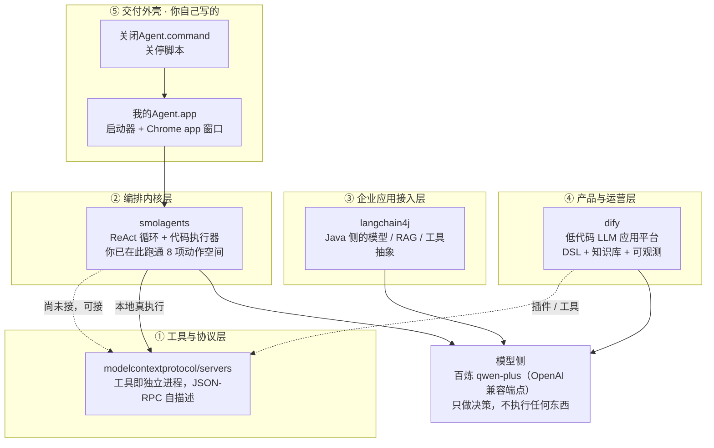

一句话读法：**模型只负责"想"，四份代码分别负责"怎么想（smolagents）""用 Java 怎么接（langchain4j）""不懂代码的人怎么把它做成产品（dify）""工具怎么标准化（MCP servers）""怎么让别人双击就能用（你的 App 外壳）"。**

### 1.2 四仓归属表

| 仓库 | 体量 | 版本 / 来源 | 在链路里的节点 | 本机能不能跑 |
|---|---|---|---|---|
| `smolagents/` | 263 MB | `1.27.0.dev0`，git HEAD `96f33fa`(2026-10-06)，**editable 装在 `.venv`** | ② 编排内核 | **能**，已跑通（`my_ui.py` + 桌面 App） |
| `langchain4j/` | 56 MB | `1.23.0-beta33-SNAPSHOT`，tar 解出、无 `.git` | ③ Java 接入层 | 源码可读；编译需 `jdk17`+`mvn39`（已装在 `~/tools`，见 3.8） |
| `dify/` | 166 MB | tar 解出、无 `.git`；`api` 60 MB + `web` 83 MB | ④ 平台层 | **未部署**：`docker/.env` 不存在，`SECRET_KEY=` 空 |
| `servers/` | 5.8 MB | git HEAD `ef9808f`(2026-10-24) | ① 工具/协议层 | **未安装**：无 `node_modules`，且要求 Node ≥ 24（本机 v22.20.0） |

### 1.3 本机实际拓扑（谁在哪个端口上）

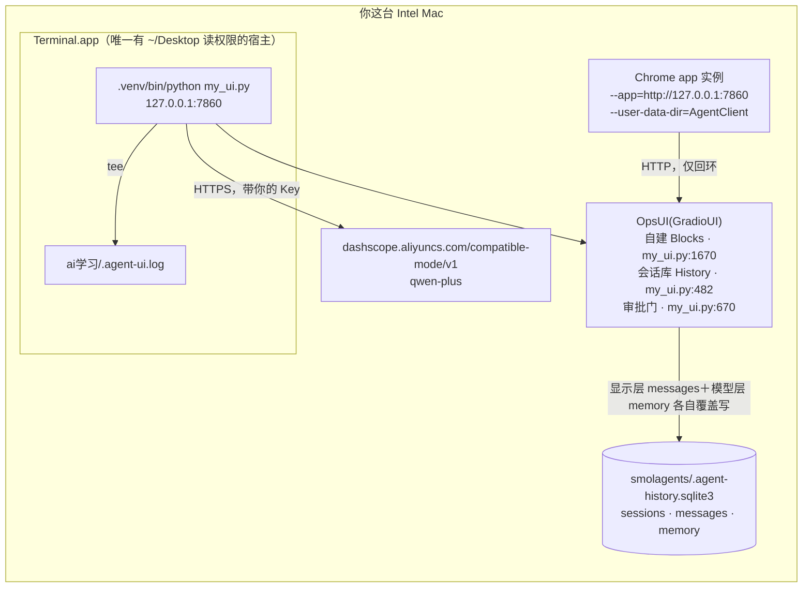

要点三条，都不是设计上的浪漫选择，是被系统约束逼出来的：

1. **服务只绑 `127.0.0.1`、`share=False`**（`smolagents/my_ui.py:1751-1752`，v1.1 前在 `:70-72`）。框架默认是 `share: bool = True`（`smolagents/src/smolagents/gradio_ui.py:422`）——照默认调用会把带着你百炼 Key 的 agent 变成 `gradio.live` 公网链接。
2. **冷启动必须让 Terminal 动手**：macOS 的 TCC 不允许"由 `.app` 直接拉起的进程"读取 `~/Desktop` 下已存在文件的内容，`.venv/bin/python` 由 `.app` 直接起会 EPERM 起不来（原因记在 `我的Agent.app/Contents/MacOS/launcher:4-7`）。副作用：每次冷启动多一扇日志终端窗口。
3. **窗口用独立 Chrome profile**（`~/Library/Application Support/AgentClient`），所以你日常 Chrome 的标签页、扩展、登录态完全不参与，也不会被接管。

### 1.4 建议的阅读顺序

1. 你自己那 3 个 Python 文件（第 6 章）——最短路径看清"一个 agent 由哪几块拼成"。
2. `smolagents` 内核（第 2 章）——唯一一份你已经在跑的代码，值得读到行号级。
3. `servers`（第 5 章）——把"工具"从函数升级成协议，概念量最小、收益最大。
4. `langchain4j`（第 3 章）——回你的主栈，看同一套抽象在 Java 里怎么落（`AiServices` 的动态代理值得精读）。
5. `dify`（第 4 章）——平台层，看工程性部分（多租户、DSL、可观测、异步 worker）而不是算法。

---

## 2 smolagents —— 编排内核，"用代码当动作空间"

### 2.1 功能定位

让 LLM 用"写 Python 代码"的方式思考和行动的**最小 Agent 循环引擎**（官方口号 "Agents that think in code!"）。它不是什么都管的框架：核心循环一千行左右，可整份读完。

### 2.2 解决了什么问题

| 对手 | 它的问题 | smolagents 的回答 |
|---|---|---|
| LangChain 式重编排 | 抽象层太多，查一个 bug 要穿七层代理 | 一个 `MultiStepAgent` 基类 + 两个子类，循环骨架一屏看完（`agents.py:540-611`） |
| 原生 function calling | 每步只能吐一个 JSON 调用，多步组合靠模型反复往返，token 浪费且做不了中间计算 | `CodeAgent` 一步 = 一段程序，里面可以循环、判断、串多个工具（`agents.py:1505`、`agents.py:1715-1719`） |
| 通用"agent 平台" | 看不见链路，出问题只能猜 | 每一步是 `TaskStep` 对象，`agent.memory.steps` 可逐条打印（`my_agent.py:78-82` 就是这么自查的） |

### 2.3 模块地图

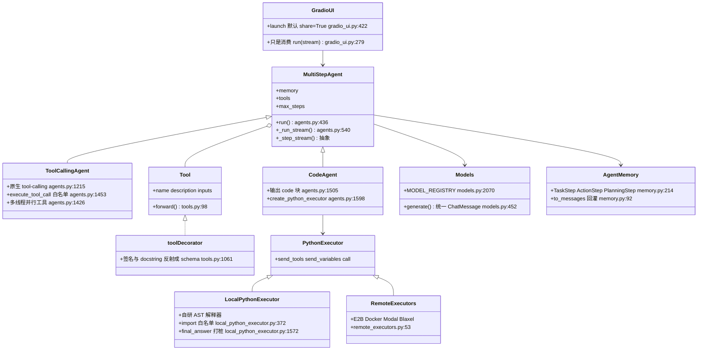

**Agent 即工具**：`_setup_managed_agents`（`agents.py:369-387`）给子 agent 填上 `name/description/inputs/output_type`，于是子 agent 本身就是一个 Tool 塞进父 agent 的工具表——多 agent 复用单 agent 的全部机制，**没有第二套路由代码**。所谓 "handover" 只是提示词约定（system prompt 里列出子 agent 名字），不是运行时特性。

### 2.4 一个 step 的真实链路（序列图）

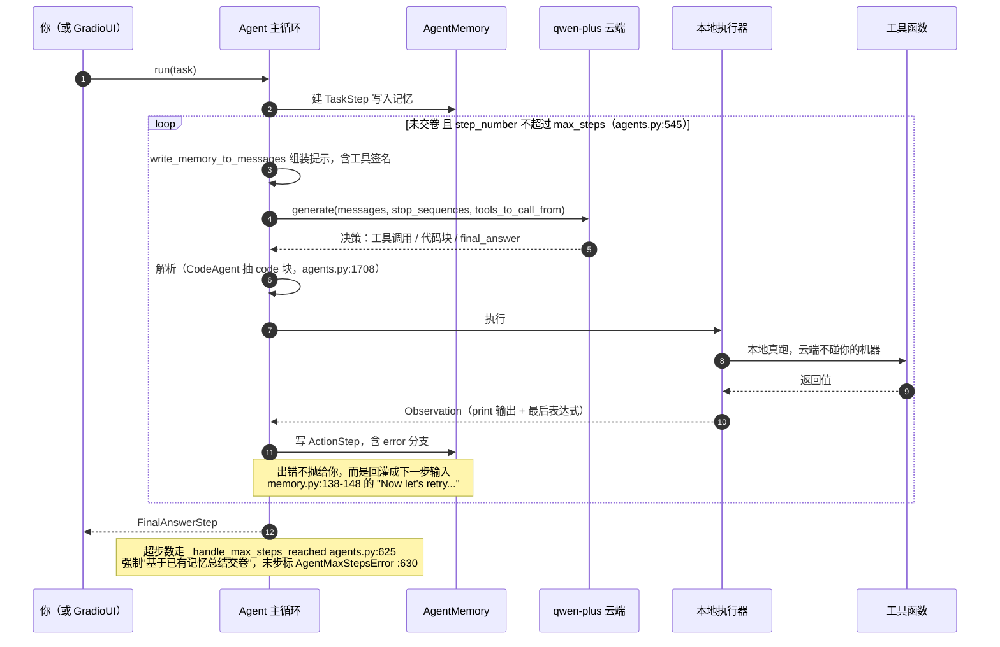

这条链路里最值得记住的一点：**云端只产生文本，所有副作用都在你机器上执行**——这也是"能不能让 agent 直接读我自己那个面板 URL"是数据出域问题、而不是技术难题的原因。

### 2.5 状态机

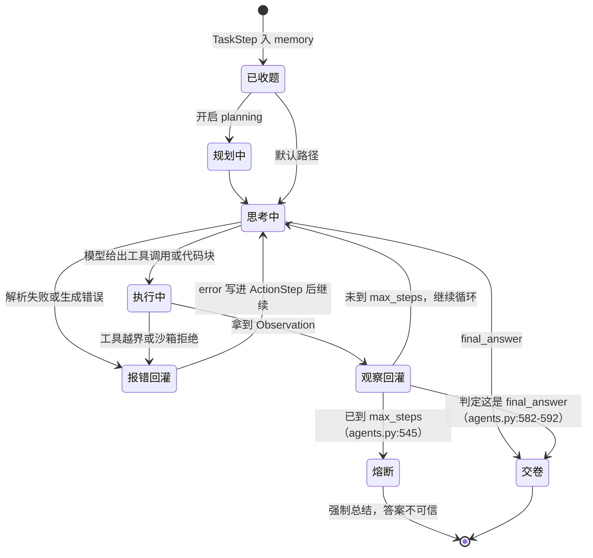

### 2.6 难点与采用的手段

| 难点 | 具体表现 | 实际手段（代码位置） |
|---|---|---|
| 代码动作空间的**安全边界** | 模型写的 Python 在你机器上跑，等于把 shell 交给它 | 自研 AST 解释器逐节点求值（`local_python_executor.py:1583`），不走真 `eval`：import 白名单树 `:372`/`:1309`（拒绝文案 `:1317`）、未注册函数禁调 `:859`、builtins 受限 `:906-908`、dunder 调用白名单 `:910-917`、模块属性递归裁剪 `get_safe_module:1271`、超时 `:285` + 操作计数防死循环 |
| 本地沙箱**不是**真沙箱 | 框架自己在注释里承认不可信代码要换后端（`local_python_executor.py:1692-1693`） | `create_python_executor`（`agents.py:1598-1618`）按 `executor_type` 分发 local / e2b / docker / modal / blaxel；`PythonExecutor` 抽象只有 3 个方法（`local_python_executor.py:1677-1685`），远端只是多包一层生命周期（`remote_executors.py:53`） |
| 工具签名怎么让模型看懂 | 模型必须知道参数名、类型、必填 | `Tool.to_code_prompt`（`tools.py:258`）把工具渲染成"函数定义 + docstring"塞进 system prompt；远端执行时用 `get_tools_definition_code`（`tools.py:1335`）生成真实 `import` 代码注入沙箱 |
| 模型**不守规矩** | 吐出不存在的工具名、把 JSON 当字符串、不给闭合标签 | 白名单校验直接拒（`agents.py:1467`：`Unknown tool xxx, should be one of: ...`）；文本里正则抽 tool_calls（`models.py:583`）；参数是字符串就 `parse_json_if_needed`（`agents.py:1334`）；闭合标签缺失就手动补（`agents.py:1693-1695`）；`final_answer = x` 误赋值被正则改写（`local_python_executor.py:332`） |
| 怎么"跳出"深层循环交卷 | 代码可能嵌在函数第 5 层里 | `final_answer` 注册时只是普通工具（`agents.py:402` `setdefault`），本地执行被打桩成抛 `FinalAnswerException`，它继承 `BaseException`——**防被用户代码里的 `except Exception` 吞掉**（`local_python_executor.py:1572-1578`） |
| token 成本看不见 | 排障时不知道上下文涨在哪 | `Monitor.update_metrics`（`monitoring.py:100-117`）打印的是**本次 run 的全生命周期累计**（`run()` 开头 `monitor.reset()`，`agents.py:480`）；**单步真实值**在 `ActionStep.token_usage`（`agents.py:1323`、`agents.py:1697`），网页那行读的是后者。两个口径混用会得出错误结论 |
| 流式体验 | 长思考期间界面空白 | `stream_outputs=True` 时 `_run_stream` 变生成器逐段 yield，模型层吐 `ChatMessageStreamDelta`，用 rich `Live` 边生成边刷（`agents.py:1665-1673`） |
| agent 复用与分享 | 调好的 agent 想存档 / 上线 | `save` / `push_to_hub` / `from_folder`（`agents.py:892`/`1160`/`1118`），反序列化走 `AGENT_REGISTRY` 白名单（`agents.py:1810`）防任意类实例化 |

### 2.7 亮点（这份代码里最值得偷师的四招）

1. **一步 = 一个程序**：动作空间从"选一个工具"升级为"写一段代码"，变量在 executor 的 `state` 里跨步存活（`send_variables`/`send_tools`，`agents.py:490-492`）。
2. **用控制流异常实现交卷**：一个 `BaseException` 子类把答案从沙箱最深处直接抛到主循环——简单、可靠、不怕用户代码捕获。
3. **子 agent 即工具**：多 agent 拓扑不引入新概念，编排能力全部复用单 agent。
4. **防御性补丁密度**：`fix_final_answer_code`、闭合标签回填、Observation 截断（`truncate_content`）——真实世界的 agent 有一半代码在处理"模型不听话"。

### 2.8 边界

它管**循环、工具、执行、记忆、序列化**，不管：RAG 索引（只做检索工具，不做索引管线）、会话持久化（`memory` 纯内存，落盘靠手工 `save`）、工作流可视化 / 低代码 DAG、模型网关与限流计费（LiteLLM 只是可选适配器）。定位是"嵌进更大系统的那颗芯"，不是对外发布的成品。

---

## 3 langchain4j —— 你的主栈上，同一件事的 Java 写法

### 3.1 功能定位

JVM 生态里"把 LLM / RAG / 工具调用接进 Java 应用"的惯用库。README 自陈目标是 *simplify integrating LLMs into Java applications*，并强调它**不是** LangChain-Python 的移植（`langchain4j/README.md:19`、`:38-43`）。

### 3.2 解决了什么问题

20+ 模型供应商、30+ 向量库的 API 各家不同；在企业里换一家模型供应商约等于改一遍业务代码。langchain4j 把差异吸进 provider 模块，业务侧只依赖 `langchain4j-core` 的接口。

**为什么你的组合里必须有它**：smolagents 让你看懂 agent 内核，但生产落地点在 Spring/Quarkus；这一份是"明天就能带进工作"的那一半。两份代码的抽象（Tool / Memory / Agent）正好互相印证。

### 3.3 模块地图与依赖方向

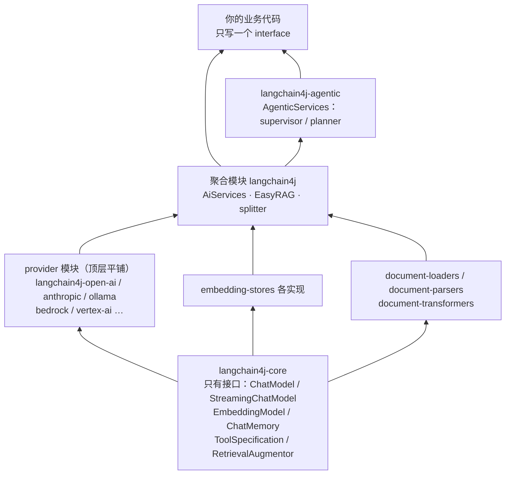

一个和直觉不一样的点：**没有 `model-providers/` 这个目录**，provider 就是仓库根下平铺的顶层模块。根 `pom.xml:7` 版本 `1.23.0-beta33-SNAPSHOT`。core 关键接口：`ChatModel.java:34`、`StreamingChatModel.java:41`、`EmbeddingModel.java:39`、`ChatMemory.java:21`、`ToolSpecification.java:19`、`RetrievalAugmentor.java:20`、`ChatMemoryStore`（持久化 SPI）。

### 3.4 AiServices 的运行时魔法（序列图）

"一个 Java 接口 = 一个会调工具的 agent"，代码里只有一处魔法：JDK 动态代理。

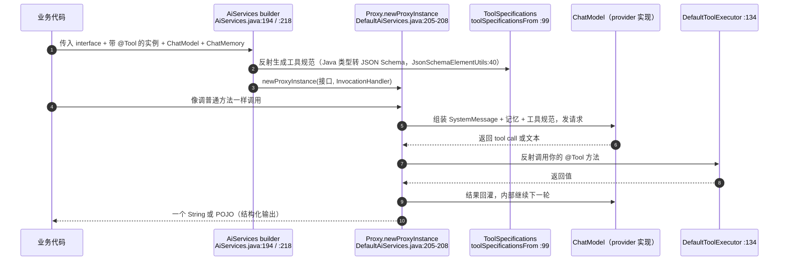

**`@MemoryId`**（`core/.../MemoryId.java:19`）让同一个 agent 实例按参数值分会话记忆——多用户场景不用自己搭 map。

### 3.5 RAG 管线（活动图）

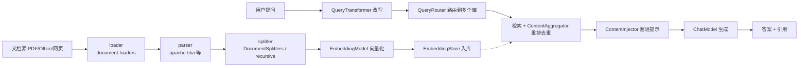

入口 `DefaultRetrievalAugmentor.augment()`（`langchain4j-core/.../rag/DefaultRetrievalAugmentor.java:169`），四个阶段组件在同文件 `:125-128`。**每个方框都可替换**——这是它和 dify「知识库黑盒」最大的区别：这里你能亲手换掉重排策略。

### 3.6 难点与手段

| 难点 | 实际手段 |
|---|---|
| 反射密集，GraalVM 原生镜像不友好 | 兼容工作放在外部 `quarkus-langchain4j` 扩展里做，本仓库只保证接口稳定 |
| 一个接口 N 家实现，能力不齐（流式 / 工具 / 视觉 / 结构化） | core 用 `Capability` 枚举显式声明能力，业务侧可探测后降级 |
| Java 类型 → JSON Schema（泛型、嵌套 record、可选性） | `internal/JsonSchemaElementUtils.java:40` 集中处理 |
| 上下文窗口与记忆膨胀 | `ChatMemory`（`:21`）+ 窗口/条数驱逐策略，持久化走 `ChatMemoryStore` SPI |
| 供应商鉴权 / 超时 / 重试差异 | provider 各自实现 `ChatModel`（范式见 `langchain4j-open-ai/.../OpenAiChatModel.java:55`），HTTP 客户端也抽成独立模块 `http-clients/` |

### 3.7 亮点

1. **接口即 SDK**：不写继承、不写装配，一个 interface + `@Tool`/`@SystemMessage`/`@MemoryId` 就长出 agent。
2. **策略全链路可换**：`retrievalAugmentor` / `tools` / `toolProvider` 均可 builder 注入（`AiServices.java:419`、`:537` 附近）。
3. **`langchain4j-agentic`**：`AgenticServices` 提供 supervisor / planner 显式编排，正好补上"smolagents 那种自动循环"与"我想要的可控图"之间的中间档。

### 3.8 本机实际状态（当场查过，纠正一条过期结论）

- 默认 `java -version` 落到 **JDK 8**（1.8.0_201，`/Library/Internet Plug-Ins/...`），但 `~/tools/jdk-17.0.20.1+1/Contents/Home/bin/java` 是 **17.0.20.1**，`~/tools/apache-maven-3.9.16/bin/mvn` 也在；`~/.zshrc:111` 有 `jdk17()`、`:113` 有 `mvn39()`。
  → **能编译**，前提是每条命令前先 `jdk17`（parent pom 要求 `<java.version>17</java.version>`，`langchain4j-parent/pom.xml:39`）。
- `langchain4j-core/target/classes` 里有 **648 个 class 文件**（tar 包自带的 CI 产物），说明这份快照本身构建过；`~/.m2` 无 `dev.langchain4j` 缓存。
- 仓库里**没有 examples 目录**（官方示例在独立的 `langchain4j-examples` 仓库，`README.md:64-70`）。本地最省事的入手点是 `langchain4j-easy-rag`（一行 API 完成摄取 + 检索）。
- 建议首次编译：`mvn39 -pl langchain4j-core -am -o compile`（先离线，避免拉全量依赖）。【待补：本机首次联网编译的实际耗时与失败点】

## 4 dify —— 不是框架，是"把 LLM 应用做成资产"的平台

### 4.1 功能定位与本质差别

框架给你库和抽象，**Dify 给你一个产品**：带持久化、多租户权限、分发（API Key / 内嵌 WebApp）、可观测的完整运行时。你写的东西是 YAML DSL 和配置，不是代码。它解决的问题是"不会写代码的人如何把提示词 / 知识库 / 工作流沉淀成可发布、可监控、可迭代的资产"。

### 4.2 组件与部署视图（这份代码的真实构成）

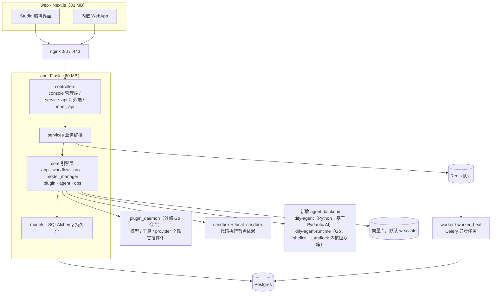

`docker/docker-compose.yaml` 里 `services:` 共 **47 个**，但只有 **13 个常驻**（`api, web, worker, worker_beat, redis, nginx, plugin_daemon, sandbox, local_sandbox, agent_backend, agent_ssrf_proxy, ssrf_proxy, init_permissions`），其余 34 个用 `profiles:` 门控（数据库二选一、20 多种向量库、knowledge_fs 系列）。默认拉起哪几个由 `docker/.env.example:303` 决定：`COMPOSE_PROFILES=${VECTOR_STORE:-weaviate},${DB_TYPE:-postgresql},collaboration` → 实际约 **16 个容器**常驻，对外只开 nginx 的 80/443（`docker-compose.yaml:980`）。

### 4.3 一次 chatflow 请求的调用链（序列图）

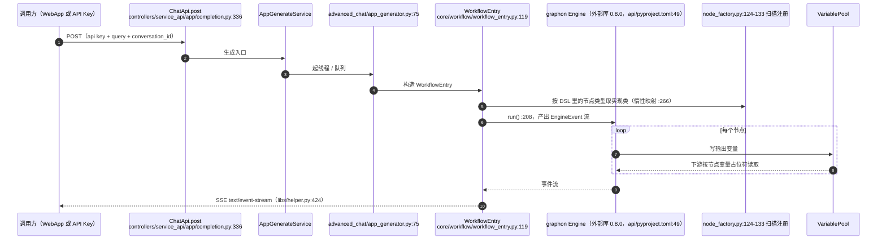

### 4.4 工作流活动图（并行 / 迭代 / 人工介入）

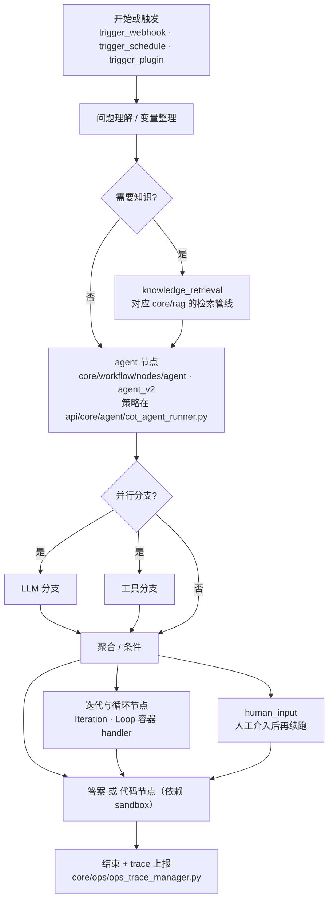

`api/core/workflow/nodes/` 下实测存在的节点族：`agent`、`agent_v2`、`datasource`、`human_input`、`knowledge_index`、`knowledge_retrieval`、`trigger_plugin`、`trigger_schedule`、`trigger_webhook`。注册方式很 Java 味：**`pkgutil.walk_packages` 遍历导入，节点类在装饰器里自注册**（`api/core/workflow/node_factory.py:124-133`），再由 `@lru_cache` 的 `register_nodes()` 汇总成类型映射表（`:266` 附近）。加一个节点 = 加一个文件，不改引擎。

### 4.5 难点与手段

| 难点 | 实际手段（证据） |
|---|---|
| 多租户隔离 | `api/models/account.py` 的 `Tenant` 体系（`:165` 附近可见 `TenantStatus`），业务对象一律挂 `tenant_id` |
| RAG 检索质量 | `core/rag/` 拆成 `extractor → index_processor → splitter → rerank → data_post_processor → datasource/vdb 工厂`，含双索引（parent-child）与 `summary_index` |
| 图执行引擎与业务解耦 | 引擎被抽成独立库 **graphon==0.8.0**（`api/pyproject.toml:49`），dify 侧只做节点实现与事件翻译 |
| 模型 / 工具可插拔 | 全走 `plugin_daemon` 外部进程 + `core/plugin/` HTTP client；出站请求经 `ssrf_proxy` 隔离 |
| 长任务与流式 | Celery `worker` / `worker_beat` 承担异步；SSE 出口 + 中断 API（`completion.py:490` 附近 `ChatStopApi`） |
| 版本升级与配置面 | 47 服务里 34 个 profile 门控；`.env.example` 变量近 300 项 |
| 代码执行的安全 | 独立 `sandbox` 服务；新增 `dify-agent-runtime` 用 **Landlock** 做内核级沙箱（`dify-agent-runtime/README.md:1-12`、`internal/landlock`） |
| 可观测 | `core/ops/ops_trace_manager.py` 统一 trace（Langfuse / Opik 等）+ `extensions/ext_otel.py` OpenTelemetry |

### 4.6 亮点

1. **应用即 DSL**：`api/services/app_dsl_service.py:187 import_app` / `:945 export_dsl`——一个对话应用能被导出成 YAML，进 Git、能 review、能跨环境搬。这是"把 prompt 工程变成工程资产"的落地形态。
2. **节点自注册**：新增能力不碰引擎。
3. **官方把 agent 沙箱下沉到内核层**：`dify-agent`（Pydantic AI）+ `dify-agent-runtime`（Go + Landlock）+ compose 里的 `agent_backend`（`docker-compose.yaml:827`，专用网络 `:1502`）。这条线和你 smolagents 里的执行器抽象是**同一个问题的两种答案**，对照读最值。

### 4.7 边界

不适合：深度定制算法（引擎外置，改执行语义成本高）、轻量私有化（Postgres + Redis + Celery + 多进程是硬依赖）、没有 `sandbox` 服务时用代码节点。

### 4.8 本机实际状态

- `docker/.env` **不存在**，只有 `docker/.env.example`，其中 **`:33 SECRET_KEY=` 是空值**，不填 api 起不来。
- Docker Desktop 装了，但 VM 是否自启必须**当场** `docker info` 查，不能凭记忆断言。
- 所以这份仓库目前的真实用途是**纯源码阅读**。部署前置三项：`cp .env.example .env` + 填 `SECRET_KEY` + 确认镜像源（国内直连 Docker Hub 可能卡，改 `daemon.json` 的 `registry-mirrors` 会影响你以后所有镜像）。**这一步等你点头我才动**（约 3~5 GB 下载、16 个常驻容器、占 80 端口）。

---

## 5 modelcontextprotocol/servers —— 把"工具"从函数升级成协议

### 5.1 定位与解决的问题

MCP 官方**参考实现**仓库（`README.md:3` 明确警告：是教学示例、不是生产方案）。它解决的是集成平台最经典的 **M×N 坍缩**：

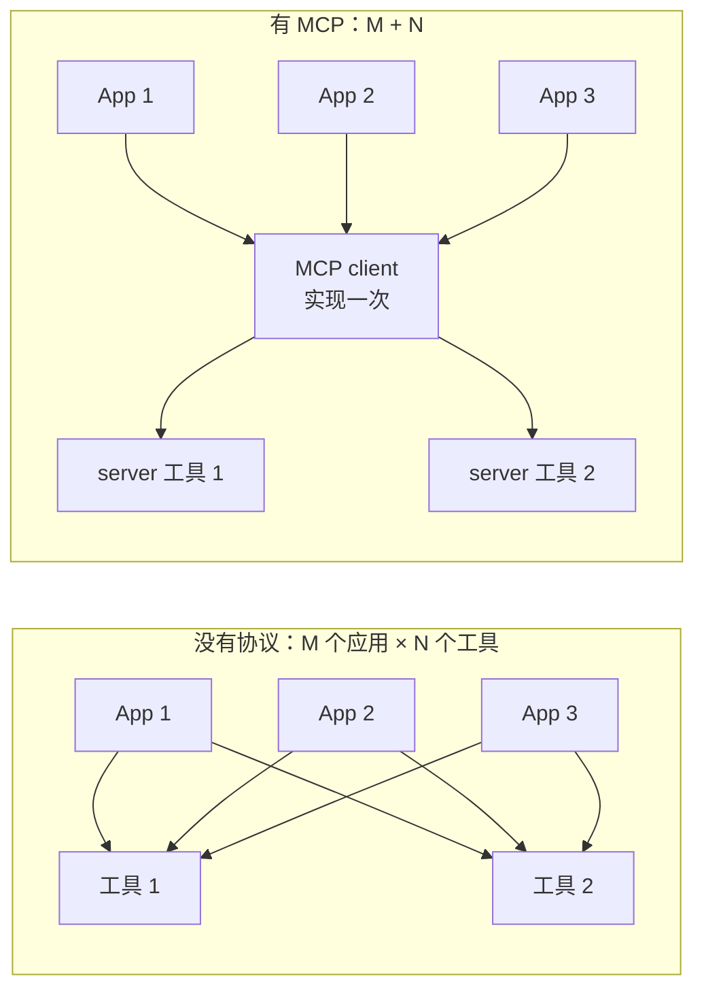

`README.md:12-23` 列了 10 个语言的官方 SDK，**含 Java SDK**——对你主栈最亲近的一条路。

### 5.2 这份代码的真实构成（一个和直觉不符的点）

`src/` 下**只剩 7 个 server**，不是几十个：`everything`、`fetch`、`filesystem`、`git`、`memory`、`sequentialthinking`、`time`。旧的 GitHub / GitLab / Postgres / Slack / Puppeteer 等 **13 个已"毕业"迁到 `servers-archived`**（`README.md:39-53`）。而且 `fetch` / `git` / `time` 已是 **Python** 实现（如 `src/fetch/src/mcp_server_fetch/server.py`），所以这个仓库现在是 TS + Python 混合；`package.json:11-13` 的 workspaces 是 `src/*`。

### 5.3 三个核心原语（用例视角）

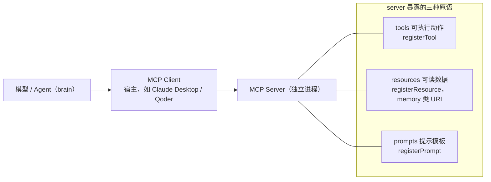

| 原语 | 位置 | 长什么样 |
|---|---|---|
| tools | `src/memory/index.ts:780`；`src/filesystem/server.ts:281` 起 14 处；`src/fetch/.../server.py:440` | `server.registerTool("create_entities", { inputSchema: z.object(...) })`；Python 侧是 `@server.tool(name=..., annotations=...)` |
| resources | `src/memory/index.ts:1134`（URI 定义在 `:729`），`:1166` 起支持 `resources/subscribe` 订阅通知 | `memory://knowledge-graph`，mimeType `application/json` |
| prompts | `src/everything/prompts/simple.ts:11` | `server.registerPrompt` |

`src/everything/server/index.ts:180-182` 一次把三类原语全注册了，是最好的"全家福"入门文件。

### 5.4 一次工具调用的序列图

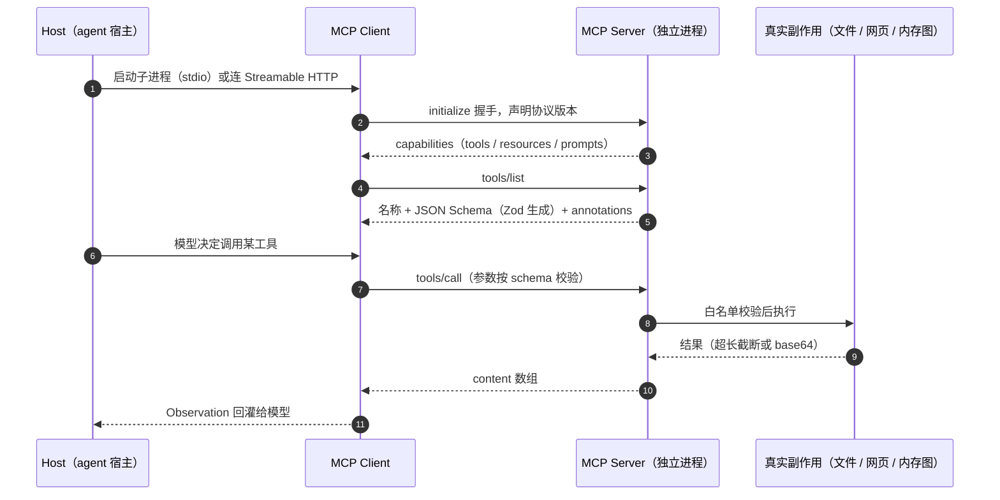

传输在 `src/everything/index.ts:22-41` 按 argv 动态 import 三种：`stdio` / `sse` / `streamableHttp`（HTTP 默认端口见 `transports/sse.ts:146`）；其余 TS server 走 stdio（`src/filesystem/index.ts:116-131`）。

### 5.5 难点与安全边界（这一节是精华）

| 难点 | 实际手段（证据） |
|---|---|
| 路径白名单怎么做到不被绕过 | `src/filesystem/index.ts:37-61` 启动时 `realpath` 解析符号链接（防 macOS `/tmp` 逃逸与 symlink 攻击）；`src/filesystem/path-validation.ts:11-105` `isPathWithinAllowedDirectories` 拒绝 null 字节、前缀匹配必须落在分隔符边界（防 `foo` 命中 `foobar`）；写操作用 `O_NOFOLLOW` 拒写被换入的符号链接 |
| roots 动态变更时的竞态 | `src/filesystem/server.ts:226-250` 用 barrier 包装 `registerTool`，白名单刷新期间的调用会等新名单，不会用旧权限执行 |
| SSRF（让服务器替你去访问内网） | `src/fetch/.../server.py:127-136` 判 `ip.is_global`，`:139 _refuse_private_destination` 拦私网 / 回环，**每一跳重定向都重查**（`:340-341`），并强制 robots.txt |
| 客户端怎么知道这个工具危不危险 | 每个工具带 annotations 四元组 `readOnlyHint / destructiveHint / openWorldHint`（`src/memory/index.ts:793-798`、`src/fetch/.../server.py:445-450`），宿主据此决定要不要弹确认 |
| 大输出撑爆上下文 | `fetch` 工具 `max_length` 上限 999999 字符（`server.py:467-470`）；`filesystem` 的 `list_directory` 有 `maxBytes`/`maxFiles` 截断，`read_media_file` 返回 base64（`server.ts:324`） |
| 协议版本迭代 | 同一个 `createServer()` 工厂同时服务 2025-era（`initialize` 握手）与 2026-07-28（`server/discover` 无握手）两代协议 |

### 5.6 亮点

1. **Zod → JSON Schema**：`@modelcontextprotocol/server ^2.3.1` + `zod ^4.2.0`（`src/memory/package.json`），`filesystem/server.ts:44` 用 `z.object(shape).meta({$schema: JSON_SCHEMA_DIALECT})` 强制产出 draft schema——**类型即契约**。
2. **`createServer()` 工厂 + `isEntryPoint` 守卫**：测试能在进程内驱动真实启动路径，而不是 mock。
3. **参考实现的身份**：它不追求功能最多，而是"任何语言的 SDK 都照这个写法对齐"，所以**读码收益高于使用收益**。

### 5.7 同一片天地的三种工具写法（对你最重要的一张表）

| 维度 | `langchain4j @Tool` | smolagents `@tool` / `Tool` | MCP `registerTool` |
|---|---|---|---|
| 形态 | 进程内方法注解 | 进程内函数 / 类 | **独立进程 / 独立服务** |
| 契约来源 | 反射 Java 类型 → JSON Schema | 反射 Python 签名 + docstring | Zod / Pydantic → JSON Schema，协议自描述 |
| 跨语言 | 否（同 JVM） | 否（同进程） | **是**（JSON-RPC） |
| 复用粒度 | 代码复用 | 代码复用 | **协议复用** |
| 权限模型 | 能调这个方法就有权限 | 白名单 + 你自己写的 `guarded()` | allowed directories / roots / annotations / SSRF 代理 |
| 适合 | 企业内部业务动作 | 框架内快速试验 | 想把工具开放给任意宿主或团队 |

### 5.8 本机实际状态

`node_modules` **不存在**（还没 `npm ci`）；本机 node v22.20.0，而 `src/memory/package.json:16` 要求 `"node": ">=24"`。现存 7 个 server **都不需要外部凭据**，外部依赖只是 git / time / fetch 需要 Python + `uvx`。**装不装等你点头**（会占一整棵 `node_modules`）。

---

## 6 你自己写的那部分 —— 从"跑通"到"别人能双击使用"

这部分不是上游代码，但它是这套语料的**交付层**，踩到的坑信息量最大。

### 6.1 `smolagents/my_coding_agent.py`：五只手 + 三圈边界（256 行）

设计原则写在文件头（`:7-11`）：**边界写在代码里，不靠 prompt 求模型自觉**。

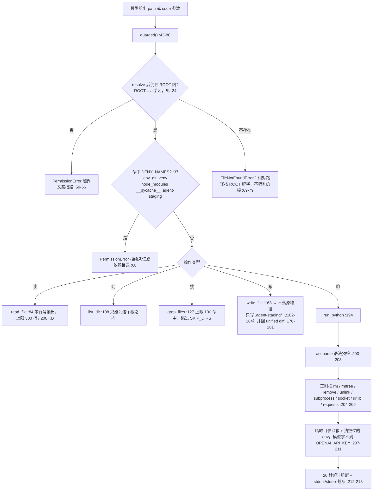

三圈闸门的实质：**路径收敛**（`guarded`）、**写操作只暂存**（`.agent-staging/`，要你自己 `cp` 才生效；`.agent-staging` 同在一进的拒绝名单里，所以 agent 读不回自己刚暂存的副本——这个闭环是**定性过的**，理由写在 `my_coding_agent.py:33-36`）、**执行环境降级**（空 env + 熔断 + 静态禁词）。

**v1.8 在这一层做的是"说什么"，不是"判什么"（P0-a／P0-b／P0-c，工单 #40）。** 起因是 `ai学习/.agent-ui.log` 里 2026-11-03 21:06 那轮（17,344 B / 207 行）：旧越界文案只说「不在白名单根目录之下」，模型下一步写的是「请联系系统管理员调整权限」——本机没有这个开关，那是它自己补出来的路径；旧 `FileNotFoundError` 只给拼接后的结果，模型不知道自己把 `人生/` 接到了哪个根上，于是**同名同参**又把 `list_dir('人生/')` 打了一遍。现在 `guarded()` 抛出的两条文案里写明：这一整套工具只服务 ROOT 这一个根、**动作空间里没有删除/移动/重命名**、相对路径的口径、以及「不要用同一个参数再打一遍」（`:59-66`、`:69-79`）；`list_dir`／`write_file` 的 docstring 各补一句能力穷举（`:109`、`:112`、`:165-166`）。**收敛逻辑、`DENY_NAMES`、`must_exist` 的分支顺序一字未动**（`:53` 那句注释就是这条的自我声明），判定面还是原来那三圈。`build_agent()` 里那段 `description`（`:236-247`）也一并写全了，但要说死：**顶层 `ToolCallingAgent` 的 `description` 模型读不到**——它只在 `describe()` 里用，而 `describe()` 服务于被上级调用的 managed agent（`agents.py:1005`）；实测 `'读代码' in agent.system_prompt` → **False**（`my_agent.py:81` 同一条注释）。真正进模型上下文的是**每个工具的 docstring**，所以起作用的是上面那几处。这一层动了之后 `my_coding_agent.py` **208 → 256 行**（8,889 → **13,367 B**，`diff` **+58 / −6**、9 个 hunk），CLI 侧动作数从题 B 的 8/7 步降到 **2/2** 步（实测见 `验收脚本/v1.8/run/v18_p0abc_live.out`）。

一个必须诚实记录的局限：`run_python` 的禁词是**正则黑名单**，属于"挡住无意"而不是"挡住有心"。真正的安全边界是 smolagents 自己承认的那句话——本地执行器非安全沙箱，不可信代码要换 E2B/Docker（`local_python_executor.py:1692-1693`）。目前这套只在"我自己的目录 + 我自己盯着"的前提下成立。

### 6.2 `smolagents/my_agent.py`：合并成一个 agent，而不是开第二个窗口

`my_agent.py:8` 直接 `from my_coding_agent import ...`，把 5 个自写工具与 2 个业务工具（`MaxDrawdownTool:33`、`AnnualizedVolTool:53`）挂进同一个 `ToolCallingAgent`（`:71-90`），动作空间 8 项（含框架注入的 `final_answer`）。v1.8 起这份文件 **111 行 / 5,410 B**（v1.7 时 82 行 / 2,879 B，+29 行全在 `PLANNING_INTERVAL` 那段账和 `description` 上）。

- **指标口径写在代码里**，不是行业黑话：最大回撤 = 相对历史峰值的最大跌幅，同时回吐发生区间（`:39-50`）；年化波动率 = 日收益率标准差（样本方差，分母 n-1）× √252（`:59-66`）。
- 一个踩过的坑：`my_coding_agent.py` 原本在模块级 `agent = build_agent()`，导致 `import` 就顺手建了第二个 agent 并触发模型初始化；现在建 agent 挪进 `if __name__ == "__main__":`（`:252-256`），**import 无副作用**。
- 成本实测：工具从 2 个变 7 个后，单题累计 input token 从 **2,375 → 19,399**（同口径累计值）。工具变多 ≈ 提示词里的签名变多 ≈ 每步上下文更贵，**这不是免费的功能叠加**。
- **v1.8 在这里开了框架的"规划"（P0-4 的地基）**：`PLANNING_INTERVAL = 8`（`:30`）交进 `planning_interval=`（`:78`）。框架条件是 `step_number == 1 or (step_number-1) % interval == 0`（`agents.py:550-552`）——**第 1 步必出一份计划**，8 又和 `max_steps = 8`（`:75`）同高，所以**每题恰好一份、题内不重规划**（下一次落在第 9 步，循环够不着）。设成 `None` 就整刀关掉，回到 v1.8 之前。代价在同一道题上量过（`验收脚本/v1.8/run/v18_plan_probe.out`，**单题样本、只当量级看**）：关 **7.1s、in 5,260 / out 262**、2 个 `ActionStep`、`PlanningStep` 0 条；开 **40.1s、in 13,591 / out 1,713**，其中**规划那一次单独** `in 1,188 / out 1,458`、**32.9s**（占满那 40.1s），计划正文 6,195 字符，后面每一步的 input 都被这段计划抬高（单步 `3,957 / 4,138 / 4,308` 对关着的 `2,463 / 2,797`）。屏上那一格怎么显示、批准卡在开工之前怎么拦，见 6.3.10。

### 6.3 `smolagents/my_ui.py`：交付外壳里唯一真正的"产品决策"（1,758 行）

#### 6.3.1 三条硬决策（v1.0 立的，v1.1、v1.2 沿用）

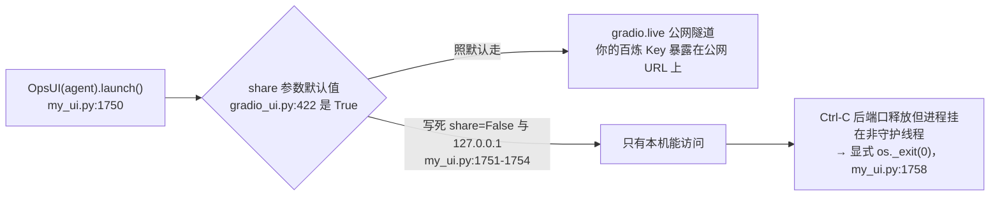

验证口径两条，缺一不可：日志里**没有** `gradio.live`；`lsof -nP -iTCP:7860 -sTCP:LISTEN` 只出现 `127.0.0.1`。

第三条是**结构性的**：不改上游一行源码。所有界面增强都写在 `OpsUI(GradioUI)` 子类里，`_stream_response` 自己维护那份内部列表、每次 `yield list(msgs)` 交副本给 gradio（`my_ui.py:1382`；v1.1/v1.2 是 `list(msgs) + [stats]` 在 `:310`，v1.3 把统计并进了步骤卡，见 6.3.5）。收益是上游升级时冲突面只有这一个文件；代价是 gradio 那套折叠语义你得自己摸清（见 6.3.2 的坑、6.3.4 里 v1.2 换壳踩的那几脚，以及 6.3.5 里 D4 那条 `ValidationError`）。

#### 6.3.2 v1.1 加的两层：成本上墙 + 真刹车

**成本卡。** 每步之后追加一条 `gr.ChatMessage`，数字写在 **`metadata.title`** 上：

```
📊 第 3/8 步 · 本题累计 in 12,345 / out 678 token · 本步 4.2s        （· 本步报错）
```

**v1.3 起这条独立卡不再单发**：一个 step 只出一张卡，上面那串数字并进了步骤卡的标题（`_step_card`，`:691-746`；标题拼装 `:724-729`，末行 `:740-743`），三档口径一字未改。下面这张表和"为什么写在 title 里"那条实测结论仍然照旧成立。

这不是审美选择，是被实测逼的：gradio 会把带 `metadata.title` 的消息折成组，**收起状态时正文根本不在 DOM 里**。第一版把数字写正文，界面上一个字都看不见。点开是三行明细，三个口径**写死不混**：

| 口径 | 取法 | 为什么单独一档 |
|---|---|---|
| 本步 | `cur[-1]` 的 `timing.duration` / `token_usage` | `Timing.duration` 可能是 `None`，必须 `or 0.0` |
| 本题累计 | 最后一个 `TaskStep` 之后的所有 `ActionStep` 求和 | `GradioUI` 默认 `reset_agent_memory=False`（`gradio_ui.py:310`），记忆跨题累积 |
| 进程累计 | `agent.monitor.get_total_token_counts()` | 与日志 `[Step N]` 逐位相符，用来证明前两个不是我自己算着玩的 |

顺带一个容易误判的点：卡里的"第 N 步"是**本题内**（`agents.py:543` 每次 `_run_stream` 置 1），控制台 `[Step N]` 是**进程内**（`monitoring.py:108` 的 `len(self.step_durations)`）。从第二题起这两个数**必然不同**，不是 bug。

**刹车。** 停止按钮本来就在（gradio 6.30 的 `stop_btn` 默认 `True`），缺的是"点了真停"。下图是 v1.1 立的链路——`_stream_response` 那层 `finally` 在 v1.2 换壳时**一字未改**搬了过来，但触发它的人变了（v1.2 的按钮是自建的，见 6.3.4）；v1.3 又搬了一次：**agent 挪进 worker 线程**，于是"关内层生成器"这一步只能跟着挪进那条线程的 `finally`（`:821-829`），`_stream_response` 的 `finally` 只剩三个动作——置放弃标记、`interrupt()`、结算待批（`:949-958`）：

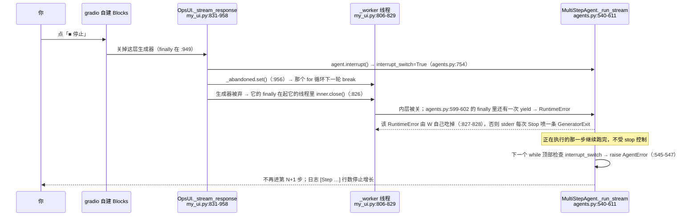

语义一句话：**stop 是在步边界停，不打断正在执行的那一步**。实测那条 `time.sleep(30)` 最终是被 `run_python` 自己的 20 秒沙箱超时掐掉的（日志 `Observations: 超时 20 秒，已杀掉`），不是被 stop 掐的。要瞬间掐断得动执行器，不在这条工单里。

停止之后服务照常用：`interrupt_switch` 由下一次 `run()` 在 `agents.py:470` 重置回 `False`，**不需要重启**。实测停完再问一题，1.22 秒出 `Final answer: 2`。

#### 6.3.3 D1：一行 `mkdir` 放错位置，整条执行工具就挂

`run_python` 拿 `ai学习/.agent-staging` 当 `tempfile.TemporaryDirectory(dir=…)` 的父目录（`my_coding_agent.py:178`），目录不存在就是裸 `FileNotFoundError`。原来那句 `STAGING.mkdir()` 写在 `if __name__ == "__main__"` 分支里，而 UI 的真实链路是 `my_ui.py:15 → my_agent.py:8 → from my_coding_agent import …`（v1.2 前那条 import 在 `my_ui.py:10`，更早 `:4`）——**import 不执行 `__main__`**。目录当时存在，只是因为历史上直接跑过一次 `my_coding_agent.py`，属于**靠巧合活着**。

v1.1 把它提到模块级（`my_coding_agent.py:26-28`），并成对复现验证：把目录挪开后，旧代码 `import 后目录存在: False` + `FileNotFoundError`，新代码 `True` + `run_python: 'exit=0\n42\n'`。

#### 6.3.4 v1.2 换壳：`ChatInterface` 换成自建 `Blocks`，多出一层 SQLite 显示库

v1.2 把界面从"框架给的默认形态"改成"侧栏 + 状态条 + 深色"。**agent 侧一行未动**，全部改动落在 `my_ui.py`（76 → 462 行）。链路现在是两条正交的：提问链路走 `_respond`，回看链路走 `History`，两者只在"消息列表"这一个数据结构上相遇。

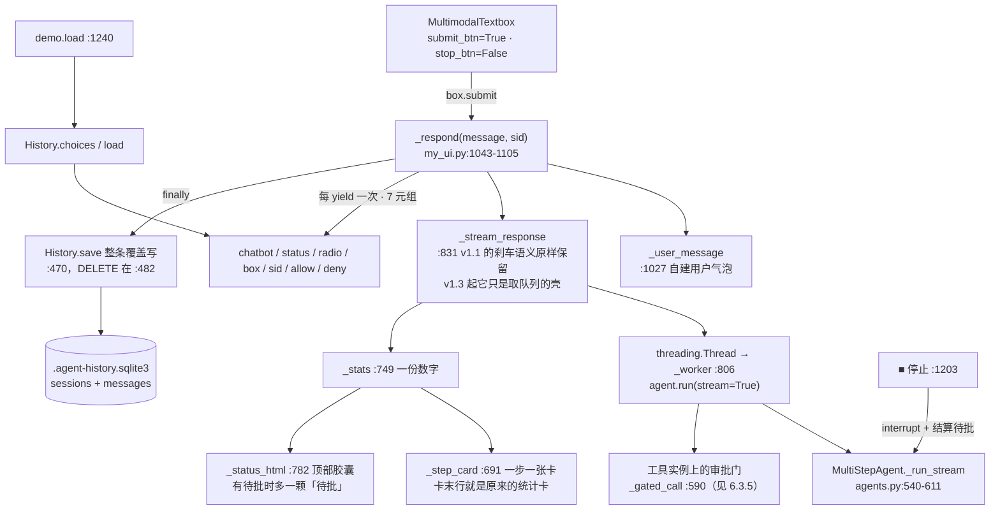

四个非显然的实现点，每一个都是实测撞出来的：

1. **为什么不能继续用 `gr.ChatInterface`**：它的 `_setup_events()` 在 `__init__` 里就跑完了（`chat_interface.py:265`），构造完之后**没有口子**往消息流旁边插侧栏、也没有口子把状态条提到输入框上方。所以 `create_app()`（`my_ui.py:1183-1241`）整体覆盖成 `gr.Blocks`，只继承 `GradioUI` 以复用它的 `agent` 装配与 `_stream_response` 上游实现。
2. **用户气泡没人拼了**：`GradioUI._stream_response` 交出来的一直只有 assistant 那一串，以前是 `ChatInterface` 替你补上用户那句；换成自建 Blocks 后屏幕第一行会凭空消失、库里也没有。**必须自己拼**（`_user_message()`，`:1027-1041`），而且只拼显示、不重跑 `_process_message`——那句会把上传文件真复制一份。
3. **gradio 自带的 stop 键在 Blocks 下是死的**：`MultimodalTextbox(stop_btn=True)` 那个按钮的取消链路只有 `ChatInterface` 会接（`chat_interface.py:371-372` 把按钮摘下来自己管）。实测在 `步数 7/8` 点它，照样跑到 `9/8` 才完。所以 `stop_btn=False`，刹车改由 `:1203` 的自建「■ 停止」→ `_stop()`（`:1115-1135`）→ `agent.interrupt()`，与 6.3.2 那条 `finally` 是**同一个开关的两个触发源**（v1.3 起这个触发源还要多结算一次待批，见 6.3.5）。
4. **刷新页面不重跑 `create_app`**：Radio 的 `choices` 还停在建应用那一刻的空表，实测重载后侧栏是空的——这恰好是 V3 要消灭的那个缺陷。解法是挂 `demo.load`（`:1240`，回调 `:1162-1180`）把库里的会话重新推一遍，并自动展开最新一条。v1.4 起这条回调**同时把 `sid` 指到那条会话**，见 6.3.6。

`History`（`:401-516`）管**三张表**：`sessions(id, title, created_at, updated_at)` 与 `messages(id, session_id, ord, role, content, meta, …)` 是显示层，v1.5 追加的 `memory(session_id PRIMARY KEY REFERENCES sessions(id) ON DELETE CASCADE, payload, updated_at)` 是模型层（见 6.3.7）。外键都带 `ON DELETE CASCADE`，`memory` 的 DDL 是 **additive** 的——老库直接被新代码多建一张表，v1.4 的代码反过来读新库也不碰它。五个约定值得记住：

| 约定 | 位置 | 为什么 |
|---|---|---|
| `DB_PATH` 用 `Path(__file__).resolve()` 而不是 cwd | `:30` | 启动器 `cd smolagents` 与否都落在同一个文件，避免"换个起法历史就看不见了" |
| `save()` 是**整条覆盖写**（先删后插全量） | `:470-491`，`DELETE` 在 `:482` | 半截停止的那次也落库；重复保存不会产生双份消息。所以调用方必须喂**完整列表**——v1.4 的 D5 修的就是这个前提（见 6.3.6）|
| 标题取首条 user 消息前 **28** 字，且只在仍是「新会话」时写；`updated_at` 每次存都刷 | `:477-478` 取值，`:488-491` 那条 `CASE WHEN title = '新会话'` | 侧栏一行放得下；重存不会把标题改掉；v1.4 修掉「有了标题就再也不刷新时间」的 D6 |
| `choices()` 按 `updated_at DESC` 取，上限 **50** 条 | `:453-458` | 不搜索、不分组、不分页——这是 v1.2 的已知边界 |
| `save_memory()` 是 `INSERT OR REPLACE`，**一条会话一行**（主键就是 `session_id`），返回存了多少字符 | DDL `:429`，方法 `:493-501`，读回 `:503-506` | 和 `save()` 同样是覆盖式，所以调用方给的必须是**整份** steps；返回字符数是为了把"记忆有多大"直接写进日志和断言 |

`meta` 列存的是 `gr.ChatMessage.metadata` 的 JSON（`role`/`content` 各自一列，`:474-479` 先用 `dataclasses.asdict` 把 dataclass 拍平成字典再拆），`load()` 拿它重建 `gr.ChatMessage`（`:467`），所以折叠卡、报错条这类带 `metadata.title` 的消息能原样贴回来。**但库里那两串字不等于模型记得的东西**——`messages` 是"屏幕上说过什么"，`memory` 才是"模型下一轮读到什么"，两份各自覆盖、各自落库（v1.4 之前只有前者，这就是当时"重启后模型答不记得"的根因，v1.5 补的是后者，见 6.3.7）。`reset_agent_memory` 仍为 `False`（见 6.3.2），所以同一会话内模型那一边的 steps 一直往上长。

深色壳（`DARK_CSS`，`:236-355`）分两类活：一类是 `:root` 变量同名覆盖（`--body-background-fill` 等，gradio 6.30 自己吐在根上的那批），另一类是**定点压制 gradio 硬编成白色的六个位置**——块标题 `rgb(255,255,255)`、secondary 按钮 `rgb(228,228,231)`、气泡底 `rgb(250,250,250)`、`layout="panel"` 下的 `.message-row`（user `rgb(255,247,237)` / bot `rgb(250,250,250)`）、折叠卡 `.thought-group`、页脚。前四个都是从浏览器 `getComputedStyle()` 里读出来的实测值，不是猜的。另外 `layout` 必须给 `"panel"`：默认 `"bubble"` 会把消息列按内容收缩，实测折叠卡只有 **353px**（容器 950px），这就是第一版截图里右边空一大片的原因。v1.3 在这段 CSS 里追加了审批相关的规则（`:288-298`：待批胶囊的描边、`#approve-btn` / `#deny-btn` 的配色），没有另起一个 CSS 块。


#### 6.3.5 v1.3：审批门套在工具实例上，agent 挪进另一条线程

V4（步骤卡片化）+ P0-2（工具执行前审批）同批。`my_ui.py` **462 → 850 行**（对 `.rollback/v1.2` 的 `diff`：+432 / −44），`my_coding_agent.py` **一字未动**（`cmp` 与 `.rollback/v1.2`、`.rollback/v1.3` 两份存档都一致）。功能面也没变：仍是 7 项工具、`max_steps=8`、`qwen-plus`、单会话 `7860`。

**门套在哪：`BaseTool.__call__` 的最后一行。** `tools.py:231-249` 的 `__call__` 收尾是 `return self.forward(*args, **kwargs)`，而 Python 查属性时**实例字典优先于类上的 `staticmethod`**——所以在实例上盖一个 `forward` 属性就能拦住执行，`__call__` 前面的入参校验和后面的 `output_type` 包装全都不受影响。套法见 `_install_gate`（`:565-588`）：`copy.copy(base)` 换一个新实例再盖（`:579`、`:586-588`），**不去改 `my_coding_agent.py` 里那批模块级 `@tool` 对象**。三处不显然的细节：

- `gated.__signature__ = inspect.signature(original)`（`:585`）。不保签名的话，`*a, **kw` 会把参数吞成一个元组，审批卡就写不出「要往哪写、写什么」。有了它，`bind_partial(*args, **kwargs).arguments`（`:593`）能把参数还原成字典——**展示用的和执行用的是同一份**，不是我先格式化再另算一遍。
- 幂等标记 `_opsui_gated`（`:577`、`:587`）。多个 `OpsUI` 实例（离线测试里反复建）不能把门套成两层：两层就是问两遍，点一次「允许」只解开外面那层，里面那条线程永远挂在 `wait()` 上。
- `_pending` 和 `_gate_lock` 挂在**类**上（`:530-531`），不是实例上。因为门守的是**进程里那一个 agent** 的工具，第一个实例装好门之后别人不再重装；队列若放实例上，就会出现「A 装的门把单子递给 A，屏上看单的是 B」——按钮永远不亮。

**只拦会动东西的两只手。** `GATED_TOOLS = ("write_file", "run_python")`（`:34`）；`read_file` / `list_dir` / `grep_files` 不弹审批，否则一次检索三连问要点三遍，比不加还慢。`final_answer` 也不拦——它是交卷不是副作用。

**为什么非得换线程。** 审批是**阻塞**的，而 gradio 是**同步往前推**那条流式生成器的：工具卡在 `forward` 里等点按钮 → 生成器 yield 不出审批卡 → 界面上根本没有「允许」可点 → 死锁。所以 v1.3 把 `agent.run(stream=True)` 挪进 `_worker` 线程（`:806-829`），事件塞 `queue.Queue`；`_stream_response`（`:831-958`）变成一条**只取队列**的壳，用 `q.get(timeout=0.25)`（`:862`）驱动。关键一点：**空转的那 0.25 秒也要走一遍渲染判定**（`:919-941`），否则待批卡要等下一个 agent 事件才画得出来——而下一个事件永远不来，因为 agent 正卡在这道闸上。

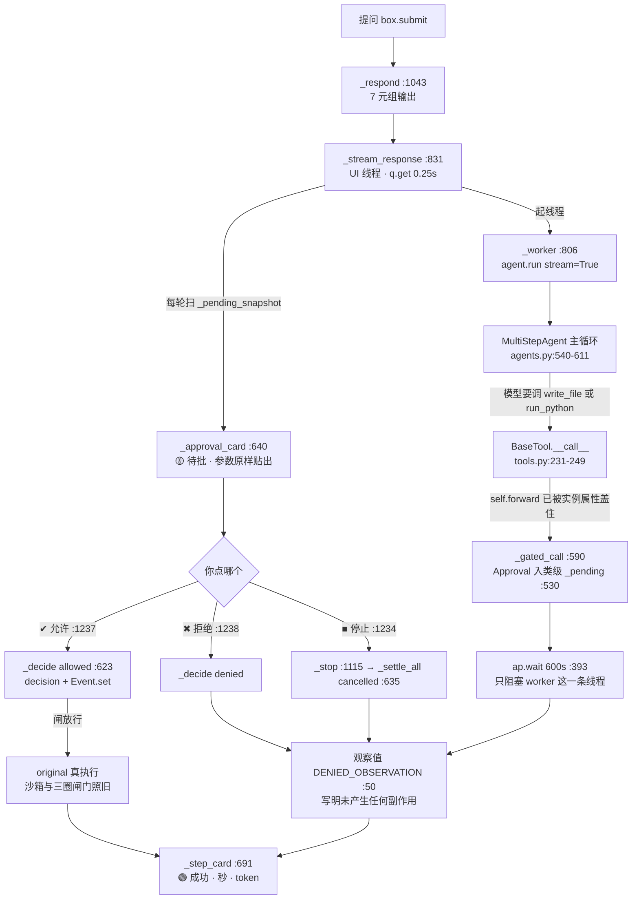

**一条流上现在有三种卡，身份存对象不存下标。** 流式思考气泡（`:867-878`）、审批卡（`:919-941`）、步骤卡（`:879-905`）都往同一个 `msgs` 列表里写。审批卡按 `ap.id` 存**卡片对象**（`:854`、`:926-927`），更新时**原地改** `content` / `metadata`（`:934-935`）——因为步骤事件到达时会 `pop` 掉那条流式气泡（`:881`），任何存过的下标从那一刻起都不作数（踩过：按下标写回，把刚生成的步骤卡盖成了审批卡）。摘单也挪到"画上收尾状态之后"（`:938-941`）：先前有一版只在更新分支里摘，结果**点得快**的那张卡第一次落笔时 `decision` 已经是 `allowed`，单子就永远留在队列里越积越多（也踩过）。

**V4：一个 step 一张卡。** `_step_card`（`:691-746`）把上游那 5~6 条无差别折叠卡并成一条，标题带工具名、结果色点、秒数和 token（`:724-729`），正文依次是模型思考、调用参数、结果、报错，末行是本题累计（`:740-743`）。数字仍然必须写进 `metadata.title`——带 `title` 的消息 gradio 会折起来，收起时正文根本不在 DOM 里（6.3.2 那条实测照旧成立）。

**三种"没执行"分开标，三处措辞要对得上。** 拒绝 / 停止取消 / 超时无人批，在审批卡上是 `DECISION_LABEL`（`:41-47`）的「已拒绝 / 随停止取消 / 超时未批」，在步骤卡上是 `DENIED_VERDICT`（`:55`）的「已拒绝 / 已取消 / 超时未批」，交回模型的是 `DENIED_OBSERVATION`（`:50-54`）三条写明"未产生任何副作用"的话。步骤卡靠正文反查命中哪一条来上色（`:710`），所以**这三个字典必须同步改**，改一个不改另两个就会出现"审批卡说取消、步骤卡说拒绝"。

**停止要多结算一处。** `_stream_response` 的 `finally`（`:949-958`）现在是三件事：`_abandoned.set()`（让 worker 的 `for` 下一轮 break）、`agent.interrupt()`、`_settle_all("cancelled")`。第三件是 v1.3 新加的——不然「停止」只把界面停住，worker 线程还挂在 `wait()` 上，`agent` 也就永远占着。换题开局同样先结算再摘除（`:834-836`）。

**D4：`metadata.status` 只有两个字面值。** gradio 6.30 的 `chatbot.py:55` 把它定成 `Literal["pending","done"]`。v1.1 起那条停止气泡一直写的是 `"complete"`，没人发现——因为**没人真在停止后去数气泡**；本轮实测一停，gradio 在 postprocess 抛 `ValidationError`，被包成 `ComponentProcessingError`，**整条 chatbot 输出直接丢掉**。已改成 `"done"`（`:1092`）。这条坑的通用形态是：折叠卡里任何字段不合 schema，掉的是整个输出而不是那一条。

**边界，四条都得记着**：命令行 `python my_coding_agent.py` 直调工具**完全不过闸**（门是 UI 装的，设计如此）；一步里多个工具调用会走 `ThreadPoolExecutor`（`agents.py:1361-1437`），队列里能同时躺多条待批，而按钮只结算**最早**那条（`:627`）；`APPROVAL_TIMEOUT = 600.0`（`:36`）的超时分支只在离线测过，**线上 600 秒没等过**【未验证】；`PlanningStep` 那张 🧭 卡（`:697-702`）本轮三次在线跑**都没触发**【未验证】。

#### 6.3.6 v1.4：屏上的消息列表和 `agent.memory` 都按会话走

D5（连问吞前一题）+ V5（点旧会话接着聊）同批，顺带修掉 D6（侧栏 `updated_at` 不刷新）。`my_ui.py` **850 → 893 行**（对 `.rollback/v1.3` 的 `diff`：`+70 / −27`），审批闸、步骤卡、状态条档位**一字未动**。

**D5 是三处叠在一起才成立的**，单独看任何一处都像"没毛病"：① `_respond` 每一轮从 `last = [user_msg] + msgs` 起，而 chatbot 的输出是**整体替换**；② `History.save()` 是 `DELETE FROM messages WHERE session_id=?` 的**整条覆盖**（`:470-491`，`DELETE` 在 `:482`）——它只有在调用方喂进**完整列表**时才等价于追加；③ `sid` 同时挂在 `box.submit` 的 inputs 和 outputs 上（`:1226-1230`），所以第二轮**沿用同一条会话**。三条凑齐 = 新的一题把旧的一题从屏上和库里**一起**抹掉。修法因此也只能是一条：起点从库里那一串起（`base = self.hist.load(sid)`，`:1052`；每一帧 `last = base + [user_msg] + list(msgs)`，`:1067`）。**覆盖语义一个字都没改**，改的是喂给它的那串。

**V5 的核心动作只有"换引用"这一件事。** `_bind_memory(sid)`（`:961-986`）把 `agent.memory` 指向 `_mem[sid]`（`:560-561` 那两个字段），依据是框架的两行事实：`GradioUI` 默认 `reset_agent_memory=False`（`gradio_ui.py:310`，实际传参在 `:389`），而 `agents.py:477` 每次 `run()` 都会把 `system_prompt` 同步进"当前那份 memory"——所以**新任务追加到谁身上，取决于起 worker 那一刻 `self.memory` 指向谁**。三个不显然的取舍：

- **不传 `reset=True`**：`agents.py:478-480` 里 `memory.reset()` 和 `monitor.reset()` 是绑在一起的，一 reset 就把"进程累计"这档口径清零，状态条上那颗数就废了。
- **不在跑到一半换**：worker 线程正在读 `self.memory.steps`，中途换引用等于把一条会话的历史灌进另一条的当前步，`_stats()`（`:749`）那条"最后一个 `TaskStep` 之后"的本题边界也会跟着错位。所以只在 `_respond` 开头调（`:1048`）。
- **`AgentMemory` 当时不落库**：`memory.py:214-232` 没有任何 (de)serializer，框架也没给序列化口子。于是记忆的生命周期＝进程的生命周期，这条是 V5 剩下的那一半，v1.4 写进了遗留清单——**v1.5 由 V6 补上**（自己写编解码、加一张 `memory` 表，见 6.3.7）。

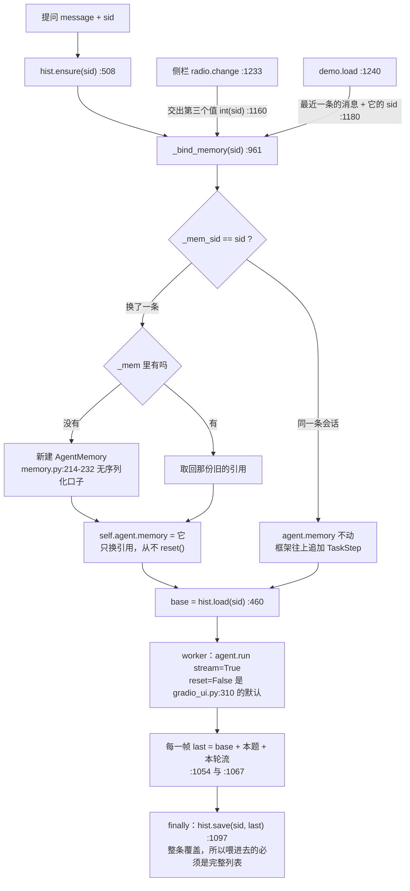

**`sid` 必须是一条**能同时喂给 chatbot 和 State 的输出，这是 V5 接线的地方。** 三处一起改：`radio.change` 的 `outputs` 多带 `sid`（`:1233`）、`_select_session` 交出 `int(sid)`（`:1137-1160`）、`demo.load` 的回调把 `_on_load` 从闭包提成方法（`:1162-1180`）并同样交出 `sid`。为什么刷新那条也要给 `sid`：屏上显示的就是最近一条会话，`sid` 空着的话下一条提问会另开一条，而屏幕是**整体替换**——刚看到的那串字当场找不回来，那就是 D5 的第二条路径。提成方法还有个附带收益：它能被离线用例直接调（53 条断言里的 7a/7b/7c 就是这么打的）。

**D6 是修 V5 时顺带撞出来的。** `History.save()` 那条 UPDATE 从 v1.2 起挂着 `WHERE id = ? AND title = '新会话'`，于是会话**一旦有了标题就再也不刷 `updated_at`**，而侧栏排序用的正是 `ORDER BY updated_at DESC`。以前这只影响"刷新页面看到哪一条"，现在决定"下一条提问落进哪一条会话"——顺序错了等于问错地方，所以改成无条件刷时间、标题用 `CASE WHEN title = '新会话' THEN ? ELSE title END` 保住（`:488-491`）。离线 8c 就是这条的正向断言：老会话一有动作就回到第一。

**口径变了多少，实测说清。** token 三档（本步 / 本题累计 / 进程累计）一个没动，但**同一会话内每题的 input 会往上爬**：模型每次收到整段会话历史。实测 `2,362 → 2,464 → 2,564`（每题 **约 +100**，正好等于上一题的一问一答），点「＋ 新会话」回到 **2,363**；`monitor` 不被 reset，所以进程累计仍是各问之和（s5 收尾 `in 15,176` = 五问相加）。另外 `save()` 是覆盖式重插，`messages.rowid` 每轮跳号（实测 `1,2,3 → 4..9`，再往后 `20..33`），**顺序与去重一律看 `ord`，别看 `rowid`**。

**三条边界要记着**：① ~~记忆只在进程里~~——这是 v1.4 的状态（重启后旧会话的字还在屏上，模型却答「不记得」，实测那题 `in 3,384` 没带上会话历史），**v1.5 的 V6 把这一半补上了**，见 6.3.7；② **`_mem_sid` 是单值**，两个标签页同时问会互相抢"当前绑到哪条会话"（`monitor` 同样共享），设计前提仍是**一次只问一题**；③ ~~**点侧栏之后高亮不跟**~~——`_select_session` 交出了 `sid`，但 `#sessions input` 的 `checked` 实测仍是 `0`，屏和内容接上了、视觉没接上（纯界面层）。③ 在 v1.5 造成了真后果、立单 V7，**v1.6 已把整条"高亮 ≠ 绑定"修掉（不止点侧栏这一路，还有「＋ 新会话」和刷新页面两条），见 6.3.8**。【订正一条测法：那句 `checked` 仍为 `0` 是用合成点击（`label.click()` / `dispatchEvent`）测的，v1.6 实测**合成点击在 gradio radio 上本就不可靠**，必须用 CDP 真鼠标 `mousePressed`/`mouseReleased`；v1.6 那张 before/after 表里"点从没亮过的另一条"在两个版本下都正常切换，真 bug 只在**值没变的那一次**。】

#### 6.3.7 v1.5：`agent.memory` 落库（重启后模型那一边接着记得）+ 停止落在待批之前不再死停（V6 + D7）

范围按工单号锁 **V6 + D7**。`my_ui.py` **893 → 1,108 行**（44,838 → **55,774 B**，对 `.rollback/v1.4` 的 `diff` 净 **`+217 / −2`**）。`my_coding_agent.py` **204 行未动**，上游源码零改动（`git diff --name-only` 为空；`git status --porcelain` 里除了三个 `my_*.py` 只多一个应用自己建的 `.agent-history.sqlite3`，它没有被 `.gitignore` 收掉）；审批闸、步骤卡、状态条三档口径**一行没碰**。

**V6 的判据只有一句话：模型读的是 `memory.steps`，不是屏上那串卡片。** `agents.py:767-769` 的 `write_memory_to_messages()` ＝ `memory.system_prompt.to_messages()` ＋ 逐条 `step.to_messages()`。所以"重启后还记得"的正解不是把屏幕文字重放一遍——重放要重新定义「本题累计」的边界，而且 `in` 会随历史**线性涨**；存**字段本身**才既保住边界又不多带一个字。存哪些字段也有根据：`memory.steps` 里只会出现 `TaskStep` / `ActionStep` / `PlanningStep` 三种（`FinalAnswerStep` 只 yield 不 append，`agents.py:609-611`；步数用满时 `:636` append 的是**带 `AgentMaxStepsError` 的 ActionStep**），白名单 `MEM_FIELDS`（`my_ui.py:69-84`）就是按 `to_messages()` 实际读到的字段列出来的。

**难度全在编解码上，五个坑每一个都是踩出来的：**

- **不存的三样**：`model_input_messages`（整段提示词，存一份等于 O(n²)）＋图片三兄弟 `images` / `image_outputs` / `model_output_images`。后果写死在边界里——**带图的观察值重启后进不了模型上下文**【本轮题面全是纯文本，多图会话【未验证】】。
- **文本必须原样存**：只有 `action_output` 过 `make_json_serializable`。因为 `utils.py:146-153` 会把**长得像 JSON 的字符串解析成 dict**，一路 `json.dumps` 再回灌，观察值 `{"ok": true, "n": 73}` 就变字了（离线断言 1c 逐字钉这条）。
- **错误对象是"造"出来的，不是"构造"的**：`AgentError.__init__(message, logger)` 里 logger 必需、而且会**当场** `log_error`。所以 `cls.__new__(cls)` + `Exception.__init__(err, message)` 再手设 `.message`（`:101-116`）。能落库的只有**类名**，所以 `_error_types()` 沿 `AgentError.__subclasses__()` 递归建类名索引（`:91-98`）——恢复出来 `type(step.error).__name__ == "AgentParsingError"`，步骤卡的「🔴 报错」判定才不塌。
- **两个 dataclass 是派生字段**：`Timing.duration` 是 property、`TokenUsage.total_tokens` 是 `init=False`，`dict()` 出来的键比构造参数多，只能挑着交（`:119-129`）。
- **`ToolCall` 用 `tc.dict()`**（OpenAI function 形状），不是 `dataclasses.asdict`。

坏数据的降级路径是**分层的**（`decode_memory`，`:173-232`）：整块坏 JSON / `fmt` 不符 / 顶层不是 dict → 返回 `[]`，当作这条会话没记忆，正常开新会话；单条坏 → `except (TypeError, ValueError, AttributeError): continue`，跳过那一条、其余照灌。**不会因为一次异常把整条会话废掉。**

```mermaid
flowchart LR
    subgraph P1["进程 1：跑完就关了"]
        A1["agent.run 往 memory.steps 上追加<br/>agents.py:477"] --> A2["encode_memory(mem.steps)<br/>my_ui.py:132-170"]
        A2 --> A3["_respond 的 finally：两个条件<br/>mem is not None 且 _mem_sid == sid<br/>my_ui.py:1103-1104"]
    end
    A3 --> T[("memory 表：一行一个 session_id<br/>INSERT OR REPLACE · my_ui.py:429 与 :493-501")]
    T --> B1["重启后 _bind_memory 未命中<br/>decode_memory(load_memory(sid))<br/>my_ui.py:981-983"]
    B1 --> B2["mem.steps.extend(steps)<br/>system_prompt 与 monitor 一律不动"]
    B2 --> C1["write_memory_to_messages()<br/>agents.py:767-769<br/>＝模型这一轮读到的那一串"]
```

**接进去只有三处，两处刻意保持小。** `History` 加一张 additive 的表（DDL `:429`，方法 `save_memory` `:493-501` / `load_memory` `:503-506`）；`_bind_memory`（`:961-986`）在进程内 `_mem` 未命中时回灌 steps——**只灌 steps**，`system_prompt` 由框架自己在 `run()` 开头同步，`monitor` 更不能动（否则「进程累计」作废，见 6.3.6）；`_respond` 的 `finally`（`:1095-1105`）在 `hist.save(sid, last)` 之后紧接着存记忆。**那两个条件不能省**：`mem is not None` 让没绑定记忆的一题不去建行，`self._mem_sid == sid` 是**会话归属**判据——中途有人换了会话，就不能把别人的记忆盖到这条上。worker 线程可能还在跑（页面被刷新的那一路），所以这一步**可能存下半截**，下一题结束时再存就整了：半截可接受、存错会话不行。

**实测走的是交付形态 7860、真 qwen-plus、两次真重启**（`关闭Agent.command`，pid `45372 → 46527 → 49146`）：

| 路 | 结果 |
|---|---|
| 记住 73 → 同会话追问 | `in 2,362` → `2,465`，进程累计 `4,827/34` |
| **重启**后点旧会话再问 | `Final answer: 73`，**`in 2,574`**（裸起步 `2,363`，说明历史真带上了）；进程档归零重算 `4,937/34` |
| 同一条继续聊 | `Final answer: 73`，`in 2,675`，进程 `7,612/51` |
| **工具观察值**也带着（审批跑 `print(3*7)` → **第二次重启**再问） | `Final answer: 21`，`in 3,091`、进程 `3,091/17`；库里那条 ActionStep 的 `observations` 是逐字的 `exit=0`⏎`21` |
| 点「＋ 新会话」问同一题 | `Final answer: 不记得`，`in 2,363` —— 持久化只针对聊过的那条，**隔离没漏** |
| 库里形状 | 首轮 2 问之后 session 1 的 payload **1,029 字符 / 4 步**，全部跑完 **4,042 字符 / 15 步**；表 4 张（`sessions` / `messages` / `memory` / `sqlite_sequence`） |

**D7 的根因是框架清了开关，不是按钮没生效。** `agents.py:470` 在每次 `run()` 开头把 `interrupt_switch` 清回 `False`，所以 `■ 停止` 落在待批卡**出现之前**（v1.4 实测 0.2s 那一下）中断的是一条**空闲的** agent——等于空放；随后到达的那条待批没人结算，界面死停「等待审批」**142.4s**（`APPROVAL_TIMEOUT` 是 600s，不会自己解），要手动补 ✖ 才解开。修法是四处，缺一条窗口就还开着：

1. **类级**计数器 `_run_seq` / `_cancelled_before`（`:535-536`）。闸装在**进程唯一**的那个 agent 上，所以计数器必须和 `_pending`、`_gate_lock` 同侧（也是类级，`:530-531`）；放实例上就出现"A 领的号管不住 A 装的那道门"。
2. **开跑先领号**：`_stream_response` 在计数器归零之后、**起 worker 线程之前**`OpsUI._run_seq += 1`（`:845-846`）。号没领上就开工，闸读到的还是上一轮的号。
3. **入队与判停在同一个临界区**（`_gated_call`，`:602-605`）：`with self._gate_lock: self._pending.append(ap); if OpsUI._run_seq <= OpsUI._cancelled_before: ap.decide("cancelled")`。两种到达顺序都被覆盖——闸先拿到锁，单子已在队里，随后 `_stop` 的 `_settle_all` 必定看得见；`_stop` 先拿到锁，这里入队时立刻自判 `cancelled`，压根不等人点。**"先查后入队"那个缝被锁死了。**
4. `_stop`（`:1130-1135`）先领取消号，再 `_settle_all("cancelled")`，最后 `interrupt()`。

交付形态复测：提问后 **0.2s** 按 ■ 停止，`awaitingSeen 0`（**从没进过**「等待审批」），0.7s `停止中` → **1.2s `已停止`**，此后 26s 轨迹全是 `已停止`。停止那一轮同样进记忆：库里 session 1 那条 `run_python {"code": "print('D7')"}` 的 `observations` ＝「用户按了停止，本次执行已取消，未产生任何副作用。」，屏上是 `⏹ 待批 · run_python · 随停止取消` + `⚪ 已取消`。**语义扩了一格**：`■ 停止` 现在覆盖"**本轮之后到达的**待批"。

**验证与回滚。** 离线 `/tmp/v15_test.py` **65 条断言全 PASS**（编解码 16 / 落库与重启 22 / D7 17 / 回归 10），其中 1n 是**拿框架自己的 `write_memory_to_messages()` 逐字比对回灌前后**，2l 断言回灌进来的都是**上一题**的 steps、本题累计边界仍从 0 起算（`300/13`），3l 端到端跑真 `_stream_response` ＋ 假 `agent.run`（0.6s 后调 gated 工具）→ 0.2s 按停止 → **3s 内自己结束**。回归项里 `outputs` 仍 7/3/4、门没有被套两层。回滚双向都演过：v1.4 方向 **15 条全 PASS**（行数 893、没有 `encode_memory`/`MEM_FMT`/memory DDL/`_run_seq`，而 D5/V5/D6 与审批闸全在），v1.5 方向 **13 条全 PASS**，恢复后与 `.rollback/v1.5/` **逐字节一致**，再跑离线 65 条仍全绿。**数据不会坏**：`memory` 表是 additive 建的，实测拿 v1.4 的代码读写 v1.5 写过的库——`load(1)` 读出 12 行不减、`save()` 正常、`memory` 表原地留着不碰，而且 v1.4 直接在那份库上**真启动过一次**（7861 `HTTP 200`、日志无 `Traceback`）。回滚重新打开的是 V6 和 D7 两件事，不是数据。

**四条边界，第一条已经造成了真后果。** ① **侧栏选中态陈旧**（v1.4 的遗留 ③）：点「＋ 新会话」之后 radio 仍保留**上一次**的 `checked`，于是"点那条**高亮着的**旧会话"＝点了一个值没变的 radio → **不触发 change** → 问题落进新会话（探测口实测 `in 2,463`、答「不记得」，数据没坏、只是进错了门）。反证是每次点击前先读 `before-checked`：它为 `0` 时一切正常。修法是 `_new_session` 把 radio 的值同步成那条新会话，纯界面层——**本轮范围外，没擅自改**，已立 **V7**（**v1.6 修掉了，见 6.3.8；顺带订正：这里那句"反证"用的是合成点击，v1.6 实测合成点击在 gradio radio 上本就不可靠，判据一律改成 CDP 真鼠标事件**）。② `_cancelled_before` 是**类级**，一个标签按停止会让**所有**在飞的待批按 `cancelled` 结算【未验证：本轮始终一次一题】，前提仍是**一次只问一题**。③ **停在待批上的那一轮**，记忆里有 `TaskStep` 而无对应 `ActionStep`——与 v1.4 的停止语义一致，不是新增缺陷。④ 审批等待时间照旧计入步骤耗时（实测 `第 1 步 · run_python · 🟢 成功 · 272.9s`，真执行约 1s），v1.3 起就是这个口径，本轮没改；要不要单列「等待时长」另立 V 单（**v1.6 立了 V8 并做完：总时长口径一字未改，旁边多一格「审批 21.0s」，见 6.3.8**）。

#### 6.3.8 v1.6：侧栏亮的那一条就是你现在问的那一条 + 审批等待单独一格（V7 + V8）

范围按工单号锁 **V7 + V8**。`my_ui.py` **1,108 → 1,205 行**（55,774 → **63,316 B**，字符 46,071 → 50,717，对 `.rollback/v1.5` 的 `diff` 净 **`+105 / −8`**）。`my_coding_agent.py` **204 行 / 8,355 B 未动**（`cmp` 与 `.rollback/v1.5`、`.rollback/v1.6` 双份一致），上游源码零改动、库 schema 零改动；审批闸的**判定**、停止的语义、三档 token 口径**一行没碰**——V8 只从闸那里多读了一个秒数。

**V7 的根因一句话：高亮和绑定是两件事。** 侧栏那条 Radio 的 `checked` 由浏览器自己的点击历史决定，而真正决定"问题落进哪条会话"的是服务端的 `self._sid`——它在 v1.5 有**三条互不回写高亮的写路径**：`_respond` 建条（`:1047`）、`_new_session` 清空（`:1112`）、`_on_load` 指到最近一条（`:1178`）。于是点「＋ 新会话」之后屏幕换成空白（绑定＝一条还不存在的新会话），radio 却仍亮着上一条；用户照着亮着的那条点＝点了一个**值没变**的 radio → gradio 不派发 `change` → 问题落进新会话。刷新页面是同一根因的另一面：绑着最近一条、侧栏**一条都不亮**。

**为什么不干脆"每帧都带 `value`"——这条是本轮实测出来的。** gradio 6.30 里**服务端 `gr.update(value=...)` 会被当成一次 `.change` 送回后端**：程序化设 `value="B"` 触发 `.change`，设 `value=None` 也原样送回一次 `None`，但两者都**不**触发 `.input`；只有用户真的点选才 `.change` / `.input` / `.select` 三件齐发。流式期间每 0.25 秒一帧，每帧带 `value` 就是**每秒两次空转事件**，而且送回的那条回调和正在流式的那条会抢同一个 chatbot 输出——抢赢就把刚画出来的步骤卡盖掉。所以方向反过来：**`choices` 每帧刷，`value` 只在绑定真的换了那一次给**，新增的 `_radio_update(force=False)`（`:1007-1025`）就是这一句：`force or self._sid_shown != self._sid` 才交 `value=self._sid`，同时把 `_sid_shown` 记上（`:1022-1024`）。`force` 专给 `_on_load`（`:1180`）——刷新后浏览器那一侧的 radio 是全新的、没勾选，服务端这个对象却还是刚才那一个、`_sid_shown` 没变，不强迫就永远不补那一下。真送回的那一次由 `_select_session` 的**回声守卫**退回（`:1155-1156`）：`if not sid or str(sid) == self._sid: return gr.update(), gr.update(), gr.update()`——三个输出全交空更新（不碰 chatbot），且守卫**挡在 `int()` 之前**，所以 `value=None` 的回声不会崩。真切换时 `_sid` 与 `_sid_shown` **一起**更新（`:1157`、`:1159`），下一帧就不会再多送一次 `value`。

**V8 的由来是 6.3.7 边界 ④ 那句白纸黑字的"本轮没改"。** `272.9s` 里 271 秒是人在等按钮，模型和工具加起来约 1 秒——把等待算进步骤耗时是 v1.3 卡片化时留下的口径，诊断上是误导：分不清到底是模型慢、工具慢，还是没人点。**总时长的定义一个字没改**（仍是框架的 `timing.duration`，含等待），只是旁边多一格可以单看的数。记账是一条跨线程的链，四个位置各有分工：

```mermaid
flowchart LR
    subgraph WR["worker 线程（工具调用侧）"]
        D1["waited 记在落定那一刻<br/>decide() my_ui.py:390<br/>超时分支 :396 记 APPROVAL_TIMEOUT"] --> D2{"ap.waited ≥<br/>APPROVAL_WAIT_MIN=0.05<br/>:40"}
        D2 -->|否| D3["不过账<br/>随停止取消的微秒级等待<br/>:609-611 之前就被筛掉"]
        D2 -->|是| D4["OpsUI._pending_wait += waited<br/>同一个 _gate_lock 临界区 :609-611"]
    end
    D4 --> U1["_stream_response 收到 ActionStep<br/>一次取干 :897-898"]
    U1 --> U2["payload._opsui_wait = waited（私有属性，不在 MEM_FIELDS :69-84）<br/>self._run_wait += waited :900-901"]
    U2 --> V1["步骤卡 22.1s · 审批 21.0s<br/>:721-727，末行「含审批」:742"]
    U2 --> V2["_stats 的 task_wait（当前会话 steps 求和）:769<br/>→ 状态条「本题审批」pill :792-793"]
    U3["开局清零 _pending_wait / _run_wait<br/>:839 / :843"] -.-> D4
```

**接进去只有四处，每一处都刻意保持小。** ① `_radio_update` 新增，三个调用点换过去：`_respond` 每帧那条从裸 `gr.update(choices=...)` 改成 `radio = self._radio_update`（`:1062`，可调用、逐帧现算）、`_new_session` 返回 `self._radio_update()`（`:1113`）、`_on_load` 返回 `force=True` 那版（`:1180`）。② 等待的**记**与**取**分在两条线程上，所以账挂在类级 `_pending_wait`（`:540`）上——和 `_run_seq` 同一个理由：门只装在进程唯一的那个 agent 上，装门的实例和画卡的实例可能不是同一个。③ 显示面三处各加一格且**都是加法**：步骤卡标题（`:727`）与正文（`:722`、`:742`）、审批卡结算后 `· 等了 X.Xs`（`:650`）、状态条 pill（`:792-793`）。④ 门槛 `APPROVAL_WAIT_MIN = 0.05`（`:40`）在**过账点**和**审批卡标题**两处生效，所以「本题审批」和「等了 X.Xs」是同一口径，不会出现 pill 上没有、卡片上写 `0.0s` 的错位——`0.05` 这个数不是拍的：D7 那条"入队即随停止取消"的路，账上确实有 0.0004 秒，加门槛之前交付形态实测抓到过 `⚪ 已取消 · 0.9s · 审批 0.0s` 这种纯噪声。

**V7 是在种子库上原地复现再复跑的**（探测口 7861，3 条会话、**零模型调用**，点击全部走 CDP `Input.dispatchMouseEvent` 真鼠标事件；证据 `/tmp/v16_base.before.txt` / `/tmp/v16_base.after.txt`）：

| 步骤 | v1.5（改之前） | v1.6（改之后） |
|---|---|---|
| 0 打开页面 | `chk=[false,false,false]`——**绑着丙却一条都不亮** | `chk=[true,false,false]`——绑谁亮谁 |
| 1 点「甲」 | `chk=[false,false,true]`，屏上 1 问 1 答 | 同（无回归） |
| 2 点「＋ 新会话」 | **`chk=[false,false,true]` 甲还亮着**，屏上已是「还没有会话」 | `chk=[false,false,false]` 全不亮，与屏一致 |
| 3 点那条亮着的「甲」 | **空点**：`chk` 不变、`user/bot` 都不出现（`change` 没派发）→ 下一问落进新会话 | `chk=[false,false,true]`，1 问 1 答回来 |
| 4 对照：点从没亮过的「乙」 | 正常 `chk=[false,true,false]` | 正常，两边一致 → **差别只在"值没变的那一次"** |

**V8 与 V7 的端到端都走交付形态 7860、真 qwen-plus**（`/tmp/v16_delivery.py` 经 CDP 9333 驱动 headless Chrome，库＝真实的 `smolagents/.agent-history.sqlite3`）：

| 判据 | 结果 |
|---|---|
| 总时长口径不变、等待单列 | 状态条 `本题耗时 22.9s` ＋ **`本题审批 21.0s`**；步骤卡 `第 1 步 · run_python · 🟢 成功 · 22.1s · 审批 21.0s · in 2,349/out 22` |
| 没审批就一格都不多 | `第 2 步 · final_answer · 🟢 成功 · 0.8s · in 2,433/out 17`——标题、正文、状态条都没有"审批 0.0s" |
| 审批卡结算后带等待 | `🟢 待批 · run_python · 已允许 · 等了 21.0s` |
| 长等待对照（探测口挂 71.0s 再点允许） | `本题耗时 72.9s` / **`本题审批 71.0s`** / `Final answer: 21`；等待期间 `本题耗时 0.0s`、状态 `等待审批`、pill `待批 run_python` |
| V7 新会话把高亮清掉 | `chk=[false,false,false]`，与屏上「还没有会话」一致 |
| V7 点那条旧的真回来了 | 点 A 会话 → `chk=[true,false,false]`、屏上 1 问 4 气泡、`Final answer: 21` |
| V7 追问落在对的那条 | 同一条再问 → `第 1 步 · final_answer · 🟢 成功 · 0.8s · in 2,525/out 17`、`Final answer: 21`；`in 2,525` 说明带着历史，侧栏**没有多出会话** |
| D7 复测（加门槛之后） | 提问后 0.9s 按 ■ 停止：从没进过「等待审批」、**2.0s 自己收尾**、`⚪ 已取消 · 1.1s`，**「审批 0.0s」那格不再出现** |
| 真模型 + 会话链（探测口 7861） | 新会话问「记住一个数字：73」→ 该条**当场点亮**、`in 2,344/out 16`；点「＋ 新会话」→ `chk` 全 false；**点回那条**（v1.5 是空点）→ `userN=1 botN=2`；追问 → **`Final answer: 73`**、`in 2,439`、进程 `4,783/33` |

**验证与回滚。** 离线 `/tmp/v16_test.py` **92 条断言全 PASS**（`FAILS: 无`）＝ v1.5 那 **65 条原样搬过来全绿**（编解码 16 / 落库与重启 22 / D7 17 / 回归 10）＋ **V7 10 条**（5b 刷新后不再是"绑着某条、一条都不亮"、5d 值没变的那次回声三个输出全空、**5g 新会话之后点"刚才那条"是真切换**、5h `value=None` 的回声不崩、5j 整题只回送一次 `value`）＋ **V8 17 条**（6a 记在 `decide()` 那一刻、6d 入队即取消不过账、6g 两格并存且后者 ≤ 前者、6l 没审批的题一格不多、6m 换题清零、**6n `_opsui_wait` 进不了记忆库**、6o 总时长照旧进得去、6p/6q 审批卡用同一条门槛）。回滚双向都演过：**v1.5 方向 25 条全 PASS**（`py_compile`、`import` 起来且字符数与磁盘一致、行数 1,108、**V7 四个锚点全不在**——含"新会话那句不回写高亮"这条 bug 本体、**V8 六个锚点全不在**、`Approval` 不记等待），**v1.6 方向 31 条全 PASS**；两份断言里 **14 条共享清单两个方向都必须绿**（V6 编解码 / memory 表 / `_bind_memory` 回灌 / 落库归属判据、D7 四个锚点、D5、V5、D6、v1.3 审批闸）→ 这两刀都是**加法式**改动。恢复后与 `.rollback/v1.6/` **逐字节一致**（`cmp` 两份），再跑离线 92 条仍全绿。**数据不会坏**：本轮没建表、没改 `MEM_FMT`、没改字段白名单，v1.6 写的 payload 与 v1.5 是**同一个格式**、回滚后照读；屏上多显示的那格等待**从来没进过库**，所以也不存在"回滚后读出多余字段"。回滚重新打开的是 V7 那个真后果和"等待看不见"，不是数据。

**四条边界。** ① **「本题审批」跨重启读不出来**：`_opsui_wait` 是 `ActionStep` 对象上的**进程内私有属性**，`MEM_FIELDS`（`:69-84`）不认它 → 回到旧会话只见「本题耗时」不见「本题审批」（6n/6o 就是这件事的两面断言，新题照旧单列）。这和 v1.5 定的"只存 `to_messages()` 读到的字段"是同一条纪律，**是写下来的边界，不是缺陷**；要让它进库得给记忆格式升 `MEM_FMT` v2 ＋ 兼容读旧 payload，已立 **V9**。② **V7 的回声守卫假设"一个窗口"**：`_select_session` 按 `str(sid) == self._sid` 拦回声，两个浏览器标签同时开着时，另一个标签的**真实**切换会被服务端当成"值没变"退回【未验证：本轮全程单标签】——与 6.3.7 边界 ② 是同一类限制，前提仍是**一次只问一题**。③ **新会话没有可亮的那一条**：点「＋ 新会话」那一刻库里还没有它的行（第一问下去才 `hist.ensure`），所以 `self._sid = None`、侧栏一条都不亮才是实话（`:1112`）；若哪天改成点击即建行，这里必须跟着改成"亮那一条"，否则又是一次高亮/绑定分家。④ **并行多工具时那一格等待挂在第一个到达的 `ActionStep` 上**（"一次取干"），多格怎么分摊【未验证：本轮所有题都是单工具】；待批队列仍只处理**最早**那一条（v1.3 起就是）。

**这四条后来怎么样**：① 由 **v1.7 的 V9 收掉**——`MEM_FMT` 升 v2、`ActionStep` 多一个可选键 `wait`、`decode_memory` 认 `("v1","v2")`，机制与实测见 6.3.9；收掉它的代价写在 §9.4 那条回滚边界里（**回滚 v1.6 会把 v1.7 期间新建的会话读成没记忆**，兼容读只朝一个方向）。②③④ 三条**仍然开着**。本节 936 行那句「屏上多显示的那格等待从来没进过库」描述的是 v1.6 那一刻的事实，v1.7 之后不成立。

#### 6.3.9 v1.7：审批等待跟着记忆进库——重启、点旧会话都读得出那一格（V9）

**范围就一张单。** V9＝6.3.8 边界 ① 自己立下的那单。`my_ui.py` **1,205 → 1,253 行**（63,316 → **67,362 B**，字符 50,717 → 53,019，对 `.rollback/v1.6` 的 `diff` 净 **`+85 / −37`**、15 个 hunk）。`my_coding_agent.py` **204 行 / 8,355 B 未动**，上游源码零改动；**库 schema 也零改动**——`memory` 表还是那三列，本轮只往 payload 那串 JSON 里加一个**可选**键 `wait`。

**基线四条事实决定了写法**（`/tmp/v17_base_v16.py` → `/tmp/v17_base_v16.out`，**被测模块换成归档的 `.rollback/v1.6/my_ui.py`**：上线之后真实库里已经多了一条真 v2 payload，拿现网代码原样重跑会把"缺口复现"跑成"缺口已关"；**13 条全 PASS**）：

- **A 缺口本体**：活进程里那一格看得见（`task_wait 0.61s`、pill 在），但落库那串里**根本没有 `wait` 这个键**——payload 出现过的键就八个（`_t / is_final_answer / observations / step_number / task / timing / token_usage / tool_calls`），`fmt` 仍是 `v1`。
- **B 回灌读不出**：同一个库起第二个 `OpsUI`、`_bind_memory` 回灌之后 `task_secs 0.66`（V6 的口径在）、**`task_wait 0.0`** → 缺口坐实在"只有等待读不出"。**同一节顺手推翻了 v1.6 的一句注释**：屏上那张历史卡**一直带着**「（含审批 …）」（卡片正文走 `messages` 表，实测 4 条消息里 1 条含"含审批"）→ 真缺口只在 `_stats` / 状态条这一串数，不在卡片。
- **C 光进库没有出口**：「点一条旧会话」这条路**不回灌记忆**（`_bind_memory` 只在 `_respond` 开头），切到甲之后状态条仍是 `步数 0/8`。所以 V9 必须同时给状态条一个**读屏幕上这一条**的出口，否则这一格进了库也看不见。
- **D 改动点不在显示层**：只把秒数挂回 step 对象的 `_opsui_wait`，pill、步骤卡标题、正文累计行**三处零改动**就显示（D1/D2 绿）→ 该动的是编解码。

```mermaid
flowchart LR
    subgraph OLD["V8 那条链，本轮一字未动"]
        W1["decide 那一刻记 waited<br/>my_ui.py:390"] --> W2["类级 _pending_wait 过账<br/>门槛 0.05 在此 :609-611"]
        W2 --> W3["ActionStep 到达时一次取干<br/>payload._opsui_wait :897-901"]
    end
    W3 --> E1["encode_memory：真等过才写<br/>row 多一个 wait 键 :162-168"]
    E1 --> DB[("SQLite memory.payload<br/>fmt 升到 v2 :63<br/>v1 的行不会被回写")]
    DB --> D1["decode_memory：fmt 认 v1 与 v2<br/>:179-180 兼容读"]
    D1 --> D2["挂回同一个私有属性<br/>:225-229，v1 没这键就读作 0"]
    D2 --> S1["_stats 的 task_wait :769<br/>（steps 参数是本轮加的 :749-752）"]
    S1 --> UI1["状态条「本题审批」pill<br/>:792-793"]
    SS["_session_steps sid :988-1004<br/>进程有这份就读它的 steps<br/>没有就 decode 库里那一串（只读）"] --> S1
    C1["点旧会话 _select_session :1160"] --> SS
    C2["刷新 _on_load :1178-1180<br/>＝重启后第一次看"] --> SS
```

**六处分工，每一处都只有几行。** ① `MEM_FMT = "v2"`（`:63`）＋ `MEM_FMT_READ = ("v1", "v2")`（`:68`）——升版本必须带兼容读，注释里点名那条反面证据（真实库那 7 条 payload 在 strict v2 下全读空＝基线 E1）。② `MEM_FIELDS`（`:69-84`）**一字未动**，后面补了注释说明为什么：这张表的口径是"下一轮**模型**读到的字段"，而 `wait` 和 `timing`、`token_usage` 同一类——界面用、`to_messages()` 不认（`:85-88`）。③ `encode_memory` 的 ActionStep 分支多写一格（`:162-168`），**只有真等过才写**、0 不占位，所以没审批的会话编出来和 v1.6 逐字相同（只差 `fmt` 那两位），库里体积不涨。④ `decode_memory`：版本判定从 `!= MEM_FMT` 改成 `not in MEM_FMT_READ`（`:179-180`，认不出的 v0／将来的 v3 **仍旧整块当没记忆，不猜着读**），ActionStep 分支从"一路 `append(构造调用)`"改成"先 `step = ActionStep(...)` 再决定挂不挂属性"（`:203-229`）。⑤ `_stats(steps=None)`（`:749-752`）与 `_status_html(state, steps=None)`（`:782`）：**不传参就是原样读 `agent.memory`**（老调用点一个都没动，7r 断言的就是这句），传了就读那一条会话自己的步骤。⑥ 新增 `_session_steps(sid)`（`:988-1004`）→ 接到 `_select_session`（`:1160`）和 `_on_load`（`:1178-1180`）这两个入口上。

**为什么不做成"点旧会话时顺手 `_bind_memory`"**：那条路会把 worker 线程正在读的记忆换掉（`_bind_memory` 上那条"刻意不做"写着的理由），V5 的语义也不该由一次点击改动。所以这一路是**只读**的：`agent.memory`、`_mem`、`_mem_sid` 一个都不碰（7m/7p 断言）。

**兼容读只朝一个方向——本轮唯一"回滚有代价"的地方。** 基线 E1：只改版本号不做兼容读 → 真实库那 **7 条 v1 payload 在 strict v2 下全体读空**（V6 当场作废）。基线 **E1b**（v1.6 原样的代码、不动 `MEM_FMT`）：它读 v1.7 写的 v2 账**同样读空** → 回滚到 v1.6 之后，**v1.7 期间新建的会话在模型那一边变成"没记忆"**（侧栏还在、屏上字还在，追问会答不记得）。库里 **v1 的行不会被回写升级**：交付形态实测真实库旧 7 行 payload 的 sha1 **逐行不变**，`sessions / messages / memory` 由 7/49/7 变 **8/54/8**——**只追加**。

**实测·探测口 7861**（真 qwen-plus，临时库；先用归档的 `.rollback/v1.6` 编码器**现编两条真 v1** payload 种进去：415 / 414 字符（UTF-8 425 / 424 B）、`fmt=v1`、无 wait——不是手写的假 v1）：

| 判据 | 结果 |
|---|---|
| v1 兼容读的第一面 | 新进程打开页面即 `_on_load` 绑最近一条「v1旧记忆-乙」：`本题耗时 12.5s`、**「本题审批」这格不存在**（`pillWait=null`）——读得动，只是不猜 |
| 挂着审批 20 秒 | 2.0s 进「等待审批」；等待期间 `本题耗时 0.0s`、无「本题审批」、pill `待批 run_python` |
| 点允许之后 | `本题耗时 23.0s` ＋ **`本题审批 20.7s`**、步数 `2/8`、本题 `in 4,789 / out 39`、`Final answer: 21` |
| 落库那一串 | sid 3：**`fmt=v2`**、3 步、**`wait=[20.743, 无]`**（领到账那条 ActionStep 有、`final_answer` 那条没有）、`duration=[22.08, 0.97]`、965 字符（UTF-8 1,013 B） |
| **真重启**（kill → 同一个库重起 → 只做一次页面加载） | `本题耗时 23.0s / 本题审批 20.7s` ← 新进程的 `_mem` 是空的、一个 `_respond` 都没跑过，**这个数只能来自库里那一格** |
| 重启后点两条 v1 旧会话 | 甲 `本题耗时 41.0s`、乙 `12.5s`，两边**都没有**「本题审批」（兼容读不猜）；侧栏高亮跟着点走 → V7 没回潮 |
| 只读路径没换成绑定 | 刷新／点击之后 `agent.memory` 仍是新进程那一份空的；屏上是甲、条上也报甲，但下一次提问仍落进它自己那条 |

**实测·交付形态 7860**（`我的Agent.app` 真启动器 ＋ 真 qwen-plus，库＝**真实的** `smolagents/.agent-history.sqlite3`）：

| 判据 | 结果 |
|---|---|
| 等待单列 ＋ 进库 | 状态条 `本题耗时 23.4s` ＋ **`本题审批 20.7s`**；`🟢 待批 · run_python · 已允许 · 等了 20.7s`；`🛠 第 1 步 · run_python · 🟢 成功 · 22.1s · 审批 20.7s · in 2,355/out 22`；`🛠 第 2 步 · final_answer · 🟢 成功 · 1.3s · in 2,438/out 17`（**没审批的那一步一格都不多**）；进程 `in 4,793 / out 39` |
| 真实库前后对照（只读脚本） | 7/49/7 → **8/54/8**；**旧 7 行 sha1 逐行不变、零丢失**；新增 sid 8：`fmt=v2`、`wait=[20.672, 无]`、967 字符（UTF-8 1,015 B） |
| **真重启（走关闭器）** | `关闭Agent.command` → 重开 → 页面第一次加载即 `本题耗时 23.4s / 本题审批 20.7s` |
| 重启后点一条真 v1 旧会话 | 「用 run_python 打印 4*5 的结果…」→ `本题耗时 1.1s`、**无「本题审批」** |
| 四条关停判据（两轮各一次） | 7860 监听 **0** / Agent 专用 Chrome **0** / `who` 只剩 **console** / Terminal 窗口数 **0** |

**验证与回滚。** 离线 `/tmp/v17_test.py`（venv python，`_stream_response` / `agent.run` 打桩、临时库）**115 条全 PASS、`FAILS: 无`、`exit=0`**＝ v1.6 那 92 条原样搬过来全绿 ＋ **V9 新 22 条**。三条按新口径动过：**2b** 期望 `fmt` 从 v1 改 v2、**6n 直接翻转**（v1.6 断言"`_opsui_wait` 进不了库"，V9 之后它必须进得去，键名是 `wait` 而不是私有属性名）、新增 **2b2**（没等过审批的一题 payload 里没有 `wait`）。V9 这 22 条里要紧的：**7a** 没等过审批的步 v2 编出来与归档 v1.6 编码器**逐字相同**（对照模块用 `importlib` 把 `.rollback/v1.6/my_ui.py` 装进来比）、**7b** 真等过才多写、多的正好是 `, "wait": 12.346` 那 16 个字符（纯 ASCII，字符＝字节）、**7c** 读回来挂回同一个私有属性（显示层一行没改）、**7d** 模型读到的那一串不掺这一格、**7e/7f** 真实库副本 8 条 payload 全读得回且"新读 v1 == v1.6 读自己那一份"逐字段一样、**7g** 八条往返重编长度差 `[0,0,0,0,0,0,0,0]`、**7h** v1 无 wait 读作 0、**7i** `fmt:"v0"/"v3"` 整块拒读、**7l** 换全新 `AgentMemory` ＋ 新 `OpsUI`、只做一次 `_on_load`（就是"重启后刷新"那一下）那一格自己回来、**7m/7p** 全程只读（`agent.memory` 仍是新那份、`_mem == {}`、点旧会话也不改绑定）、**7n/7p** 屏上是甲、条上就报甲（乙那一题不带那一格，别把甲的等待算给乙）、**7q** 换下一题不继承上一题读回来的等待、**7r** `_stats()` 不传参时行为与 v1.6 逐字相同、**7s** V7 回声守卫没回潮。双向回滚 `cmp` 逐字节一致：v1.6 方向 **92 条**、v1.7 方向 **115 条**（第 7 步改掉那三行过时注释之后**整套重跑过一遍**，`/tmp/v17_drill.sh` → `/tmp/v17_drill_rerun.out`）。

**四条边界。** ① **回滚不是无损的**（E1b 那条）：真要长期退回 v1.6，就把 v1.7 建的会话作废，**别手工去改 payload 里的 `fmt`**——那是改数据不是改代码。② **v1 时代的老账永远没有这一格**：那个数从来没进库，本轮不猜、不补；代价是同一个库里两种格式长期并存，`MEM_FMT_READ`（`:68`）得一直带着。③ **点旧会话仍然不换绑定**：屏上／条上一致了，`agent.memory` 却仍停在上一条提问的会话（V5 的语义，本轮有意不动）→ 点甲看了两眼再提问，问题落进的是新起的那条，不是甲。④ **并行多工具时那一格等待挂在"第一个到达的 `ActionStep`"上**（v1.6 §6.3.8 边界 ④ 就写着），本轮所有题仍是单工具【未验证：多工具并行怎么分这两格】。另有一条**实跑暴露的新单 D8**：正在流式（尤其挂在审批闸上等人点）时刷新或关页面，这一题**一行都不落库**——机制【未验证】，写在 6.3.9 之外、看板 D8 那一行。

#### 6.3.10 v1.8：一次上线四刀——断开补账（D8）＋ 计划批准（P0-4）＋ 越界指路（P0-a/b/c）＋ 重复熔断（P1-a）

**范围与体量。** 工单 **#38 #39 #40 #41 ＋ #42 只立单**（顺序是 11-02 点死的 D8 → P0-4 → P0-a/b/c → P1-a）。`my_ui.py` **1,253 → 1,758 行**（67,362 → **102,752 B**，对 `.rollback/v1.7` 的 `diff` 净 **`+541 / −36`**、52 个 hunk）；`my_agent.py` **82 → 111 行**（2,879 → 5,410 B）；`my_coding_agent.py` **208 → 256 行**（8,889 → 13,367 B）；三份合计 **+42,399 B**。上游源码零改动，库 schema 零改动（`memory` 表还是那三列，本轮往 payload 里只多写了 `wait` 那一格的**补账**）。**装门顺序本身是语义**：`OpsUI.__init__` 里 `_install_gate()`（`:664`）→ `_install_dup_gate()`（`:666`）→ `_install_plan_gate()`（`:667`）——查重必须在审批**之外**（被挡的那次调用不该先弹审批卡），计划门套在最外面（它守的是 `_run_stream`，不是某个工具）。

**刀一 D8 断开侧（#38）：刷新／关页面这一题不再一行都不落库。** 机制那一条 v1.7 只能标【未验证】，本轮实测坐实：客户端断开时 gradio 关的是 `_respond`（`:1481`）那条生成器，`GeneratorExit` 走的是**另一档**，不是按 ■ 停止那条 `AgentError`（`:1528` 那句注释写死了"GeneratorExit 之后再 yield 是 RuntimeError"）。于是新增一档状态 `interrupted`（`STATE_LABEL :416`），`_respond` 在 `finally` 之前认旗（`:1530` 置位、`:1566` 分支），收尾函数 `_mark_interrupted`（`:909`）干三件事：把还挂在队列上的待批卡结算成终态（「⏹ 待批 · run_python · **随中断取消** · 等了 5.2s」，`:981`）、**把没人点的审批等待补进 `_pending_wait`**（`:929-938`，门槛仍是 `APPROVAL_WAIT_MIN=0.05`，`:43`）、追加一张标记卡「⏹ 已中断 · 审批空等 5.2s」（`:940`、`:961`）。补账那一格挂到**第一个到达的 `ActionStep`** 的 `_opsui_wait` 上，所以它顺着 v1.7 的 V9 通道进库（`encode_memory :193-201`、`decode_memory :259`）。实测（探针 app **7872** ＋ 真 qwen-plus ＋ 每场景一份独立库，`验收脚本/v1.8/run/v18_after_fix.out`）：B1 断开主测库里从 3 条变 **4 条**、payload 350 → **366 B**、里面有 `"wait": 5.172`；**B0 正常允许跑完**没被改坏（`Final answer: 21`、本题 in 4,790 / out 39）；**B4 按 ■** 措辞照旧「随停止取消」且 `mark.enter` **0 次**（断开那一路没被停止路借用）；B2 SIGKILL／B3 SIGINT 仍 `messages 0 / memory 0`——**没有 finally 就没有收尾，这是行为边界，不是回归**。

**刀二 P0-4 计划可见＋批准（#39）：框架的规划步第一次真被跑到，而且开工前有人签字。** 地基在 `my_agent.py`（`PLANNING_INTERVAL = 8` 与它的代价账，见 6.2）。闸这边 `_install_plan_gate`（`:830-883`）包的是 `agent._run_stream`，包装里只多一句 `_plan_gate(ev)`（`:852` 原样转发、`:854` 命中 `PlanningStep` 才拦）。**为什么卡在 yield 之后**：`agents.py:556-562` 是 `for element in self._generate_planning_step(...): yield element` 然后才 `memory.steps.append(planning_step)`——内层生成器交出 `PlanningStep` 那一刻停在 yield 上，那两句还没跑，这是全流程里**最后一个"计划已经有了、agent 还没动手"的缝**（`:839-843` 注释）。审批对象复用 v1.3 那套队列，只是多带一个 `kind="plan"`（`Approval :445`、传入处 `:866`），计划正文当作参数摊在卡上（`:990`）；**✖ 或超时**抛的是新异常 `PlanDeniedError`（`:428`），状态档走 `plan_denied`「计划未批准」（`:1536`、`:1545`），**不写成「已停止」**——那一题是人在计划上说不，不是按了 ■。**面板**是计划正文唯一看得见的一处：`plan = gr.Markdown("", elem_id="planpanel", visible=False)`（`:1696`）＋ CSS `:395`（`max-height: 208px` 可滚），读数由 `_plan_update`（`:1023`）／`_last_plan`（`:1051`）出，`_plan_shown` 在 payload 到达那刻先置 `pending`（`:1314`，不等队列），`_respond` 的每个 yield（`:1521`、`:1580`）和 `demo.load`（`:1745`，八元组）都带着它。实测（`run/v18_p04_live.out`，C0-C4 各一份独立库）：C0 面板上屏 **1,875 字符**、门 `allowed/1.285s`，**只有这一跑有工具门**（计划门 1／工具门 1，其余四跑工具门 0）；C1 ✖ → `PlanDeniedError`、`run_python` 侧日志行 **0**、状态「计划未批准」；C2 ■ 与 C3 刷新都抛**普通 `AgentError`**，落成「已停止」／「已中断」两档，没串味；C4 超时 `timeout/20.000s` 与 ✖ 同档。**步型顺序 C0 = T,P,A,A，其余四跑只有 T**——没批准的计划一个都没进记忆（门卡在 `memory.append` 之前）。面板首次上屏延迟 2／3／8／1,006 ms 这五个数的口径：剧本按 1,000 ms 轮询，只能说"1 秒粒度内已上屏"，**不是**精确延迟。

**刀三 P0-a/b/c（#40）在 `my_coding_agent.py` 那一层**，写法与证据见 6.1 末段——它是纯文案刀：判定面一字未动（离线 `v18_test_p0abc.py` **48 条**里含 **17 条路径表全等**和「绝对不存在文案逐字未变」），CLI 直跑 old／new 各两样本，题 B 的动作数从 **8／7 → 2／2**、同名同参重复从 1／3 → **0／0**（`run/v18_p0abc_live.out` 第六节）。

**刀四 P1-a 重复调用检测与熔断（#41）：同一件事第二次再做就挡下，第三次警告仍不止就收题。** 起因是 `ai学习/.agent-ui.log` 2026-11-03 21:06 那轮：`list_dir('人生/')` 同名同参打了三次。实现分两层——**挡**在工具层：`_install_dup_gate`（`:732`）套在最外面，`_dup_call`（`:765`）把实参按 `forward` 签名归一成 key（`_bind_args :718`、`json.dumps(..., sort_keys=True)` `:766`），**第二次起不进 `forward`**、直接回一句观察值；计数 `_dup_blocked`（`:635`）是**每题累计**、`_stream_response` 开局清零（`:1258`）；幂等标记 `_opsui_dedup`（`:751`）防两个 `OpsUI` 实例把同一次重复记两次账。**收**在流层：超过 `DUP_BLOCK_LIMIT = 2`（`:73`）在第 3 次挡下时置 `_dup_tripped`，`_install_dup_stop`（`:763` 装、`:788` 定义）包 `agent._run_stream`，**判在 `ActionStep` 交出之后**（`:819`）、换流也在那之后（`:826`）。为什么不能只靠 `interrupt()`：`agents.py:606-608` 在 `not returned_final_answer and step_number == max_steps + 1` 时会走 `_handle_max_steps_reached` **再打一次模型**——实测多出来的那一次 `in 1,560 / out 303`、**7.16 s**，所以必须换掉流而不是打断它。状态档 `dup_fused`（`:1545`），措辞单独一句「本题挡下的重复调用超过了上限 2 次，已在步边界收场」（`:1552`），**不写成「你按了停止」**；`DUP_FUSE_OBSERVATION`（`:82`）是回给模型的那句警告。**行为证据是零成本回放**（假模型 ＋ 真 `OpsUI`／agent／工具，剧本＝21:06 那轮 run A 的前 8 条，token 全是假数）：dup-on 模型调用 **8** 次、真进 forward **5** 次、被挡 **3** 次落在第 **[3, 4, 8]** 步、状态 `dup_fused`、库里 messages 10；dup-off 对照 9／8／0、`maxed`、messages 11。**连问两遍**那一格第二问形状与第一问逐格相同（仍挡 3 次、仍落 [3,4,8]），库在同一条会话上追加（messages 20）→ D5 语义没被碰坏。回放断言 **17 条全绿**（33.6 s），离线 `v18_test_dup.py` **75 条全绿**。**真模型那一路本轮没跑成**：百炼账户 400 `#overdue-payment`，所以「⛔ 在真实题面上的观感」「重复被挡时审批卡的联动」都是【未验证】。

**验证与回滚。** 离线**五套 238 条全 PASS、五道 `exit=0`**（`v18_test_interrupt 21`／`v18_test_plan 43`／`v18_test_p0abc 48`／`v18_test_nochange 51`／`v18_test_dup 75`），而且是**在整版演练恢复现场之后**重跑的。整版双向演练 **51 条断言 / 失败 0**（`run/v18_drill_v18.out`）：退向 v1.7 三份逐字节 == 快照、四刀锚点一个都不在、`from my_ui import DUP_MARK` 与 `PlanDeniedError` 按要求 `ImportError`；进向 v1.8 四刀锚点全在（3／10／5／13）、v1.7 那 17 个锚点全在、装门顺序核对通过；**现场被覆盖的窗口 36.7 秒**。恢复命令就是 6.3.9 那一套 `cp .rollback/v1.8/*` → `smolagents/`。**这一轮没跑交付形态 7860**：四刀的在线证据全部来自探针口 7872 与 CLI 直跑，你的 7860（PID 80159，11-03 21:03 起）和 `.agent-history.sqlite3` 全程只 `stat` 没被写过 → **7860 里跑的还是 v1.7 那份内存代码，要吃 v1.8 得重启 App**，而重启后要实跑还得先解账户欠费。v1.6／v1.7 都有的「四条关停判据」这一轮**没有**（没有交付形态的起停就没有那四条）。

**四条边界。** ① **面板在批准之后不会在刷新后重现**：没批准的那些计划根本没进 memory，`_on_load` 无从读起（C3 第二刷等满 8,018 ms 仍是「DOM 里没有 `#planpanel`」）。② **计划正文是英文**（框架的规划 prompt 是英文，本轮不改语言）。③ **「本题 token」少算了规划那一次**：C0 屏上 `in 5,703 / out 39`，真实是 `6,784 / 458`（少 1,081 = **15.9%**、419 = **91.5%**），因为累加只挂在 `isinstance(payload, ActionStep)` 那一支（`:1315-1318`）——要不要把它并进累计是**口径决定**，已立单 **P1-23** 等你点头（耗时同一支 `:1319-1320`，【未验证】）。④ **#42 立单**：同一题两跑首屏不一样——跑① 首屏距点击 **+2.673 s**、落库已完成 → 屏上 bot=3；跑② **+0.132 s**、比 `GeneratorExit` 还早 0.408 s → **屏上 bot=0**（库里照旧 4 条）。四个可判帧里 `Δt>0` 那 2 帧 **100% 少读**、窗口宽度 min **0.418** / 中位 **0.591** / max **0.765** 秒；推荐修法 (a) **有界重试**（`_on_load :1645` 读到 messages=0 **且** sid 还在 `self._mem`（`:658`）时每 ~50 ms 重读、带上限），(b) 提前 save **已证否**，(c) 客户端第二帧不建议；反面证据决定了不能只看 `mem_held`（读全那一帧同样挂着 sid，只看它会空转重试到上限）。**产品代码本轮为 #42 一字未动**（立单时三份 == `.rollback/v1.8/`，token 消耗 0）。


### 6.4 `~/Desktop/我的Agent.app` + `~/Desktop/关闭Agent.command`：全链路状态机

```mermaid
stateDiagram-v2
    [*] --> 已停止
    已停止 --> 冷启动中: 双击图标
    冷启动中 --> 冷启动中: 清 Chrome 会话恢复状态（launcher:31）
    冷启动中 --> 等服务: 让 Terminal do script（launcher:104）
    等服务 --> 已停止: 40 秒内没监听就弹窗报警
    等服务 --> 运行中: 7860 起来
    运行中 --> 前置已有窗口: SingletonLock 里的 PID 仍存活（launcher:116-122）
    前置已有窗口 --> 运行中
    运行中 --> 运行中: open -n 起独立 app 窗口（launcher:127）
    运行中 --> 已停止: Ctrl-C（退出码 130）或双击关闭脚本
    已停止 --> [*]
```

关停脚本只认三样东西（`关闭Agent.command:28`、`:35`、`:39`）：7860 上命令行含 `my_ui.py` 的监听者、`agent-ui-start.sh` 的 shell、专用 profile 的 `SingletonLock`。批量收终端窗口时**把自己那一扇排除在外**（`:72`），改在脚本 exit 之后由脱离会话的 closer 延时 5 秒收（`:53`）。

四条踩出来的结论（都属于"看起来对、实际错"）：

1. `exec "$CHROME"` 会把 PID / 身份交给 Chrome，LaunchServices 于是认为你的 bundle 还活着 → 下次双击只发 reopen 事件 → Chrome 回答一个带地址栏的普通窗口。**这就是"我双击图标为什么弹出浏览器页面"的根因之一**，正解是 `exec /usr/bin/open -n -a "Google Chrome" --args --app=…`（`launcher:124-127`）。
2. 判"窗口已存在"要用 `$PROFILE/SingletonLock`，且测试符是 **`-L` 不是 `-e`**：软链的"目标"是 `主机名-PID` 字符串，永远不是真实文件，用 `-e` 恒假、守卫静默失效。
3. Chrome 认为上次没干净退出时会把会话恢复成**普通浏览器窗口**，所以每次启动前删 4 个 Session/Tabs 文件并改写 `Preferences` 的 `exit_type` / `exited_cleanly`（`launcher:28-40`）。
4. 关终端窗口的坑最深：Terminal 在"窗口里有进程在跑"时会弹「你想要终止这个窗口中正在运行的进程吗？」，点它需要**辅助访问权限**，而 Terminal 拉起的脚本拿不到（实测 `-25211 osascript 不允许辅助访问`）→ 关窗命令永远卡住。可行做法是把关窗动作 `fork + setsid` 挪出该终端会话，让那扇窗口的 shell 安静停在提示符上再 close（`launcher:44-79`）。另外 `count of windows` 会把 tab 已消失的幽灵窗口计入，**不能用它验证关没关掉**；可信判据是 `who` / `ps -t ttysNNN` + System Events 窗口数 + 未决警告数。

### 6.5 两份 HTML

`agent链路图.html`（22 KB：序列图 + 活动图 + "为什么那个窗口拒了你"对照表）与 `agent链路详解.html`（29 KB）是同一诉求的产物：**把链路可视化到能双击就看**。这两份目前是**裸 `.html`**，双击走系统默认浏览器——没有像 6.4 那样给它们套手写 bundle（`Info.plist` + `MacOS/launcher` + `Resources/app.icns`）。套外壳这件事只在 `我的Agent.app` 上真正落地并验过；对 HTML 来说它还是"下一步可做"，不要当成既有事实引用。

一条当时踩到的环境坑留在这里当线索，**但它没有在 HTML 外壳这条路上复验过**：路径含中文时 `--app=file://…` 疑似被 Chrome 静默忽略、退化成普通新标签页且不报错，需先做百分号编码；验证要看窗口标题（App 窗口标题就是文档 `<title>`，不带 `- Google Chrome` 后缀）。【待补】真给 HTML 套 App 时重新验一遍。


---

## 7 跨仓视角：同一个"读代码找答案"的请求走完四个节点

以你实测过的那题为例（"final_answer 在哪一行注册进 self.tools，把前后 3 行读出来"）：

```mermaid
sequenceDiagram
    autonumber
    participant U as 你（App 窗口输入）
    participant UI as GradioUI（gradio_ui.py:279）
    participant AG as ToolCallingAgent 循环
    participant MD as qwen-plus（云端，只做决策）
    participant TF as 工具层（本地）
    U->>UI: 提问
    UI->>AG: agent.run(task, stream=True)
    AG->>AG: 组装提示：system 含 8 个工具签名 + TaskStep
    AG->>MD: generate
    MD-->>AG: tool_call list_dir
    AG->>TF: 本地执行，云端不碰你的机器
    TF-->>AG: Observation
    AG->>MD: 回灌后再决策
    MD-->>AG: tool_call grep_files
    AG->>TF: 正则扫描，跳过 SKIP_DIRS，上限 100 命中
    TF-->>AG: smolagents/src/smolagents/agents.py:402
    AG->>MD: 回灌
    MD-->>AG: tool_call read_file 指定 start_line 与 lines
    AG->>TF: guarded() 三重校验后读文件
    TF-->>AG: 带行号片段
    MD-->>AG: final_answer
    AG-->>UI: 流式吐答案
    UI-->>U: 你看到答案（5 步，累计 input 19,399 token）
    Note over AG,TF: 若这步模型改成调 write_file，落点是 .agent-staging 且只回 diff
```

**节点归属一句话**：smolagents 站在"② 编排内核"，它调用的工具层就是 MCP 那种"① 工具层"的**进程内版本**。如果把这 5 个自写工具改写成 MCP server，② 与 ① 之间就变成跨进程协议——代码量增加一点点，可复用性从"这个应用"变成"任何宿主"。这是这套语料下一步最自然的连线。

---

## 8 BDD 场景清单（验收口径，可直接当测试用例读）

```gherkin
# 语言: 中文。功能: 本地 Agent 客户端
功能: 双击图标即开即用

  背景:
    假如 我的百炼 Key 只存在于 smolagents/.env，不出现在任何其它文件

  场景: 首次冷启动
    当 我在桌面双击「我的Agent」
    那么 Terminal 里出现服务日志，且日志中不含 "gradio.live"
    并且 监听 7860 的进程地址只有 127.0.0.1
    并且 出现一个无地址栏、无标签页的独立应用窗口，标题为 "Smolagents"

  场景: 已运行时重复双击
    假如 Agent 窗口已经打开
    当 我再次双击图标
    那么 只前置已有窗口
    并且 不产生新的 Chrome 实例，也不产生普通浏览器窗口
    并且 不触碰我日常 Chrome 的标签页与登录态

  场景: 关停
    当 我双击「关闭Agent」或在日志窗口按 Ctrl-C
    那么 7860 无监听者，且 Agent 专用 Chrome 进程数为 0
    并且 跑过启动器的那个终端窗口被自动收起
    并且 不弹出需要我手动确认的「终止正在运行的进程」警告
```

```gherkin
# 功能: Agent 的能力边界（安全）
功能: 白名单 + 校验 + 熔断，而不是模型自觉

  场景 outline: 越界一律拒绝
    当 模型请求读取 "<路径>"
    那么 结果是 <预期>

    例子:
      | 路径                     | 预期                         |
      | smolagents/my_ui.py      | 放行，返回带行号片段          |
      | smolagents/.env          | PermissionError，拒绝凭证目录 |
      | ../../其他目录/x.py      | PermissionError，越界         |
      | ~/.ssh/id_rsa            | PermissionError，越界         |

  场景: 写操作不落地
    当 模型调用 write_file 修改一个白名单内的文件
    那么 原文件内容不变
    并且 副本落在 .agent-staging 下的同名路径
    并且 返回值是 unified diff，并提示我自己执行 cp 才生效

  场景: 执行环境降级
    当 模型调用 run_python
    那么 子进程的 env 只有 PATH / HOME / PYTHONIOENCODING / PYTHONUTF8 / LANG
    并且 它拿不到 OPENAI_API_KEY
    当 代码里含 rmtree / socket / urllib / requests / subprocess
    那么 直接被正则拒绝，未执行
    当 代码运行超过 20 秒
    那么 被超时杀掉并返回"超时 20 秒，已杀掉"

  场景: 模型幻觉出不存在的工具
    当 模型调用 web_search，而我的工具表里没有它
    那么 框架抛 AgentToolExecutionError
    并且 错误文案是 "Unknown tool web_search, should be one of: ..."
    并且 这个错误被回灌成下一步输入，而不是打断整个 run

  场景: 死循环熔断
    假如 max_steps = 8
    当 模型连续 8 步交不出 final_answer
    那么 框架强制它基于已有记忆总结一次
    并且 末步标记 AgentMaxStepsError，答案被标注为不可信
```

```gherkin
# 功能: 执行前审批与步骤卡（v1.3 / P0-2 + V4）
功能: 会动东西的两只手，先给你看参数再让它动

  场景: 允许
    当 模型调用 run_python 或 write_file
    那么 会话里出现一张「🟡 待批 · 工具名」卡，参数原样贴在卡里
    并且 顶部状态条多一颗「待批」胶囊，「✔ 允许」「✖ 拒绝」被点亮
    并且 此刻磁盘上没有本工具的任何副作用——它一行都还没跑
    当 我点「✔ 允许」
    那么 工具执行，随后出现「🛠 第 N 步 · … · 🟢 成功」卡

  场景 outline: 没执行的三种说法必须分开，且两卡口径一致
    当 待批项被 <处置>
    那么 审批卡收尾成 <审批措辞>，同一步的步骤卡是 <步骤卡措辞>
    并且 交回模型的观察值写明"未产生任何副作用"
    例子:
      | 处置         | 审批措辞   | 步骤卡措辞   |
      | 点「✖ 拒绝」 | 已拒绝     | ⚪ 已拒绝     |
      | 点「■ 停止」 | 随停止取消 | ⚪ 已取消     |
      | 挂满 600 秒  | 超时未批   | ⚪ 超时未批   |

  场景: 只读工具不问
    当 模型调用 read_file / list_dir / grep_files
    那么 不出审批卡，直接执行（一次检索三连问三遍比不加还慢）

  场景: 命令行不过闸
    当 我在终端直接跑 python my_coding_agent.py 调同一只手
    那么 没有审批环节——门是 UI 装在工具实例上的，设计如此

  场景: 一步一张卡
    当 一个 step 结束
    那么 屏幕上只新增一张折叠卡，标题带工具名、结果色点、秒数与 token
    并且 卡末行的累计口径是**本题内**，与控制台 [Step N] 的进程内口径不是一回事
```

```gherkin
# 语言: 中文。功能: 会话连续与记忆隔离
功能: 一条会话就是一段连续的记忆，不是一屏消息

  场景: 同一页面连问两题不吞前一题
    假如 我没有点「＋ 新会话」
    当 我先问「请把数字 73 记住」再问「我刚才让你记住的数字是多少」
    那么 屏幕上两问两答共 4 行**都在**
    并且 历史库里这条会话有前一题的行（覆盖写喂的是完整列表）
    并且 侧栏仍然只有 1 条会话，标题是最早那题的前 28 字
    并且 第二题的 input token 比第一题多约 100（等于上一题的一问一答）

  场景: 新会话是另一段记忆，不只是新屏
    当 我点「＋ 新会话」后问同一道「我刚才让你记住的数字是多少」
    那么 模型答「不记得」
    并且 该题 input token 回到裸起步的量（实测 2,363 而非 2,464）
    并且 库里新增第 2 条会话

  场景: 点旧会话能接着聊
    当 我在侧栏点开一条旧会话再提问
    那么 屏幕换成那条会话的消息，且 sid 一并切过去
    并且 这一题落在**同一条**会话里，不是另开一条
    并且 模型答得出那条会话里 earlier 的内容（实测回 73）

  场景: 刷新页面回到最近一条
    当 我刷新页面或重开应用
    那么 侧栏按 updated_at 倒序列出会话，屏上自动展开最近有动作的那条
    并且 直接接着问不会另开一条会话
    并且 老会话一有动作就回到列表第一（v1.2~v1.3 的 WHERE 条件会漏刷，即 D6）

  场景: 停止的半截也算这一轮
    当 我在多步任务中途按「■ 停止」
    那么 已经产生的半截内容落库，且**前几轮仍在**
    并且 收尾气泡是 status=done 的「⏹ 已停止」

  场景 outline: 记忆只在进程里（v1.4 的边界，v1.5 已关掉）
    假如 服务重启过
    当 我点开重启前的旧会话接着问
    那么 屏上历史读得出来
    但 模型答「不记得」——v1.4 时 AgentMemory 不落库；v1.5 起由 memory 表回灌

  场景: 关掉再开，旧会话还记着（V6）
    假如 我用桌面的「关闭Agent」收工，再双击「我的Agent」开起来
    当 我在侧栏点回那条旧会话，问「我刚才让你记住的数字是多少」
    那么 屏上那串字是从 messages 读回来的
    并且 模型答得出 73——那是 memory 表回灌的 steps（实测该题 in 2,574，裸起步是 2,363）
    并且 工具跑过的结果一样带着：第二次重启后问「刚才 run_python 打印了什么」答 21

  场景: 持久化不等于共享（新会话照旧一无所知）
    当 我点「＋ 新会话」问同一道题
    那么 模型答「不记得」，该题 input 回到裸起步的 2,363
    并且 库里新那条会话的 memory 行从零开始，旧的一条不受影响

  场景: 半截停止的那一轮也进记忆
    当 我在多步任务中途按「■ 停止」
    那么 落库的是那一刻的 steps，下次接着聊从那一刻的进度继续
    并且 被取消的那次工具调用交回模型的是「未产生任何副作用」那句

  场景: 停止落在待批卡出现之前（D7）
    当 我在审批卡**还没画出来**的时候按「■ 停止」（实测提问后 0.2 秒）
    那么 界面走到「已停止」，不会停在「等待审批」等我补刀
    并且 随后才到达的那条待批自己按「随停止取消」结算
    并且 实测 awaitingSeen=0：状态条从没进过「等待审批」，0.7s 停止中 → 1.2s 已停止

  场景 outline: 带图的观察值不进持久记忆（已知边界）
    假如 某一步的观察值里有图片
    当 我重启后接着问那张图里是什么
    那么 模型读不到它——images / image_outputs / model_output_images 三样一律不存【未验证：本轮题面全是纯文本】

  场景: 待批与累加同屏
    当 一条已有历史的会话里出现工具审批
    那么 待批卡排在旧消息下面，旧的一条不丢
    并且 允许后步骤卡照常出「🟢 成功 · 秒 · token」

  场景: 侧栏亮的那一条就是我现在问的这条（V7）
    当 我点「＋ 新会话」
    那么 侧栏一条都不亮——这条会话此刻在库里还没有行（第一问下去才建行），亮着任何一条都是骗人的
    当 我点回刚才那条旧会话
    那么 它是真切换，屏上内容和绑定一起回来（v1.5 这里是"点了一个值没变的 radio"，change 不派发，问题落进新会话）
    当 我刷新页面
    那么 亮着的那一条就是我现在绑着的那一条（v1.5 是绑着最近一条、侧栏全部不亮）
    并且 提问时新建的会话当场点亮

  场景: 审批等待单独看得见，总时长口径不变（V8）
    假如 一条待批我隔了约 21 秒才点「允许」，工具本身跑了约 1 秒
    那么 步骤卡标题是「22.1s · 审批 21.0s」，正文「本步 22.1s（含审批 21.0s）」
    并且 状态条多一枚「本题审批 21.0s」，审批卡结算后带「已允许 · 等了 21.0s」
    并且 「本题耗时」仍是框架 `timing.duration` 量的整步时长（含等待），**定义一个字没改**
    当 这一题没有任何审批
    那么 标题、正文、状态条一处都不多出「审批 0.0s」这种噪声（门槛 `APPROVAL_WAIT_MIN = 0.05`，随「■ 停止」取消的微秒级等待也不过账）

  场景: 「本题审批」跟着记忆进库，重启后刷新就回来了（V9）
    假如 我在某条会话里让审批等了 20.7 秒才点「允许」，那一步工具本身约 1 秒
    那么 当场状态条是「本题耗时 23.4s / 本题审批 20.7s」
    当 我用关闭器收工再重开、只做一次页面加载
    那么 状态条仍旧是「本题耗时 23.4s / 本题审批 20.7s」——新进程的 `_mem` 是空的，这个数只能来自库里 payload 的 `wait` 那一格
    并且 记忆格式是 `MEM_FMT = "v2"`，只有真等过审批的那条 `ActionStep` 才多一个**可选**键 `wait`
    当 这一题没有任何审批
    那么 payload 里根本没有 `wait` 这个键（真实库 8 条「读进来再编回去」长度差全为 0），界面也一格都不多

  场景: 点侧栏旧会话，状态条报的就是屏幕上那一条（V9）
    当 我点一条聊过的旧会话
    那么 「本题」那串数（步数、耗时、审批、token）跟着换成屏幕上这一条的（v1.6 这里报的是上一次提问那条，什么都没提问过时甚至是空的 `0/8`）
    并且 这一路全程只读——`agent.memory`、`_mem`、`_mem_sid` 一个都不动，下一次提问仍落进它自己那条（V5 的语义）
    当 我点的是 v1 时代（v1.6 及更早）攒下的会话
    那么 照读：步数、耗时、token 都在，只是**没有**「本题审批」那一格——那个数当年没进库，本轮不猜、不补

  场景: 回滚到 v1.6 会把 v1.7 期间新建的会话读成没记忆（已知代价，不是缺陷）
    当 我把 `my_ui.py` 换回 `.rollback/v1.6/` 那一份
    那么 v1.7 写的 `fmt:"v2"` payload 会被 v1.6 的 `decode_memory` **整块读空**（兼容读只朝一个方向：新代码认 `("v1","v2")`，旧代码只认 `"v1"`）
    并且 v1 时代的老账两边都不受影响；真要长期退回 v1.6，就把 v1.7 建的会话作废，**别手工去改 payload 里的 `fmt`**——那是改数据不是改代码

  场景: 挂在待批上刷新或关页面，这一题不再一行都不落库（D8，v1.8）
    假如 一条待批卡正挂在屏上等人点，我刷新页面
    那么 待批卡结算成终态「⏹ 待批 · run_python · 随中断取消 · 等了 5.2s」，另外多一张「⏹ 已中断 · 审批空等 5.2s」
    并且 库里从 3 条消息变 4 条，那 5.2 秒第一次跟着记忆进了 payload（`"wait": 5.172`，payload 350 → 366 B）
    当 我是按「■ 停止」而不是刷新
    那么 措辞照旧「随停止取消」，且「已中断」那张卡一张都不出（断开与停止是两档，不互相借用）
    当 进程被 SIGKILL／SIGINT 直接打死
    那么 库里仍 `messages 0 / memory 0`——没有 finally 就没有收尾，这是行为边界，不是回归

  场景: 提问先出一份计划，我说了算它才开工（P0-4，v1.8）
    当 我提一个问题
    那么 状态条出现「待批 计划」，屏幕上方「🧭 本轮计划」那一格写着它要干什么、要动哪几个工具，带 ✔ 允许／✖ 拒绝
    当 我点 ✔
    那么 后面的工具审批照常弹、跑完，批准过的那份计划进记忆（追问时模型读得到）；步型顺序实测 `T,P,A,A`
    当 我点 ✖ 或没人点等到超时
    那么 状态是「计划未批准」，那一题**一个工具都没跑**（`run_python` 侧日志行 0），而且**没有**批准过的计划一步都不进记忆（另四跑只有 `T`）
    当 我在计划待批上按 ■ 或刷新
    那么 落「已停止」／「已中断」，不会串成「计划未批准」
    并且 开关是 `my_agent.py:30` 的 `PLANNING_INTERVAL`：设 `None` 就一题一次规划调用都不发，关掉之后屏幕与 v1.8 之前逐像素一样；开着时**每题恰好一份**计划（第 1 步必出，`max_steps = 8` 让第 9 步够不着），代价量级 7.1s → 40.1s
    并且 已知不重现：面板在批准之后**刷新后不再出现**（没批准的计划根本没进 memory）；计划正文是**英文**（框架 prompt 是英文）

  场景: 同一件事第二次再做就被挡下，警告完还不止就收题（P1-a，v1.8）
    假如 模型把同名同参的一次调用打了第二遍
    那么 第二次**不进 `forward`**（副作用不发生），观察值回去警告它
    当 挡下次数超过 `DUP_BLOCK_LIMIT = 2`
    那么 在那一步的 `ActionStep` 交出之后收掉这一题，状态档 `dup_fused`（⛔），措辞是「本题挡下的重复调用超过了上限 2 次，已在步边界收场」，**不写成「你按了停止」**
    并且 计数是**每题累计**、换题清零（`_stream_response:1258`）
    当 同一题连问两遍
    那么 第二问的形状与第一问逐格相同（仍挡 3 次、仍落在第 [3,4,8] 步），库在同一条会话上追加 → 连问累加（D5）没被碰坏
    并且 真模型那一路本轮【未验证】：百炼账户 400 `#overdue-payment`，行为证据是 21:06 那轮的**零成本回放**（假模型、真 `OpsUI`／agent／工具）

  场景: 越界的时候它得给我指路，不是让我去找不存在的管理员（P0-a/b/c，v1.8）
    当 我给一个 ROOT 之外的路径
    那么 报错原文里写清三件事：这一整套工具只服务这一个根、**动作空间里没有删除／移动／重命名**、根外要用户自己在终端执行
    并且 模型不再产出「联系系统管理员调整权限」这种本机没有的路径（CLI 直跑 old／new 各两样本，题 B 动作数 **8／7 → 2／2**、同名同参重复 **→ 0**）
    当 我给一个相对路径而它不存在
    那么 报错把口径摊开：这是按 ROOT 拼出来的结果，**不会去猜别的根目录**，并且「不要用同一个参数再打一遍」
    并且 **判定面一字未动**：路径收敛、`DENY_NAMES`、`must_exist` 分支顺序全等（离线 48 条含 17 条路径表全等＋「绝对不存在文案逐字未变」）——这一刀只改"说什么"
```

上面这些的实测记录在 `迭代记录.md`：v1.3 那节是允许 / 拒绝 / 停止三条路各在线跑过一遍，副作用用 `/tmp` 落盘文件反查，**600 秒超时只有离线断言，线上没等过那么久**；v1.4 那节是连问累加、新会话隔离、点旧会话接着聊、审批与累加同屏四条在线路（探测口 7861 与交付形态 7860 各跑过），外加 53 条离线断言和「重启后答不记得」这条边界的实测；v1.5 那节就是**把那条边界关掉**的那一刀——记住 73、跨两次真重启（`in 2,574` 与 `3,091` 两次都是重启后答对）、新会话仍隔离、审批与落库同屏四条在线路跑在**交付形态 7860** 上（真 `关闭Agent.command` 收工再开），D7 用 0.2s 抢在待批之前按停止复测，外加 65 条离线断言与双向回滚演练（v1.4 方向 15 条 / v1.5 方向 13 条，恢复后逐字节一致）；v1.6 那一刀把 v1.5 留下的两条边界都收了——V7 在**种子库＋零模型调用**的探测口上把 bug **原地复现再复跑**（打开页面 `chk` 从 `[false,false,false]` 变 `[true,false,false]`、"点那条亮着的"从空点变真切换，见 6.3.8 那张 before/after 表），V8 在交付形态 7860 上实测 `22.1s · 审批 21.0s` 与 `本题审批 21.0s`，外加 **92 条离线断言**（v1.5 那 65 条原样全绿 ＋ V7 10 条 ＋ V8 17 条）与双向回滚演练（v1.5 方向 25 条 / v1.6 方向 31 条，两份共享的 14 条清单两个方向都必须绿，恢复后与 `.rollback/v1.6/` 逐字节一致）。v1.7 那一刀只收一张单（V9）：把 v1.6 那句「重启后读不出来」变成读得出——记忆格式升 `v2`（`ActionStep` 多一个可选键 `wait`）＋ 兼容读 `("v1","v2")` ＋ 状态条改读**屏幕上这一条**；实测跑在**真重启**上（探测口 kill→重起→一次页面加载拿回 `23.0s / 20.7s`；交付形态走 `关闭Agent.command` 重开拿回 `23.4s / 20.7s`），真实库旧 7 行 payload 的 sha1 **逐行不变**（7/49/7 → 8/54/8，只追加），外加 **115 条离线断言**（v1.6 那 92 条原样全绿 ＋ V9 新 22 条）与双向回滚演练（v1.6 方向 92 条 / v1.7 方向 115 条，`cmp` 两个方向都逐字节一致）——但**这一轮回滚不是无损的**：v1.6 读 v1.7 写的 v2 账会读空，那条不对称写在上面第三个场景里。v1.8 一次上四刀（#38 D8 断开侧／#39 P0-4 计划批准／#40 P0-a/b/c 越界指路／#41 P1-a 重复熔断，另立 #42 D8-2）：离线**五套 238 条全 PASS**（`v18_test_interrupt 21`／`v18_test_plan 43`／`v18_test_p0abc 48`／`v18_test_nochange 51`／`v18_test_dup 75`）＋整版双向演练 **51 条 / 失败 0**（现场被覆盖窗口 36.7 秒）；在线跑在**探针口 7872 ＋ 每场景一份独立库**（`v18_live_*` 11 份）和 CLI 直跑上——**这一轮没有跑交付形态 7860**（那台还在跑 v1.7，本轮只 `stat` 过它），所以 v1.6／v1.7 都有的那「四条关停判据」这一轮**没有**；#41 的真模型那一路因为账户欠费**没跑成**，用零成本回放替的。全文见 `迭代记录.md` v1.8 一节。

---

## 9 附录

### 9.1 关键代码位置总表（按"值得跳进去看"排序）

| # | 位置 | 说明 |
|---|---|---|
| 1 | `smolagents/src/smolagents/agents.py:540-611` | ReAct 主循环 + max_steps 熔断 + 错误回灌，全框架的心脏 |
| 2 | `smolagents/src/smolagents/agents.py:1453-1502` | 工具白名单校验，`Unknown tool … should be one of`（`:1467`） |
| 3 | `smolagents/src/smolagents/agents.py:402` | `tools.setdefault("final_answer", FinalAnswerTool())` |
| 4 | `smolagents/src/smolagents/tools.py:1061-1168` | `@tool`：签名 + docstring 反射成 schema，源码存进 `__source__` |
| 5 | `smolagents/src/smolagents/local_python_executor.py:1572-1667` | `FinalAnswerException` 打桩实现交卷 |
| 6 | `smolagents/src/smolagents/local_python_executor.py:855-918`、`1309-1343` | 沙箱三闸：未注册函数 / builtins / import 白名单 |
| 7 | `smolagents/src/smolagents/monitoring.py:100-117` | token 是**累计**口径，务必和单步口径分清 |
| 8 | `smolagents/src/smolagents/gradio_ui.py:422` | `launch(share=True)` 的默认值——UI 壳最大的坑 |
| 9 | `langchain4j/langchain4j/src/main/java/dev/langchain4j/service/DefaultAiServices.java:205` | `Proxy.newProxyInstance`：接口变 agent 的唯一一处魔法 |
| 10 | `langchain4j/langchain4j-core/src/main/java/dev/langchain4j/agent/tool/ToolSpecifications.java:99` | `@Tool` → `ToolSpecification`（含 JSON Schema） |
| 11 | `langchain4j/langchain4j-core/src/main/java/dev/langchain4j/rag/DefaultRetrievalAugmentor.java:169` | RAG 四阶段入口 |
| 12 | `dify/api/core/workflow/workflow_entry.py:119`、`:159`、`:208` | 工作流入口 → graphon Engine → 事件流 |
| 13 | `dify/api/core/workflow/node_factory.py:124-133` | `pkgutil.walk_packages` 扫描 + 节点自注册 |
| 14 | `dify/api/services/app_dsl_service.py:187`、`:945` | DSL 导入 / 导出：应用即 YAML |
| 15 | `dify/docker/docker-compose.yaml`（`services:` 47 / 常驻 13） | 平台真实成本 |
| 16 | `servers/src/filesystem/path-validation.ts:11-105` | 路径白名单的核心实现 |
| 17 | `servers/src/memory/index.ts:780`、`:1134` | tools / resources 注册的标准写法 |
| 18 | `servers/src/everything/index.ts:22-41` | stdio / SSE / Streamable HTTP 三传输切换 |
| 19 | `smolagents/my_coding_agent.py:43-80`、`:194-218` | 你自己的 `guarded()`（越界收敛 ＋ 两条给模型读的报错）与 `run_python` 沙箱三闸（ast 语法闸 `:200-203`、禁用调用 `:204-206`、临时目录＋清空 env＋20 秒熔断 `:207-218`） |
| 20 | `~/Desktop/我的Agent.app/Contents/MacOS/launcher:104-127` | TCC 绕行 + Chrome app 窗口的完整写法 |
| 21 | `smolagents/src/smolagents/agents.py:545-547`、`:470`、`:754` | **中断三件套**：`interrupt()` 置 `interrupt_switch` → 只在 `while` 顶部（步边界）生效 → 下次 `run()` 开头自动清零，所以停完不用重启 |
| 22 | `smolagents/src/smolagents/agents.py:599-602` | `finally` 里还有一次 `yield`：从外面关这个生成器必然触发 `RuntimeError("generator ignored GeneratorExit")`，谁包它谁负责吃掉 |
| 23 | `smolagents/src/smolagents/gradio_ui.py:310` | `reset_agent_memory: bool = False`——同进程内记忆与 monitor **跨题累积**，这是"本题累计"和"进程累计"必须分成两档的根因 |
| 24 | `smolagents/src/smolagents/monitoring.py:108` | 控制台 `[Step N]` 的 N 是 `len(self.step_durations)`，即**进程内**；与 `agents.py:543` 每题置 1 的**本题内**步号是两把尺子 |
| 25 | `smolagents/my_ui.py:1085-1158` | 步骤卡把数字写进 `metadata.title` 而不是正文：gradio 折叠组收起时**正文不在 DOM 里**（v1.1 独立统计卡在 `:31-36`，v1.3 起并进这张卡） |
| 26 | `smolagents/.venv/…/gradio/chat_interface.py:265` | `ChatInterface._setup_events()` 在 `__init__` 里就跑完——**构造之后无法重接布局**，这是 v1.2 放弃 `ChatInterface` 改自建 `Blocks` 的直接原因 |
| 27 | `chat_interface.py:145`、`:371-372` | 两条实测纠正：① `save_history=True` 存的是**浏览器 localStorage**，它**能**活过服务端重启（真正的缺口是服务端没有可查的账）；② `stop_btn` 那个按钮由 `ChatInterface` 摘下来自己管，换成裸 `Blocks` 后**点了没反应** |
| 28 | `smolagents/src/smolagents/agents.py:606-608`、`:625-637` | 步数用满后**不抛异常**：`while` 循环**外**再走一次 `provide_final_answer`（`_handle_max_steps_reached`），造出的 `ActionStep` 带 `step_number=9`、`error=AgentMaxStepsError`。所以状态胶囊要认「步数用满」而不是「完成」，而 `interrupt_switch` 管不到这一步（实测撞上过：+36.74 s、+9,096 input token） |
| 29 | `smolagents/my_ui.py:30` | `DB_PATH` 按 `Path(__file__).resolve()` 定位而非 cwd：启动器 `cd smolagents` 与否都落在同一个 `.agent-history.sqlite3` |
| 30 | `smolagents/src/smolagents/tools.py:231-249` | `BaseTool.__call__` 收尾是 `self.forward(*args, **kwargs)`（`:246`）——**实例属性优先于类上的 staticmethod**，所以审批门能盖在实例上而不动上游、不动模块级 `@tool` 对象（v1.3 `_install_gate`，`my_ui.py:670-693`） |
| 31 | `smolagents/src/smolagents/agents.py:1361-1437` | `process_tool_calls`：一步里多个工具调用走 `ThreadPoolExecutor`（`:1428-1434`）。阻塞式审批因此可能一次收到多条待批，而 UI 的按钮只结算最早那条（`my_ui.py:896`，`_decide` 里 `un[0].decide(...)`）——**并行审批是已知缺口，不是漏写** |
| 32 | `.venv/…/gradio/components/chatbot.py:55` | `status: NotRequired[Literal["pending", "done"]]`。写别的值不是报错而是**整条 chatbot 输出被丢**（`ValidationError` → `ComponentProcessingError`）：D4 就是这么藏了三个版本的 |
| 33 | `smolagents/my_ui.py:1218-1241`、`:1243-1396` | 线程 + 队列的驱动骨架：`_worker` 消费 `agent.run(stream=True)`，`_stream_response` 每 `0.25s` 取一次队列。**空转轮也要扫待批队列**，否则审批卡画不出来（agent 正卡在闸上，不会有下一个事件） |
| 34 | `smolagents/my_ui.py:57-62` | `DENIED_OBSERVATION` / `DENIED_VERDICT` 两个字典**必须同步**：前者是交回模型的措辞，后者是步骤卡反查命中的色点口径，改一个就会出现「审批卡说取消、步骤卡说拒绝」 |
| 35 | `smolagents/src/smolagents/agents.py:477`、`:478-480` | `run()` 开头：`:477` 无条件把 `system_prompt` 同步进**当前那份** `self.memory`，`:478-480` 才是 `if reset: memory.reset(); monitor.reset()`。v1.4 的会话级记忆隔离**只换引用、绝不说 `reset=True`**，依据就是这两行——一 reset 连 `monitor` 一起清零，「进程累计」口径当场作废（`my_ui.py:1399-1424`） |
| 36 | `smolagents/src/smolagents/memory.py:214-232` | `AgentMemory` 只有 `system_prompt` + `steps` 两个字段和一个 `reset()`，**没有任何 (de)serializer**——框架不给口子，所以 v1.5 的 V6 是自己写字段（`my_ui.py:163-263`），而不是给 `AgentMemory` 加序列化器：上游升级时冲突面仍然只有 `my_ui.py` 一个文件 |
| 37 | `smolagents/src/smolagents/gradio_ui.py:310` + `:389` | `reset_agent_memory: bool = False` 的默认值声明在 `:310`，实际传参在 `:389`（`run(task, images=…, stream=True, reset=self.reset_agent_memory)`）。"记忆跨题累积"这件事是这两个位置共同决定的，v1.4 的 `base = hist.load(sid)` 与之是**两套独立的累加**（显示层 vs 模型层） |
| 38 | `smolagents/my_ui.py:1493`、`:1508` | D5 的全部修法就这两行：起点是库里那一串（`base`），每帧 `last = base + [user_msg] + list(msgs)`。`History.save()` 的覆盖语义**没改**——它只有在喂完整列表时才等价于追加，v1.3 之前喂的就是不完整的那串 |
| 39 | `smolagents/my_ui.py:1614`、`:1729`、`:1645`、`:1745` | V5 的接线：`_select_session` 交出第三个值 `int(sid)`、`radio.change` 的 `outputs` 多带 `sid`、`_on_load` 同样交出 `sid` 并挂 `demo.load`。少任一处都会退化成"屏上像接上了、其实另开一条会话" |
| 40 | `smolagents/my_ui.py:569-572` | `updated_at` 必须每次 `save()` 都刷（D6）。侧栏 `ORDER BY updated_at DESC` 决定了 `_on_load` 把 `sid` 指到哪条，也就是"下一条提问落进哪条会话"——以前挂在 `WHERE title='新会话'` 上，会话有了标题就再也不刷新 |
| 41 | `smolagents/src/smolagents/agents.py:767-769` | **V6 的全部根据**：模型读到的那一串＝`memory.system_prompt.to_messages()` ＋ 逐条 `step.to_messages()`。所以持久化要存的是 **steps 的字段**而不是屏上的卡片文字；编码在 `my_ui.py:163-201`，回灌在 `:1419-1421` |
| 42 | `smolagents/src/smolagents/agents.py:609-611`、`:625-637` | `memory.steps` 的**封闭集合**只有 `TaskStep` / `ActionStep` / `PlanningStep`：`FinalAnswerStep` 只 yield 不 append，步数用满时补进去的是带 `AgentMaxStepsError` 的 ActionStep。字段白名单 `MEM_FIELDS`（`my_ui.py:100-115`）就是照这个集合列的 |
| 43 | `smolagents/src/smolagents/utils.py:146-153` | `make_json_serializable` 会把**长得像 JSON 的字符串解析成 dict**。记忆编码里只有 `action_output` 过它，其余文本原样存，否则观察值 `{"ok": true, "n": 73}` 回放回来就变字了 |
| 44 | `smolagents/src/smolagents/agents.py:470` | **D7 的根因**：每次 `run()` 开头把 `interrupt_switch` 清回 `False`。所以「■ 停止」落在待批卡出现之前，中断的是**空闲的** agent（空放），后到的待批没人结算。修法不在上游这一行，在 `my_ui.py:703-706` 那个临界区 |
| 45 | `smolagents/my_ui.py:616-617`、`:1267-1268`、`:1607-1612` | 取消号三件套：**类级** `_run_seq` / `_cancelled_before`（闸装在进程唯一的那个 agent 上，号必须和 `_pending`、`_gate_lock` 同侧）、起 worker 之前先领本轮号、`_stop` 先领取消号。入队与判停必须**在同一个 `with` 里**，分开写窗口就还开着 |
| 46 | `smolagents/my_ui.py:1578-1579` | 记忆落库的两个条件：`mem is not None` 且 `self._mem_sid == sid`。后一条是**会话归属**判据——中途换了会话还照存，就把别人的记忆盖到这条上了 |
| 47 | `smolagents/my_ui.py:1445-1463` + `:1633-1634` | **V7 的全部根据是一条实测的 gradio 6.30 语义**：服务端 `gr.update(value=...)` **会被当成一次 `.change` 送回后端**（设 `None` 也送回 `None`），但 `.input` / `.select` 都不触发；只有用户真点选才三件齐发。所以 `choices` 每帧刷、`value` 只在绑定真换那一次给（`:1460-1462`），送回的那次由 `_select_session` 的回声守卫三个输出全交空更新（守卫必须挡在 `int()` 之前，否则 `None` 崩）。不这么写就是每秒两次空转事件 ＋ 和流式那条抢同一个 chatbot 输出 |
| 48 | `smolagents/my_ui.py:471`、`:710-712`、`:1324-1328`、`:43` | **V8：一次等待跨两条线程**。记在 `decide()` 那一刻（不是 worker 醒来那刻，否则审批卡第一次画收尾态带不上这个数、超时路径也记不准）→ 类级 `_pending_wait` 过账（门槛 `APPROVAL_WAIT_MIN=0.05` 在此，与审批卡标题同一口径）→ UI 线程在 `ActionStep` 到达时**一次取干**、写 step 的私有属性 `_opsui_wait`。**它不在 `MEM_FIELDS`（`:100-115`）里**（那张表的口径是"下一轮**模型**读到的字段"），所以总时长口径不变。v1.6 时这一格只活在进程里、重启读不出——**v1.7 的 V9 收掉了这条边界**，它现在随记忆进库（见 49 行），而显示层一行没改 |
| 49 | `smolagents/my_ui.py:94` + `:99` + `:193-199` + `:256-260` | **V9 的全部根据是两条读空**：只把 `MEM_FMT` 升 `v2` 而不做兼容读 → 真实库那 **7 条 v1 payload 在 strict v2 下全体读空**（V6 当场作废）；反过来 v1.6 原样的代码读 v1.7 写的 v2 账**同样读空**（基线 E1b）——所以兼容读写成 `MEM_FMT_READ = ("v1", "v2")`，`wait` 是**可选**键（真等过才写，`round(…, 3)`；v1 没这键就读作 0、**不是把整条会话判成没记忆**），认不出的 `v0`／将来的 `v3` 仍旧整块拒读。**代价**：兼容读只朝一个方向，回滚 v1.6 会让 v1.7 期间新建的会话变成"没记忆"；库里 v1 的行**不会被回写升级**（旧 7 行 sha1 逐行不变就是这条的断言），所以同一个库里两种格式长期并存、`MEM_FMT_READ` 得一直带着 |
| 50 | `smolagents/my_ui.py:1426-1442` → `:1643` / `:1661-1667` | **光进库没有出口**：状态条那串「本题」的数以前从 `self.agent.memory` 读，而那份记忆只在 `_respond` 开头换——基线实测「点一条旧会话之后步数仍是 `0/8`」（`_bind_memory` 根本不在点击那条路上）。V9 加 `_session_steps(sid)`：**进程里有这一份就读它的 steps，没有就按 V6 那条路 decode 库里那一串**，然后只接到 `_select_session` 和 `_on_load` 两个入口上。**刻意不做**的是在这里顺手 `_bind_memory`：那条路会把 worker 线程正在读的记忆换掉，V5 的语义也不该由一次点击改动（代价见 6.3.9 边界 ③） |
| 51 | `smolagents/my_ui.py:909` ＋ `:929-938` ＋ `:1566` | **D8：断开那条路也要有收尾**。刷新/关页面时 `_respond` 收到 `GeneratorExit`（`:1528` 那句注释说明了为什么这里绝不能再 `yield`），状态转 `interrupted`（`:1530`），`finally`（`:1564-1566`）先 `_mark_interrupted` 再落库。`:929-938` 是**补账**：把没人点的审批等待挂在最后一个还没有归属的 `ActionStep` 的私有键 `_opsui_wait` 上（实测 6.2566s 那格本来就把 5.231s 的等待算在内，所以这是「归属」不是「做大」），门槛同一律 `APPROVAL_WAIT_MIN=0.05`（`:43`）；卡片标题 `⏹ 已中断`（`:406` 表、`:416` 档、`:940` 文案、`:961` 把那段空等写进标题）。**证据**：B1 库里 3→4 条、payload 350→366 B、`"wait": 5.172`；B4 那格 `mark.enter 0`（没挂就真没挂，不硬造）；B2/B3 断开时 `messages 0 / memory 0` 的旧行为是这一刀的起点（`迭代记录.md` v1.8 第二节） |
| 52 | `smolagents/my_ui.py:830-883` ＋ `:1696` | **P0-4：计划卡在「已经有了、agent 还没动手」那一刻等人批准**。地基在上游 `agents.py:550-552`（`planning_interval` 不为 `None` 才产出 `PlanningStep`）与 `:556-562`（那一步 yield 完才继续），所以门是**覆盖实例上的 `_run_stream`**（`:830`），**先 `yield ev`（`:852`）再判**（`:854`）——卡片画得出来、观察值进得了记忆。计划那份单子和普通工具同一条队列：`Approval(PLAN_APPROVAL_NAME, …, kind="plan")`（`:866`），结算分支 `:990`，被拒走 `PlanDeniedError`（`:428`）→ 状态 `plan_denied`（`:1536`／`:1545`）。面板是 `gr.Markdown(elem_id="planpanel", visible=False)`（`:1696`，样式 `:395`），内容只从 `_plan_shown`（`:1314` 写、`:1023`/`:1051` 读）来。**代价实测**（同一道 12 日行情题、同一个 qwen-plus，`验收脚本/v1.8/run/v18_plan_probe.out`，单题样本）：关 7.1s / in 5,260 / out 262 → 开 40.1s / in 13,591 / out 1,713，其中规划那一次单独 in 1,188 / out 1,458、32.9s、正文 6,195 字符；`interval=8` 与 `max_steps=8` 同高，所以**每题恰好一份计划、题内不重规划** |
| 53 | `smolagents/my_ui.py:732`／`:788` ＋ `:819`／`:826` | **P1-a 的两层必须分开看**：挡在工具层（`_install_dup_gate :732` → `_dup_call :765`，key 由 `_bind_args :718` 按 `forward` 签名归一 ＋ `json.dumps(..., sort_keys=True)` `:766`；计数 `_dup_blocked :635` 每题累计、`_stream_response` 开局清零 `:1258`；幂等标记 `_opsui_dedup :751`），收在流层（`_install_dup_stop :788`，由 `:763` 顺手装）。**收为什么不能只按 `interrupt()`**：`agents.py:606-608` 在步数用满时会走 `_handle_max_steps_reached` **再打一次模型**（21:06 那份日志的实测差价 in 1,560 / out 303、7.16 秒，累计口径相减、单样本），所以要在 `ActionStep` **已经交出之后**（`:819` 判）换掉流（`:826`）——早一步在 `ToolOutput` 后抛，回放当场拍红：第 8 步的卡压根没画出来。状态档 `dup_fused`（`:1545`）与单独措辞（`:1552`，不写成「你按了停止」），回给模型的警告是 `DUP_FUSE_OBSERVATION`（`:82`），上限 `DUP_BLOCK_LIMIT = 2`（`:73`）。**行为证据＝零成本回放**（`验收脚本/v1.8/v18_dup_replay.py`，假模型＋真 `OpsUI`）：dup-on 模型 8 次／真进 forward 5 次／挡 3 次落 `[3,4,8]`／`dup_fused`／库 messages 10，dup-off 对照 9／8／0／`maxed`／11；断言 17 条全绿（33.6 s） |
| 54 | `smolagents/my_coding_agent.py:59-66`、`:69-79` | **P0-a/b/c：只改「说什么」，判一个字都没动**。这两条错误文案是给模型读的（observation 原样进下一轮上下文）：越界那条（`:59-66`）把「这一整套工具只服务这一个根」「动作空间里没有删除/移动/重命名」写死，相对路径不存在那条（`:69-79`）把口径摊开——你给的是相对路径、我只把它接到 `ROOT` 底下再找、不猜别的根，并明确禁止同名同参重打。**起因是 2026-11-03 21:06 那份 `.agent-ui.log`**：旧文案只说「不在白名单根目录之下」，模型下一步写的是「请联系系统管理员调整权限」（本机没这个开关）；旧 `FileNotFoundError` 只给拼接结果，于是它同名同参把 `list_dir('人生/')` 又打了一遍。收敛逻辑、`DENY_NAMES`（`:37`）、`must_exist` 的分支顺序一字未动。**效果**（题 B、零成本对照）：动作数 8/7 → **2/2**、重复 1/3 → **0/0**，`system_prompt` 4,796 → 4,942 字符（＋146）。注意 `build_agent` 里那段 `description`（`:236-247`）**在本机不给模型读**——`describe()` 只服务于被上级调用的 managed agent（`agents.py:1005`），探针 `'读代码' in agent.system_prompt` → `False`，真正起作用的是每个工具的 docstring 和这两条报错 |

### 9.2 术语中英对照（读上游文档时不会被绕晕）

| 中文 | 英文 | 在这套语料里的对应物 |
|---|---|---|
| 编排内核 | agent runtime / loop | smolagents `MultiStepAgent`；langchain4j `AiServices` |
| 动作空间 | action space | 实测 `len(agent.tools) == 8`：你自己声明 **7** 项，`final_answer` 由 `agents.py:402` 自动补第 8 项。两套口径到处都用，**写文档时必须说明是哪一个**（本 README 的"7 只手"指你自己写/挂的那 7 项，"8 项动作空间"指模型实际能调的注册表） |
| 熔断 | max_steps guardrail | `agents.py:545` + `:625` |
| 沙箱 | execution sandbox | `LocalPythonExecutor` / E2B / dify `sandbox` / `agent_backend`+Landlock |
| 工具规范 | tool specification / schema | `ToolSpecification` / smolagents `Tool.inputs` / MCP `inputSchema` |
| 观测回灌 | observation feedback | `ActionStep.to_messages`，含 error 分支 |
| 上下文膨胀 | context / token growth | `Monitor.total_input_token_count`（累计）vs `ActionStep.token_usage`（单步） |
| 检索增强 | RAG | langchain4j 四阶段 / dify `core/rag` |
| 协议化复用 | protocol-level reuse | MCP server 进程 |
| 可观测 | tracing / observability | dify `core/ops`、OpenTelemetry |

### 9.3 复现命令清单（都是本机验证过的）
> **这一节的口径（v1.8 起改了）**：命令里出现的路径**就是现在能直接抄去跑的路径**——八轮历史里那些 `/tmp/v1*_…` 早已收编进 `ai学习/验收脚本/<版本号>/`（`gate/` 放文档闸，`servers/` 放 MCP 冒烟），**文件名一个没改**；第 9)~12) 条本轮已从 `/tmp/…` 改写成仓库内路径（`v1.5`/`v1.7` 的脚本在 2026-10-30 那场收编里就进了仓库，见 9.4 第 12 条的那三个 `find` 读数）。入口、复跑分组与「哪几条现在跑不得」写在 `验收脚本/README.md`。历史各轮正文里（6.3.5~6.3.9）留下的 `/tmp/…` 字样是**那一轮当时实跑的路径**，不改——它们属于留痕描述，不属于复现命令。

```bash
# 1) 直接命令行跑合并后的 agent（8 项动作空间）
cd ~/Desktop/study/ai学习/smolagents && .venv/bin/python my_agent.py

# 2) 起 UI（务必 share=False）
.venv/bin/python my_ui.py            # 然后浏览器打开 http://127.0.0.1:7860

# 3) 桌面方式：双击 ~/Desktop/我的Agent.app；关停：双击 ~/Desktop/关闭Agent.command

# 4) 四项验收（关窗一定用这四个，别用 Terminal 的 count of windows）
lsof -nP -iTCP:7860 -sTCP:LISTEN                              # 只应出现 127.0.0.1
who | awk '{print $2}'                                        # 会话 = 活着的终端
/usr/bin/osascript -e 'tell application "System Events" to tell process "Terminal" to count of windows'
tail -40 ~/Desktop/study/ai学习/.agent-ui.log                 # 不应出现 gradio.live

# 5) langchain4j：先切 JDK 17，再离线编一个模块
#    jdk17 来自 ~/.zshrc:111，mvn39 来自 ~/.zshrc:113
cd ~/Desktop/study/ai学习/langchain4j && jdk17 && ~/tools/apache-maven-3.9.16/bin/mvn -pl langchain4j-core -am -o compile

# 6) MCP servers（要装才跑，装之前想清楚）
cd ~/Desktop/study/ai学习/servers && npm ci && npm run build   # 已装：395 包 / node_modules 169 MB；四个 server 各自 package.json 要 node>=24，本机 22.20.0 只出 EBADENGINE 警告，装与跑都不拦

# 7) dify（未部署；前置三件：cp .env、填 SECRET_KEY、确认 Docker VM 在跑）
cd ~/Desktop/study/ai学习/dify/docker && cp .env.example .env && docker info

# 8) v1.5：看记忆是不是真落了库（payload 是整份 steps，一条会话一行）
sqlite3 ~/Desktop/study/ai学习/smolagents/.agent-history.sqlite3 \
  "SELECT session_id, length(payload), updated_at FROM memory ORDER BY session_id;"
#    想看内容：把 payload 交给 python 解析，第一层现在 {"fmt":"v2","steps":[…]}
#    （v1.5~v1.6 攒下的行仍是 "v1"，两边并存、都读得动；库里那一行不会回写升级）
#    回灌没生效的判据是「重启后同一题的 in 回到裸起步」，肉眼看 token 最快

# 9) 复跑 v1.5 验收（脚本早已从 /tmp 收编进仓库，见 9.4 第 12 条；cwd=ai学习）
python3 验收脚本/v1.5/v15_test.py                # 离线 65 条断言（agent.run 打桩、临时库）
python3 验收脚本/v1.5/v15_rollback_check.py v14  # 回滚方向断言；v15 方向同理，须先 cp 对应 .rollback 存档
node 验收脚本/v1.5/v15_drive.js                  # CDP 驱动 headless Chrome 跑在线路，需另起 9333 端口

# 10) v1.7：逐行看 payload 里到底有没有那一格 wait（只读，不改库）
cd ~/Desktop/study/ai学习/smolagents && ./.venv/bin/python ../验收脚本/v1.7/v17_dump.py \
    ~/Desktop/study/ai学习/smolagents/.agent-history.sqlite3   # 不给参数就只看临时库那两条
#    输出每条会话的 fmt / wait / duration / 字节数；「真等过才写」的判据就看这里
#    没审批的会话应当**没有** wait 这个键，v1 时代的行应当 fmt 仍是 v1

# 11) 复跑 v1.7 验收与双向回滚演练（同样已收编，见 9.4 第 12 条）
./.venv/bin/python ../验收脚本/v1.7/v17_test.py     # 离线 115 条（v1.6 那 92 条 ＋ V9 新 22 条），临时库
bash ../验收脚本/v1.7/v17_drill.sh                  # cp .rollback/v1.6 → 92 条 → cp .rollback/v1.7 → 115 条 → cmp

# 12) 复跑 v1.8 五套离线断言 ＋ 整版双向演练 ＋ P1-a 零成本回放（cwd=ai学习，238 条应当全绿）
smolagents/.venv/bin/python 验收脚本/v1.8/v18_test_interrupt.py  # 21 条：#38 断开侧（待批卡终态／已中断标记／等待补账）
smolagents/.venv/bin/python 验收脚本/v1.8/v18_test_plan.py       # 43 条：#39 计划可见＋批准（假 _run_stream 照抄 agents.py:556-562 的形状）
smolagents/.venv/bin/python 验收脚本/v1.8/v18_test_p0abc.py      # 48 条：#40 三条文案（含 17 条路径表全等 ＋「绝对不存在文案逐字未变」）
smolagents/.venv/bin/python 验收脚本/v1.8/v18_test_nochange.py   # 51 条：判定面与前三刀的锚点没被改坏
smolagents/.venv/bin/python 验收脚本/v1.8/v18_test_dup.py        # 75 条：#41 查重层／收尾层／指纹归一／清零
smolagents/.venv/bin/python 验收脚本/v1.8/v18_drill_v18.py       # 整版双向演练 51 条（三份文件同进同出，现场覆盖窗口 36.7 s）
smolagents/.venv/bin/python 验收脚本/v1.8/v18_dup_replay.py      # 零成本回放 A/B 两格 17 条（假模型＋真 OpsUI／agent／工具，token 是假数）
#    这五套＋两份演练都是**离线**的：不起 7860、不打模型，各自的临时库在脚本里建
#    在线那一路的留痕不在这里复跑，看 验收脚本/v1.8/run/v18_live_cdp_*.out 与 v18_probe_*.stdout
```

### 9.4 待补清单（我确实没验的，别当结论用）

1. 【待补】langchain4j 在本机首次编译的真实耗时与失败点（依赖是否需要联网）。
2. 【待补】dify 部署后的实际常驻容器数与内存占用（按 4.2 推算约 16 个，未实测）。
3. 【已测 2026-10-30】MCP servers 装完：`npm ci` **added 395 packages in 1m**、`node_modules` **169 MB**、仓库合计 **175 MB**；`npm run build` 后四个 `src/*/dist/` 都在；**4/4 server 起得来并握手**（`everything` 要传 `stdio` 参数），功能调用四条全通。留痕在 `验收脚本/servers/`（`npm_ci.out` 2,427 B ＋ `srv_smoke.mjs` / `srv_call*.mjs`）。**没跑**的是 `npm run local:gate`（那条要联网装依赖并跑全量测试，不在 #6 这一格里）。
4. 【待补】smolagents `CodeAgent`（P1 那步）在你机器上的实际执行链与 token 曲线——目前只跑过 `ToolCallingAgent`。
5. 【待补】4.4 里 dify 迭代/并行节点的**具体** handler 类名与行号（我只确认了 `workflow_entry.py:48-49` 有容器 handler 的导入，未逐个下钻）。
6. 【待补】5.4 的协议版本号在你这份 HEAD 上确切是哪两个（`server/discover` 那条来自代码注释，未跑握手验证）。
7. 【待补】你 6.2 说的 2,375 → 19,399 是同题两配置的对比，严格口径应补一次"同题同步骤"的 A/B。
8. 【待补】v1.3 自己也有三项没实测到：一步多工具**并行审批**（按钮只结算最早那条）、**线上 600 秒超时**、`PlanningStep` 那张 🧭 计划卡。细节见 6.3.5 末段与 `迭代记录.md` v1.3 的遗留清单。
9. 【v1.4 那两项已由 v1.5 收掉，只剩一条】记忆持久化（V6）在**交付形态 7860** 上跨**两次真重启**实测（`in 2,574` 答 73、二次重启 `in 3,091` 答 21，见 6.3.7）；D7 也在交付形态复测过（0.2s 抢在待批卡之前按停止 → 1.2s 到「已停止」，v1.4 同一路死停 142.4s）。**仍然没验的**只有「线上真等满 `APPROVAL_TIMEOUT = 600` 秒会怎样」——两个端点测过（0.7s 自解、142.4s 手动补刀），中间那条超时分支只有离线断言。
10. 【待补】v1.4 的累加只测到**三问一答**的规模（`in 2,362 → 2,464 → 2,564`，每题约 +100）。十几问、或中间夹多步工具调用之后 `in` 的增长曲线、以及它什么时候开始挤到上下文上限，**没有数据**。
11. 【待补】v1.5 的三项：**多图会话的持久化**（`images` / `image_outputs` / `model_output_images` 一律不存，所以带图的观察值重启后模型读不到，而本轮题面全是纯文本）；**并发提问下类级取消号的后果**（一个标签按「■ 停止」会让**所有**在飞的待批按 `cancelled` 结算，本轮始终一次一题）；`memory.payload` 随会话变长的体积与 `in` 曲线（只测到 15 步 / 4,042 字符）。
12. 【已收编 2026-10-30·你点的「开 验收脚本先点」，v1.8 这轮接着收】v1.0~**v1.8 九轮**的验收脚本曾经全在 `/tmp`（`v17_test.py`、`v17_base_v16.py`、`v17_dump.py`、`v17_delivery.py`、`v17_drill.sh`、`v16_test.py`、`v16_cdp.js`、`v16_delivery.py`、`v16_rollback_check.py`、`v15_test.py`、`v15_drive.js` 等；`v16_cdp.js` / `v16_cfg.py` / `v16_read.js` 这三份 CDP 驱动 v1.7 直接复用）——**macOS 一重启这些"复跑命令"就失效**，只剩 `迭代记录.md` 里贴的输出。现在已经在 **`ai学习/验收脚本/`** 里了：按版本号分目录（`v1.1`~`v1.7` ＋ `gate/` ＋ `servers/`），**340 个原件**（收编 320 ＋ 收编之后新写 20）、**110 份 `run/` 副本**、**70 份**改写前备份、**20 MB**，`find . -type f` 合计 **520 个文件**；**一个文件名都没删**，搬前搬后逐份 sha1 比对 **0 不匹配**（320 份现在仍在，`清单有但已不在 0 份`）。复跑命令按「离线组 / 要浏览器的组」分在 `验收脚本/README.md`，那里同时写着**哪几条现在跑不得**（v1.6 那套断言在 v1.7 代码上是 90 PASS ＋ 2 FAIL，红的两条正是 V9 有意改的编解码口径）。红的两条正是 V9 有意改的编解码口径）。<br/>**本轮（v1.8）复测的体量**（2026-11-04 19:05，`cd ~/Desktop/study/ai学习/验收脚本` 三条 `find` 当场跑）：`find . -type f` 合计 **1,726** 个文件 / **105 MB**，其中**不含任何 `run/` 目录**的脚本与资料 **441** 份、各轮 `run/` **直属留痕 228** 份、`v1.8/run/chrome-d168/` 那 **1,057** 份是 headless Chrome 的缓存目录（**不计入留痕**）；三个数相加正好等于总数（441＋228＋1,057＝1,726），口径不重叠。本轮 v1.8 目录里 **24** 份 `.py`/`.js`（含文档回写用的 `v18_readme_align.py`、`v18_readme_anchors.py`、`v18_manual_align.py`）＋ `run/` 直属 **112** 份留痕。**上面第 9)~12) 条命令里的路径已经全部改指仓库内**（不再依赖 `/tmp`），五套离线断言刚才在 19:05 当场复跑过：**21／43／48／51／75 ＝ 238 条，五道 exit=0、FAIL 0 条**（`/tmp/gate_v18_v18_test_*.out` 是这一跑的临时输出，不留档；留档在 `验收脚本/v1.8/run/v18_after_fix.out` 与 `v18_drill_v18.out`）。**没有复跑**的是 `v18_drill_v18.py` 那场整版演练——它会在 36.7 秒里覆盖现场三份文件，而现场此刻的 `smolagents/my_ui.py` 是 **1,910 行**（另一个会话的未归档改动，见本文开头第 5 行那条口径），演练会把那份覆盖掉，所以这轮只复跑离线的五套。
13. 【待补】v1.6 的两项：**一步多工具并行时那一格等待怎么分**（"一次取干"把它挂在**第一个到达**的 `ActionStep` 上，本轮所有题都是单工具）；**两个浏览器标签同时开着时 V7 的回声守卫**（按 `str(sid) == self._sid` 拦回声，另一个标签的**真实**切换会被服务端当成"值没变"退回，本轮全程单标签）。同一条里那句**写下来的边界**——「本题审批」跨重启读不出来（`_opsui_wait` 不进 `MEM_FIELDS`）——**已由 v1.7 的 V9 收掉**（`MEM_FMT` 升 v2 ＋ 兼容读 ＋ 状态条读屏幕上这一条）；收它付出的代价见下面第 15 条。

14. 【已修 v1.8 #38，原样保留这一段当时的读数】**D8（v1.7 实跑暴露，两条路都有留痕）**：正在流式（尤其挂在审批闸上等人点）时刷新或关页面，这一题**一行都不落库**——`_respond` 开头已 `hist.ensure` 建了会话行，屏上曾有字，但消息与记忆都没写，那笔审批等待一起蒸发；`待批` 的 pill 挂在已经「空闲」的状态条上、`#approve-btn` reload 后 `NO-ELEMENT`，两次 `until DONE` 分别跑到 **120,353ms** 与 **300,967ms** 超时（`/tmp/v17_drain.out`、`/tmp/v17_finish.out`、`/tmp/v17_peek.out`）。**机制【未验证】**：断开时 `_respond` 的 `finally` 到底跑没跑到（gradio 在客户端断开时是否 `close()` 那条生成器）、阻塞在 `ap.wait()` 的 worker 怎么随断开结算（只能等 `APPROVAL_TIMEOUT=600s` 自己按拒绝结算？）、以及"落半截"和"标已中断"选哪个。v1.5 那句"半截可接受"的前提是半截会落库，实测连半截都没有。**这是 v1.6 就有的行为，不是 V9 的回归**（v1.7 的两轮干净跑通是因为一整轮只发一份 CDP 剧本，不中途 reload）。<br/>**v1.8 处置**（工单 #38，`迭代记录.md` v1.8 第二节那三张表）：①**机制那一格现在是有读数的**——到达顺序实测 `GeneratorExit` 在 t=16.919、落库在 t=16.929（`验收脚本/v1.8/run/v18_d8_2_ticket.out` 第五节 (b)），所以 `finally` 确实跑到了，只是那儿不能再 `yield`（`my_ui.py:1528` 那句注释钉的就是这条）；②断开时没人点的单子由 `_mark_interrupted`（`:909`）当场结算、措辞「随中断取消」，那笔审批等待**补进最后一个没有归属的 `ActionStep`**（`:929-938`），B1 库里因此从 **3 条变 4 条**、payload **350 → 366 B** 且里面有 `"wait": 5.172`；③停止那一路没被借用（B4 的 `mark.enter` **0 次**、措辞照旧「随停止取消」）；④**SIGKILL／SIGINT 两格行为未变也不该变**：B2／B3 库里都仍是 `sessions 1 / messages 0 / memory 0`——没有 `finally` 就没有收尾，这是进程被杀时的物理边界，不是这一刀的能力边界。<br/>**但修完暴露了下一格**：`#42` D8-2「刷新后首屏读到还没写完的库」——落库比首屏晚 **0.418~0.765 秒**（三个可判帧里 Δt>0 的那两帧 100% 少读），已立单（`验收脚本/v1.8/run/v18_d8_2_ticket.out` 118 行 / 11,617 B），推荐修法 **(a) 有界重试**：`_on_load`（`:1645`）读到 messages=0 **且** 这个 sid 还在 `self._mem`（`:658`）里才每 ~50 ms 重读一次；**没定下来的两件事**是重试上限取 1.0 s 还是 1.5 s（只有 2 个窗口样本、max 0.765 s，不拍脑袋），以及真界面上拿哪个容器当「还没散账」的判据；**真人按刷新那一档【未验证】**（样本全部来自 headless Chrome 自动 reload，点击→首屏 0.132／2.673 s 两档，人手通常更慢）。
15. 【待补】**兼容读只朝一个方向的长期成本**：新代码认 `("v1","v2")`，旧代码只认 `"v1"` → 回滚 v1.6 会把 **v1.7 期间新建的会话读成没记忆**（基线 E1b 实测读空，不是推理）；库里 v1 的行**永远不会**获得 `wait`（旧 7 行 sha1 逐行不变就是这条的断言），同一个库里两种格式长期并存。将来加第三版必须**重演一次 "strict 读空" 的基线**（本轮是 E1）——这不是缺陷，是每次升版本都要付的一次验证。
16. 【待补】**交付形态的日志只留最后一次启动**：启动器用的是 `tee`（覆盖写），本轮收工时 `.agent-ui.log` 只有 2 行 / 106 B，中途那次 21 行已被重开覆盖【未留痕】。要长期留痕得把 `tee` 改成 `tee -a` 或按日期分文件——那是改启动器，不在 V9 范围内。
17. 【待补】**#41 真模型那一路整段【未验证】**（百炼账户 400 `#overdue-payment`，本轮唯一一次发请求当场被挡死：`PROBE-FAIL 0.25s BadRequestError`）。账户恢复后由 `验收脚本/v1.8/v18_run_live.py D0` 补，五项逐项：①模型收到「重复调用未执行」之后**会不会换参数**；②它会不会自己走到「第 3 次同样的调用」（21:06 与 23:15 各走过一次，样本只有 2 个，qwen-plus 有温度）；③`stream_outputs=True`（逐字 delta 上屏）下熔断的帧序——回放里 `ScriptModel` 没有 `generate_stream`，`agents.py:1252-1255` 直接拒构造，整段没进回放；④⛔ 那一档在真浏览器上的呈现（本轮只钉了 state／class／标题三处字符串）；⑤写路径工具被重复调用时的观感（离线闸钉的是装门顺序的结果，不是屏幕）。**行为本身的证据是零成本回放**（假模型＋真 `OpsUI`／agent／工具），所以「挡了几次、落在哪几步」有数，「模型下一步怎么想」没有。
18. 【待补】**#39 计划这一刀的三处没验到**：①**读回侧的往返**——`PlanningStep` 现在会随 `MEM_FIELDS`（`my_ui.py:100-115`）落库，但「重启后点回那条会话、把计划 decode 回来再喂给模型」这一段没跑过（真重启那两格测的是 `wait` 与消息，不是计划正文，本轮也没为它写断言）；②**面板刷新后不重现**——`_plan_shown` 是实例上的临时值（`:1314` 写、`:1023`／`:1051` 读），reload 之后面板就是空的，这一格是**已知代价、没修**（不在批准名单里）；③**计划正文是英文**（C0 那一屏读数 1,875 字符，正文整段英文），要不要在 prompt 里钉中文没定。
19. 【待补】**P1-23「本题 token」药丸少算规划那一次调用**：C0 那一屏状态条写 `in 5,703 / out 39`，而同一题真实消耗是 **6,784 / 458**（`run/v18_p04_live.out` 的框架日志累计口径相减）——少 **1,081**（15.9%）与 **419**（91.5%）。根因在 `my_ui.py:1315-1318` 只累计 `ActionStep` 的 `token_usage`、`:1319-1320` 只累计 `ActionStep` 的耗时，`PlanningStep` 那一份没进加法。**要不要把规划算进「本题」是你的口径决定**（算进去的话「本题耗时」会一起带上那 32.9 s），所以这一格停在看板上等你点头，不是漏写。
20. 【待补】**8 步用满时第 8 步的卡在屏上出现两遍**：`agents.py:606-608` 在 `_handle_max_steps_reached` 之后又 yield 了一次同一个 `action_step`。零成本回放里当场拍到（`run/v18_p1a_replay.out` 末尾「顺带发现」那两行：对照格 dup-off 那一跑第 8 步的卡实得两次「`🛠 第 8 步 · list_dir · 🟢 成功 · 0.0s · in 3,957/out 42`」）。本刀不受影响（dup-on 走不到那一句），**要不要单开一张卡【未定】**；同一份留痕里另一格是「那次补打的模型只认正文」（`agents.py:627-637` 取 `final_answer.content`，`tool_calls` 不执行）。
21. 【待补】**v1.8 四刀都没跑交付形态 7860**（`~/Desktop/我的Agent.app` 双击那份）。在线证据全部来自探针 app 端口 **7872** ＋ 真 qwen-plus ＋ headless Chrome，每场景独立库（`run/v18_live_*.sqlite3` 十一份）。上一轮（v1.7）是走过交付形态的（真 `关闭Agent.command` 收工再开，拿回 `23.4s / 20.7s`），所以这轮的口径是**「探针上过、交付形态未过」**，不是「修好了但没人复核」。另外**整版回滚演练退回 v1.7 那份代码上没重跑 v1.7 自己的 115 条离线套件**【未复跑】——真要长期退回就在退回态上补跑一遍再宣布。

### 9.5 这套语料的三条下一步（只列，不动代码）

- **P0**：把 `my_coding_agent.py` 的 5 个工具改写成 1 个 MCP server（`src/` 加一个目录，照 `filesystem/server.ts` 的 `createServer()` 骨架），验证"协议复用"这件事——同一份工具，smolagents 和 Qoder 都能调。
- **P1**：把 `my_agent.py` 换成 `CodeAgent`，对比同一个五步任务在"JSON 工具调用"与"写代码"两种动作空间下的步数与 token。
- **P2**：读 `dify/api/core/workflow/nodes/agent_v2`，看平台是怎么把"agent 节点"塞进确定性 DAG 的——这正好回答"自动循环 vs 可控流程"这个你反复问的取舍。
